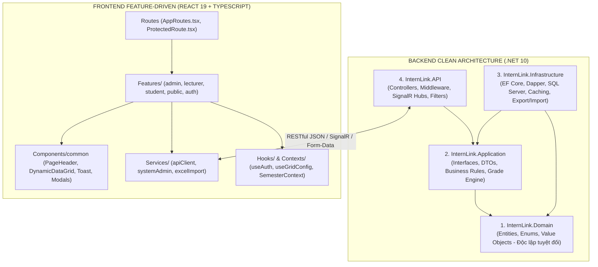
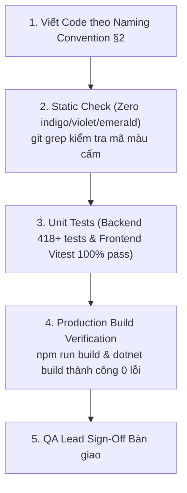

# INTERNLINK — BỘ QUY CHUẨN KỸ THUẬT & QUY CÁCH ĐẶT TÊN CHUẨN ENTERPRISE
## (ENGINEERING CODE STANDARDS, NAMING CONVENTIONS & ARCHITECTURE GUIDELINES)

> **Cấp độ tài liệu:** Tiêu chuẩn Kỹ thuật Bắt buộc (Mandatory Technical Standard)  
> **Dự án:** Nền tảng Quản trị Thực tập Đại học / Cao đẳng Toàn diện InternLink (B2B SaaS)  
> **Phiên bản:** 2.0 Enterprise  
> **Phạm vi áp dụng:** Toàn bộ Backend (.NET 10), Frontend (React 19 / TypeScript), CSDL (SQL Server) và Quy trình Kiểm soát Chất lượng (QA).  
> **Mục đích:** Chuẩn hóa toàn bộ cấu trúc dự án, đảm bảo tính kế thừa, sẵn sàng xuất bản hồ sơ tài liệu sang Microsoft Word (.docx) phục vụ lưu trữ, chuyển giao và mở rộng quy mô.

---

## 🏛️ PHẦN 1: NGUYÊN TẮC KIẾN TRÚC TỔNG THỂ (CORE ARCHITECTURE)

Hệ thống tuân thủ mô hình **Clean Architecture 4 tầng** kết hợp với **Feature-Driven Architecture** ở Frontend:



### 3 Nguyên tắc Bất biến (Non-negotiable Architectural Laws):
1. **Zero-Hardcoding Law:** Tuyệt đối không hardcode công thức điểm, quy chế học kỳ, tiêu đề cột bảng, hoặc danh mục phân hệ trong source code. Tất cả phải được lưu trữ trong CSDL và quản lý qua các Studio chuyên dụng (`Sys_Functions`, `Sys_Grid_Configs`, `GradingRules`).
2. **Enterprise BaseEntity Law:** Mọi bảng dữ liệu đều phải kế thừa đầy đủ 2 tầng khóa (`Auto_ID` tự tăng hiệu năng cao cho nội bộ CSDL và `Public_ID` GUID cho public API) cùng toàn bộ trường kiểm toán (`CreatedAt`, `CreatedBy`, `Created_By_Function`, `UpdatedAt`, `IsDeleted`...).
3. **Strict UI Token Law:** Tuyệt đối tuân thủ bảng màu độc quyền: Primary `#026aa7`, Hover `#025a8e`, Completed/Success `#7bc043`. Cấm tiệt các màu mặc định của Tailwind như `indigo-*`, `violet-*`, `emerald-*`, `blue-600`.

---

## 🏷️ PHẦN 2: QUY CHUẨN ĐẶT TÊN CHUẨN ENTERPRISE (NAMING CONVENTIONS)

### 2.1 Backend C# (.NET 10)

| Loại đối tượng | Quy tắc đặt tên | Tiền tố / Hậu tố | Ví dụ chuẩn | Ví dụ sai (Bị phạt) |
|---|---|---|---|---|
| **Entity nghiệp vụ** | `PascalCase`, Danh từ số ít | Không | `Internship`, `Student`, `WeeklyReport` | `Internships`, `tbl_Student` |
| **Entity hệ thống / phân hệ** | `PascalCase` | Tiền tố `Sys...` | `SysFunction`, `SysRole`, `SysGridConfig`, `SysAuditLog` | `Function`, `ConfigGrid` |
| **Interface** | `PascalCase` | Tiền tố `I...` | `IInternshipReportService`, `IExcelExportService` | `InternshipService`, `ReportServiceIntf` |
| **Service Implementation** | `PascalCase` | Hậu tố `...Service` | `InternshipReportService`, `GradingRuleResolver` | `ReportHelper`, `InternshipManager` |
| **Controller** | `PascalCase` | Hậu tố `...Controller` | `SysFunctionsController`, `ExcelImportController` | `SystemApi`, `ImportHandler` |
| **DTO (Request / Response)** | `PascalCase` | Hậu tố `...Dto` / `...Request` / `...Response` | `CreateStudentRequestDto`, `GradingSummaryResponse` | `StudentData`, `ResultModel` |
| **Method (Hàm xử lý)** | `PascalCase` | Động từ + Danh từ, thêm `...Async` nếu bất đồng bộ | `ExportBatchZipAsync()`, `ResolveRuleSet()` | `export()`, `doSomethingAsync()` |
| **Private Field** | `_camelCase` | Tiền tố `_` | `_db`, `_emailService`, `_configuration` | `m_db`, `db`, `EmailService` |
| **Hằng số (Constant)** | `UPPER_SNAKE_CASE` | Không | `DEFAULT_EXPIRATION_DAYS`, `MAX_FILE_SIZE_BYTES` | `defaultDays`, `MaxFileSize` |

---

### 2.2 Cơ sở Dữ liệu SQL Server

Kế thừa chuẩn mực từ Enterprise ERP (TKSolution V11):

```sql
-- Cấu trúc bảng mẫu chuẩn mực
CREATE TABLE [dbo].[Sys_Grid_Configs] (
    [Auto_ID]             BIGINT IDENTITY(1,1) NOT NULL, -- PK Clustered (Hiệu năng Index tối đa)
    [Public_ID]           UNIQUEIDENTIFIER NOT NULL,     -- AK Non-Clustered (Public API an toàn)
    [Ghi_Chu]             NVARCHAR(1000) NULL,
    [CreatedAt]           DATETIME2 NOT NULL DEFAULT SYSUTCDATETIME(),
    [UpdatedAt]           DATETIME2 NULL,
    [CreatedBy]           NVARCHAR(100) NULL,
    [UpdatedBy]           NVARCHAR(100) NULL,
    [Created_By_Function] NVARCHAR(100) NULL,
    [Updated_By_Function] NVARCHAR(100) NULL,
    [IsDeleted]           BIT NOT NULL DEFAULT 0,
    [Deleted_At]          DATETIME2 NULL,
    [Deleted_By]          NVARCHAR(100) NULL,
    
    -- Các trường nghiệp vụ của bảng
    [Screen_Code]         NVARCHAR(50) NOT NULL,
    [Field_Code]          NVARCHAR(50) NOT NULL,
    [Header_Title]        NVARCHAR(200) NOT NULL,
    [Column_Width]        INT NOT NULL DEFAULT 120,
    [Is_Visible]          BIT NOT NULL DEFAULT 1,
    [Is_Frozen]           BIT NOT NULL DEFAULT 0,
    [Sort_Order]          INT NOT NULL DEFAULT 0,
    CONSTRAINT [PK_Sys_Grid_Configs] PRIMARY KEY CLUSTERED ([Auto_ID]),
    CONSTRAINT [AK_Sys_Grid_Configs_Public_ID] UNIQUE NONCLUSTERED ([Public_ID])
);
```

#### Quy tắc CSDL:
- **Tên bảng:** Viết hoa chữ cái đầu mỗi từ, phân cách bằng dấu gạch dưới `_` cho bảng hệ thống (`Sys_Functions`, `Sys_Roles`, `Sys_Grid_Configs`) hoặc `PascalCase` số nhiều cho bảng miền nghiệp vụ (`Internships`, `Students`, `Companies`).
- **Khóa chính:** Luôn là cặp `Auto_ID` (BIGINT) + `Public_ID` (GUID).
- **Khóa ngoại:** Tên bảng đích ở dạng số ít + `Id` (ví dụ: `InternshipId`, `StudentId`, `SemesterId`).
- **Trường Boolean:** Bắt buộc bắt đầu bằng `Is...` hoặc `Has...` (`Is_Visible`, `Is_Frozen`, `Has_Graded`).
- **Xóa mềm (Soft Delete):** Mọi bảng đều phải có `IsDeleted`, `Deleted_At`, `Deleted_By`. Tuyệt đối không dùng lệnh `DELETE FROM` vật lý trong code nghiệp vụ.

---

### 2.3 Frontend React 19 & TypeScript

| Thư mục / File | Quy tắc đặt tên | Ví dụ chuẩn | Mục đích sử dụng |
|---|---|---|---|
| **Trang màn hình (Pages)** | `PascalCaseView.tsx` | `SmartExcelImportView.tsx`, `PermissionMatrixView.tsx` | Chứa logic của toàn bộ 1 route |
| **Component giao diện** | `PascalCase.tsx` | `DynamicDataGrid.tsx`, `PageHeader.tsx`, `Toast.tsx` | Component tái sử dụng |
| **Custom Hooks** | `useCamelCase.ts` | `useGridConfig.ts`, `useAdminCapabilities.ts` | Đóng gói state logic tái sử dụng |
| **Service gọi API** | `camelCase.service.ts` | `systemAdmin.service.ts`, `excelImport.service.ts` | Tập trung toàn bộ API endpoints |
| **Kiểu dữ liệu (Types)** | `camelCase.ts` | `system.ts`, `systemAdmin.ts`, `internship.ts` | Khai báo Interface & Type |
| **File kiểm thử (Tests)** | `TargetName.test.tsx` | `SmartExcelImportView.test.tsx`, `AdminMegaMenu.test.tsx` | Unit test Vitest |

#### Quy chuẩn Nút bấm & Card Tokens trong JSX:
```tsx
// Nút Primary CTA:
<button className="px-4 py-2 bg-[#026aa7] hover:bg-[#025a8e] active:bg-[#005082] text-white text-xs font-bold rounded-lg transition-colors cursor-pointer focus-visible:outline-none focus-visible:ring-2 focus-visible:ring-[#026aa7]">

// Nút Secondary / Ghost:
<button className="rounded-lg border border-slate-300 bg-white px-3 py-2 text-xs font-semibold text-slate-700 hover:bg-slate-50 transition-colors">

// Thẻ Card / Panel:
<section className="rounded-xl border border-slate-200/90 bg-white p-4 sm:p-5 shadow-2xs">

// Khung trang (Container):
<main className="mx-auto max-w-[1300px] space-y-4 animate-in fade-in duration-200 font-sans pb-12">
```

---

## 🛡️ PHẦN 3: QUY TRÌNH KIỂM SOÁT CHẤT LƯỢNG QA & GATEKEEPING

Bất kỳ tính năng nào trước khi được merge vào nhánh chính đều phải vượt qua **Hàng rào 4 bước nghiệm thu**:



### 1. Lệnh Kiểm tra Tĩnh Bắt buộc (Static Code Gate):
```powershell
# Kiểm tra không còn màu cấm indigo, violet
git grep --no-index -n -E "(indigo|violet)" frontend/src/features/

# Kiểm tra không dùng sai bo góc card
git grep --no-index -n "rounded-2xl" frontend/src/features/admin/pages/ frontend/src/features/public/pages/
```

### 2. Quy chuẩn viết Commit Message:
- `feat(module): Nội dung tính năng mới` (ví dụ: `feat(acceptance): Thêm flow xác nhận tiếp nhận doanh nghiệp qua Magic Link`)
- `fix(module): Nội dung lỗi được sửa` (ví dụ: `fix(grid): Chuyển slider độ rộng cột sang token brand primary #026aa7`)
- `refactor(module): Tối ưu mã nguồn không đổi logic` (ví dụ: `refactor(mega-menu): Đồng bộ toàn bộ palette màu sang chuẩn V2.0`)
- `docs(standard): Cập nhật tài liệu quy chuẩn`

---

## 📌 PHẦN 4: HỆ THỐNG TÀI LIỆU KỸ THUẬT PHÂN HỆ (MODULAR SPECIFICATIONS)

Toàn bộ các phân hệ kỹ thuật được chia nhỏ thành các tài liệu chuyên biệt tại thư mục `docs/specifications/`:

| Mã tài liệu | Tên phân hệ | Mục đích & Nghiệp vụ cốt lõi | Liên kết file |
|---|---|---|---|
| **SPEC-01** | **Quản trị Danh mục & Phân quyền Động** | Quản lý bảng `Sys_Functions`, Dynamic RBAC, Mega Menu, 5 cờ quyền, Multi-tenancy | [SPEC-01-DYNAMIC-RBAC-SYSTEM-FUNCTIONS.md](file:///e:/Downloads/InternLink/docs/specifications/SPEC-01-DYNAMIC-RBAC-SYSTEM-FUNCTIONS.md) |
| **SPEC-02** | **Nhập / Xuất Dữ liệu Thông minh** | Cấu hình ánh xạ cột động theo từng Khoa/Trường, Smart Import Preview, Validation | [SPEC-02-SMART-IMPORT-EXPORT-MAPPING.md](file:///e:/Downloads/InternLink/docs/specifications/SPEC-02-SMART-IMPORT-EXPORT-MAPPING.md) |
| **SPEC-03** | **Tiếp nhận Doanh nghiệp 1-Chạm & QR** | Tiếp nhận sinh viên không cần tài khoản, Giấy giới thiệu có mã tra cứu và QR | [SPEC-03-COMPANY-ONBOARDING-MAGIC-LINK-QR.md](file:///e:/Downloads/InternLink/docs/specifications/SPEC-03-COMPANY-ONBOARDING-MAGIC-LINK-QR.md) |
| **SPEC-04** | **Đánh giá Doanh nghiệp & Điểm số** | Chấm điểm thang 10, tiêu chí năng lực, chữ ký điện tử của Mentor | [SPEC-04-EMPLOYER-EVALUATION-AND-FEEDBACK.md](file:///e:/Downloads/InternLink/docs/specifications/SPEC-04-EMPLOYER-EVALUATION-AND-FEEDBACK.md) |
| **SPEC-05** | **Báo cáo Kiểm định & Xác thực Công khai** | Xuất bộ báo cáo chính quy (ZIP, Excel, Word), Cổng tra cứu công khai `/verify/:code` | [SPEC-05-ACCREDITATION-PDF-AND-PUBLIC-VERIFY.md](file:///e:/Downloads/InternLink/docs/specifications/SPEC-05-ACCREDITATION-PDF-AND-PUBLIC-VERIFY.md) |
| **SPEC-06** | **SignalR Real-time & Worker Hạn nộp** | Thông báo tức thì qua SignalR Hub, Background Cron Worker tự động nhắc hạn | [SPEC-06-REALTIME-SIGNALR-AND-DEADLINE-WORKER.md](file:///e:/Downloads/InternLink/docs/specifications/SPEC-06-REALTIME-SIGNALR-AND-DEADLINE-WORKER.md) |

