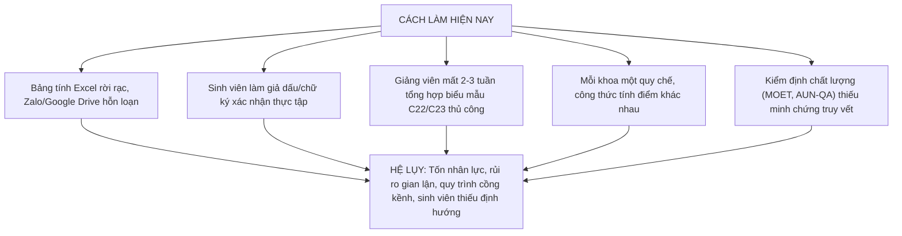
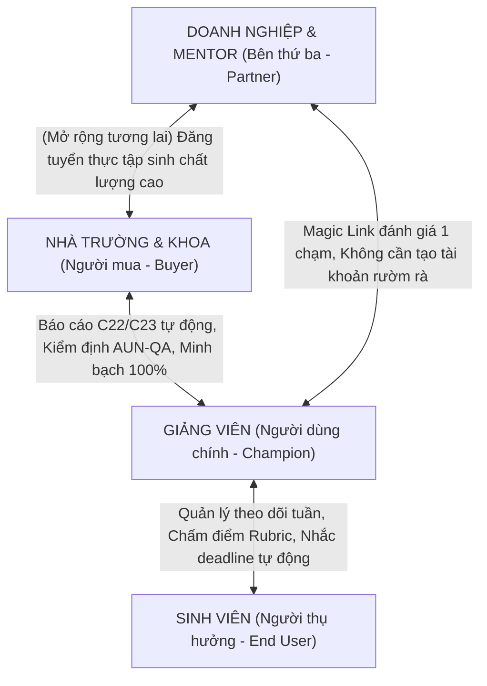
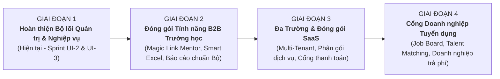

# INTERNLINK ENTERPRISE COMMERCIALIZATION BLUEPRINT
## CHIẾN LƯỢC THƯƠNG MẠI HÓA NỀN TẢNG QUẢN LÝ THỰC TẬP ĐẠI HỌC (EDTECH B2B SAAS)

> **Tác giả:** QA Lead & Technical Architect / Product Strategist  
> **Tầm nhìn:** Biến InternLink từ đồ án/sản phẩm nội bộ thành **Giải pháp Phần mềm Quản trị Quy trình Thực tập Doanh nghiệp (Enterprise Internship Management ERP)** số 1 trong phân khúc trường đại học, cao đẳng và viện đào tạo tại Việt Nam.  
> **Ngày lập:** 08/11/2026  

---

## 🎯 1. PHÂN TÍCH THỊ TRƯỜNG & NỖI ĐAU NGÁCH (ICP & MARKET PAIN POINTS)

### 1.1 Khách hàng mục tiêu (Ideal Customer Profile - ICP)
- **Cấp trường:** Phòng Quản lý Đào tạo, Phòng Hợp tác Doanh nghiệp & Quan hệ Cựu sinh viên, Ban Giám hiệu.
- **Cấp đơn vị đào tạo:** Ban Chủ nhiệm Khoa (CNTT, Kinh tế, Ngoại ngữ, Du lịch, Cơ khí...), Trưởng bộ môn, Thư ký khoa.
- **Người dùng trực tiếp:** Giảng viên hướng dẫn (GVHD), Sinh viên thực tập (SV), Người hướng dẫn tại doanh nghiệp (Mentor).

### 1.2 "Nỗi đau chí tử" của cách làm truyền thống tại các trường đại học

### 1.3 Tại sao các phần mềm quản lý đào tạo lớn (Cựu trào) thất bại ở ngách này?
- Các hệ thống ERP trường học cũ (như PSC, ASC, Edusoft, Daotao.vn) chỉ tập trung vào **Đăng ký tín chỉ** và **Thu học phí**.
- Phân hệ "Thực tập" của họ cực kỳ xơ cứng, không có:
  - Báo cáo tuần kèm ảnh định vị/chấm công real-time.
  - Phản hồi 2 chiều giữa Giảng viên và Sinh viên.
  - Cổng đánh giá 1-chạm không cần tài khoản cho Mentor Doanh nghiệp.
  - Khả năng tùy biến linh hoạt trọng số điểm theo từng Khoa/Ngành.

👉 **Đây chính là "Đại dương xanh" (Blue Ocean) có tính khả thi thương mại cực cao cho InternLink!**

---

## 🏛️ 2. TAM GIÁC GIÁ TRỊ CỐT LÕI (THE VALUE TRIANGLE)

Để một phần mềm B2B bán được và thu phí định kỳ (SaaS Subscription), nó phải giải quyết lợi ích sát sườn cho cả 3 bên:

### Trụ cột 1: Với Nhà trường & Khoa (Giá trị quyết định ký hợp đồng)
- **Tự động hóa 100% hồ sơ kiểm định:** Xuất báo cáo tổng kết C22, C23, Quyết định giao giảng viên, Danh sách sinh viên hoàn thành chỉ với 1 cú click.
- **Audit Trail chống gian lận:** Toàn bộ lịch sử nộp bài, chỉnh sửa điểm, phê duyệt đều được lưu vết (`SysAuditLog` / `CLog_Record_Action_History`).
- **Linh hoạt đa quy chế:** Khoa CNTT tính điểm khác Khoa Kinh tế, Hệ đại trà tính khác Hệ chất lượng cao. Hệ thống cho phép cấu hình quy chế động theo từng học kỳ.

### Trụ cột 2: Với Giảng viên (Giá trị giữ chân người dùng)
- Không còn phải nhận hàng trăm file Word qua Email hay tin nhắn Zalo trôi bài.
- Chấm báo cáo tuần và duyệt đề cương trực tiếp trên Web với Rubric rõ ràng.
- Tự động thống kê sinh viên có nguy cơ rớt hoặc chưa nộp báo cáo để cảnh báo kịp thời.

### Trụ cột 3: Với Doanh nghiệp & Mentor (Khác biệt thương mại độc quyền)
- **Đánh giá 1-chạm (Token / Magic Link qua Email hoặc QR code):** Người hướng dẫn tại doanh nghiệp không cần phải nhớ username/mật khẩu, chỉ cần bấm vào đường link bảo mật gửi đến email hoặc quét mã QR là có thể chấm điểm 10 tiêu chí và ký số/xác nhận ngay trên điện thoại di động.

---

## ⚙️ 3. KIẾN TRÚC KỸ THUẬT PHỤC VỤ THƯƠNG MẠI HÓA (KẾ THỪA TKSOLUTION V11)

Dựa trên nền tảng kỹ thuật vững chắc từ **TKSolution V11** mà chúng ta vừa khảo sát, InternLink sẽ được hoàn thiện theo 6 trụ cột kỹ thuật Enterprise:

| Thành phần kỹ thuật | Vai trò trong sản phẩm thương mại | Hiện trạng trong InternLink |
|---|---|---|
| **1. Multi-Tenant / Multi-Faculty Data Scope** | Một trường hoặc nhiều trường dùng chung hệ sinh thái mà dữ liệu được cô lập tuyệt đối theo Khoa / Viện / Phân hiệu. | Đã có `DepartmentId`, `TenantId` trong CSDL; Global Query Filter chống rò rỉ dữ liệu. |
| **2. Dynamic RBAC 8 Cờ quyền (`SysRolePermission`)** | Bán được cho trường học vì các trường có cơ cấu phân quyền rất phức tạp (Trưởng khoa, Trưởng bộ môn, Thư ký, Trợ lý đào tạo, GVHD, SV). | Đã có backend Sprint 2; Giao diện Ma trận quyền `PermissionMatrixView.tsx` (Sprint UI-2). |
| **3. Configurable Grading Engine (`SysGradingRuleSet`)** | Mỗi khoa tự cấu hình công thức điểm (Quá trình, Thi, Doanh nghiệp) và deadline nộp mà không cần gọi lập trình viên sửa code. | Backend Sprint 4 đã xóa 100% hardcode; Chuẩn bị màn hình cấu hình `GradingRulesConfigView.tsx`. |
| **4. Dynamic DataGrid Studio (`SysGridConfig`)** | Cho phép trường tự đổi tên cột, ẩn/hiện cột, đổi thứ tự hiển thị để khớp với thuật ngữ riêng của từng trường. | Sprint UI-1 đã xong `GridConfigStudioView.tsx` và `DynamicDataGrid.tsx`. |
| **5. Audit Trail & Diff Viewer (`SysAuditLog`)** | Minh bạch hồ sơ cho thanh tra đào tạo; phát hiện ngay ai đã sửa điểm sinh viên vào ngày giờ nào, từ IP nào. | Backend Sprint 5 đã ghi nhận JSON snapshot; Chuẩn bị `AuditLogsView.tsx` có Diff màu trực quan. |
| **6. Excel Smart Importer / Exporter** | Khả năng mapping cột thông minh khi nạp danh sách 5.000 sinh viên từ hệ thống quản lý đào tạo trường. | Cần bổ sung UI cấu hình mẫu import/export tương tự `F1018` của TKSolution. |

---

## 🗺️ 4. LỘ TRÌNH THƯƠNG MẠI HÓA 4 GIAI ĐOẠN (COMMERCIAL ROADMAP)

### Giai đoạn 1: Hoàn thiện Bộ lõi Quản trị & Nghiệp vụ (Core Stabilization)
- **Nhiệm vụ trọng tâm:**
  - Hoàn tất **Sprint UI-2**: Ma trận phân quyền 8 cờ (`PermissionMatrixView`), Cấu hình quy chế điểm động (`GradingRulesConfigView`), Tra cứu Audit Trail & Diff (`AuditLogsView`).
  - Đảm bảo 100% luồng nghiệp vụ của Sinh viên và Giảng viên chạy mượt mà, không còn bất kỳ dòng code hardcode nào.
- **Tiêu chuẩn đầu ra:** Sản phẩm chạy thử nghiệm hoàn hảo cho ít nhất 1 Khoa thực tế (Pilot Testing).

### Giai đoạn 2: Đóng gói Tính năng B2B Bán cho Trường học (B2B Packaging)
- **Nhiệm vụ trọng tâm:**
  - **Module Đánh giá Doanh nghiệp qua Magic Link / QR Code:** Doanh nghiệp không cần tạo tài khoản; giảng viên gửi link bảo mật có mã hóa SHA256 (có thời hạn 15 ngày), mentor click vào mở form chấm điểm 10 tiêu chí và ký tên số.
  - **Smart Excel Import / Export Studio:** Cho phép Import danh sách hàng nghìn sinh viên, giảng viên từ file Excel bất kỳ bằng cách kéo thả mapping cột (tương tự chức năng `F1018` của TKSolution).
  - **Engine Xuất Hồ sơ Kiểm định:** Xuất tự động mẫu C22 (Word/Excel) và C23 (Biểu tổng hợp kết quả) chuẩn form mẫu quy định của Bộ Giáo dục & Đào tạo.
- **Mô hình giá đề xuất:** Bán gói License On-Premise hoặc SaaS theo Khoa (Ví dụ: 15.000.000 - 30.000.000 VNĐ / Khoa / Năm).

### Giai đoạn 3: Multi-Tenancy & Đóng gói Nền tảng SaaS Cloud
- **Nhiệm vụ trọng tâm:**
  - Bật chế độ Multi-Tenant hoàn chỉnh: Mỗi trường đại học có một Subdomain riêng (ví dụ: `hcmus.internlink.vn`, `uit.internlink.vn`, `hutech.internlink.vn`).
  - Giao diện tùy biến nhận diện thương hiệu (White-labeling): Cho phép trường tải lên Logo, đổi màu chủ đạo (Primary Color), tên trường, thông tin liên hệ.
  - Tích hợp đăng nhập một lần (SSO): Hỗ trợ Google Workspace for Education, Microsoft Azure AD (Office 365) của nhà trường.
- **Mô hình giá đề xuất:** Bán theo quy mô sinh viên (Ví dụ: 20.000 - 30.000 VNĐ / Sinh viên thực tập / Kỳ).

### Giai đoạn 4: Mở rộng Cổng Doanh nghiệp Tuyển dụng (Marketplace Expansion)
- **Nhiệm vụ trọng tâm (Chuẩn bị sẵn kiến trúc ngay từ bây giờ):**
  - Mở Role **Doanh nghiệp Tuyển dụng**: Doanh nghiệp được cấp tài khoản để đăng tin tuyển thực tập sinh, xem danh mục đề án nghiên cứu của sinh viên xuất sắc.
  - Hệ thống gợi ý ứng viên (Intern Matching): Dựa trên kỹ năng, GPA, xếp loại học lực để gợi ý sinh viên phù hợp cho doanh nghiệp.
  - Kênh thu phí thứ hai: Thu phí doanh nghiệp đăng tin tuyển dụng hoặc phí tiếp cận hồ sơ sinh viên tài năng (Mô hình B2B2C / Marketplace).

---

## 📋 5. KẾ HOẠCH HÀNH ĐỘNG CỤ THỂ DÀNH CHO DEV NGAY HÔM NAY

Để từng bước hiện thực hóa chiến lược thương mại trên, bước đi đầu tiên bắt buộc phải là **hoàn thành xuất sắc Sprint UI-2** nhằm chốt chặn toàn bộ phân hệ quản trị hệ thống:

1. **Triển khai `PermissionMatrixView.tsx`:** Kế thừa bố cục ma trận từ `F1005` của TKSolution.
2. **Triển khai `GradingRulesConfigView.tsx`:** Cho phép chọn Khoa/Học kỳ và cấu hình trọng số, tạo tiền đề cho tính năng đa quy chế B2B.
3. **Triển khai `AuditLogsView.tsx`:** Hoàn thiện bảng nhật ký và modal diff JSON, tạo tiền đề cho tính năng kiểm định minh chứng chống gian lận.

*(Tài liệu này là Kim chỉ nam chiến lược cho toàn bộ các quyết định phát triển tính năng và kiến trúc của InternLink từ nay về sau).*
