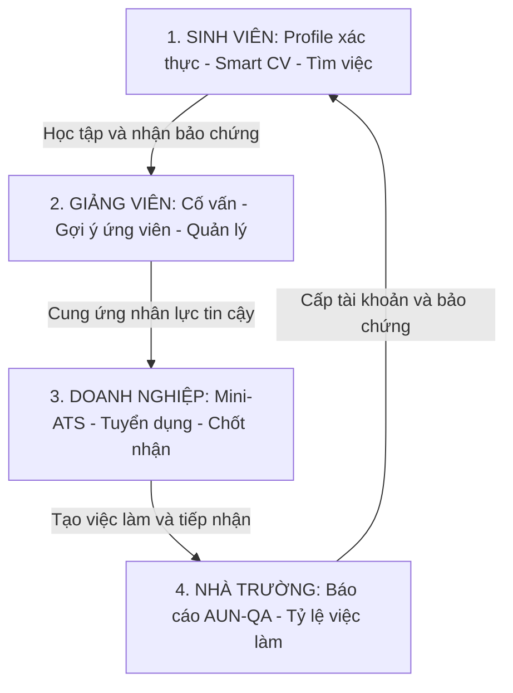
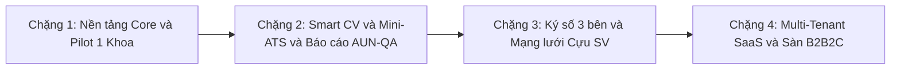

# TẦM NHÌN CHIẾN LƯỢC & BỨC TRANH LỚN: HỆ SINH THÁI INTERNLINK
### Nền tảng Liên kết Đào tạo – Hướng nghiệp – Tuyển dụng có Bảo chứng (Edu-to-Work Verified Marketplace)

> **Tác giả ý tưởng & Định hướng:** Tech Lead Thạch & Đội ngũ Phát triển InternLink  
> **Lưu trữ tại:** `docs/INTERNLINK_STRATEGIC_VISION_AND_COMMERCIALIZATION.md`  
> **Mục đích:** Lưu trữ bản thiết kế tổng thể (Master Blueprint) về tầm nhìn sản phẩm, mô hình kinh doanh và lộ trình phát triển dài hạn để nghiên cứu, gọi vốn hoặc mở rộng thương mại khi có điều kiện.

---

## I. TỔNG QUAN TẦM NHÌN (EXECUTIVE SUMMARY)

### 1. Vấn đề của thị trường hiện nay (The Burning Pain)
* **Sinh viên:** Ra trường thiếu kinh nghiệm, nộp CV đại trà trên TopCV/VietnamWorks bị loại ngay vòng lọc từ khóa; gặp khó khăn tìm nơi thực tập chuẩn chỉ, dễ rơi vào công ty "ma" hoặc bị bóc lột không học hỏi được gì.
* **Giảng viên & Khoa:** Cứ đến kỳ thực tập lại phải "đi gõ cửa", gọi điện nhờ vả người quen ở doanh nghiệp để xin gửi sinh viên; ngập đầu trong hàng ngàn email, tin nhắn Zalo, file Word/Excel vụn vặt và hồ sơ giấy tờ.
* **Doanh nghiệp:** Tốn hàng chục triệu mua tin tuyển dụng trên các sàn việc làm lớn nhưng chỉ nhận về CV rác, phóng đại kỹ năng; muốn săn nhân tài trẻ từ ghế nhà trường nhưng không có kênh kết nối chính quy, thiếu sự bảo chứng tin cậy.
* **Nhà trường & Ban Giám hiệu:** Chịu áp lực sống còn từ Bộ GD&ĐT về chỉ tiêu **"Tỷ lệ sinh viên có việc làm sau tốt nghiệp"** và **"Báo cáo kiểm định chất lượng đào tạo (AUN-QA / ABET)"** nhưng không có công cụ số hóa để theo dõi dữ liệu thực tế.

### 2. Định vị của InternLink (The Big Idea)
**InternLink không chỉ là một phần mềm nộp báo cáo thực tập.**  
InternLink định vị là **Hệ sinh thái kết nối 4 bên có Bảo chứng (Verified)**: biến mối quan hệ "xin - cho" giữa Trường và Doanh nghiệp thành mối quan hệ **Win – Win cộng sinh bền vững**.



---

## II. BỘ TÍNH NĂNG "MŨI TÊN XUYÊN GIÁP" (STRATEGIC DIFFERENTIATORS)

Các tính năng tạo nên rào cản phòng thủ (Moat) giúp InternLink hoàn toàn khác biệt so với các sàn tuyển dụng tự do (TopCV, LinkedIn) và các ERP đào tạo truyền thống (Edusoft, ASC):

### 1. Smart CV Builder với Xác thực từ Nhà trường (Verified Academic Badge)
* **Kéo dữ liệu học tập thật (Auto-populate):** Tự động điền các môn điểm A, A+, đề tài NCKH, đồ án môn học liên quan đến Job trực tiếp từ cơ sở dữ liệu nhà trường.
* **AI Bullet Point Assistant:** Trợ lý AI gợi ý chuẩn hóa mô tả dự án theo phương pháp **STAR (Situation - Task - Action - Result)** chuẩn ATS quốc tế.
* **Mã QR Chứng thực số:** Trên file PDF CV xuất ra có gắn mã QR dẫn về trang Public Profile của sinh viên trên InternLink với tick xanh xác nhận: *"Hồ sơ được xác thực bởi Trường Đại học XYZ"*.

### 2. Mini-ATS & Pipeline Tuyển dụng cho Doanh nghiệp
* **Bảng Kanban trực quan:** Doanh nghiệp quản lý ứng viên qua các cột: *GV đề xuất ➔ Đã xem hồ sơ ➔ Hẹn phỏng vấn ➔ Chốt tiếp nhận*.
* **Nút bấm "Chốt tiếp nhận" (Magic Click):** Doanh nghiệp bấm nhận sinh viên ➔ Hệ thống tự động:
  - Thông báo trúng tuyển cho Sinh viên.
  - Cập nhật vào danh sách khoa: *"Sinh viên đã có nơi thực tập"* (không cần ai nhập Excel).
  - Tự động kích hoạt đợt thực tập và phân công Mentor công ty.

### 3. Ký số & Thỏa thuận Thực tập 3 bên Trực tuyến (E-Sign Tripartite Agreement)
* Xóa bỏ hoàn toàn quy trình in giấy, xin dấu đỏ, chạy xe qua lại giữa Trường và Doanh nghiệp.
* Luồng ký số điện tử: **Trưởng khoa ký số ➔ Doanh nghiệp xác nhận online ➔ Sinh viên xác nhận OTP**.
* Tự động sinh file PDF Thỏa thuận thực tập có mã băm (Hash/QR) hợp chuẩn kiểm định.

### 4. Mạng lưới Cựu Sinh viên (Alumni Mentorship & Hiring Network)
* Cựu sinh viên đang làm Team Lead, Senior, PM tại các doanh nghiệp có huy hiệu riêng trên hệ thống.
* Doanh nghiệp có cựu SV sẽ được đánh dấu ưu tiên: *"Có 8 cựu sinh viên trường đang làm việc tại đây"*.
* Cựu SV có thể trực tiếp giới thiệu (Referral) và bảo lãnh đàn em vào công ty thực tập.

### 5. Phân tích khoảng cách kỹ năng bằng AI (Skill Gap & Career Pathway)
* Sinh viên chọn mục tiêu vị trí mong muốn (ví dụ: *Fullstack .NET & React*).
* AI đối chiếu Job Description (JD) của doanh nghiệp với Bảng điểm hiện tại:
  - Chỉ ra 70% tiêu chí đã đạt (C#, SQL, OOP...).
  - Cảnh báo 30% kỹ năng còn thiếu (Docker, Unit Test, Redis...).
  - Gợi ý đồ án hoặc môn học bổ sung để bù đắp trước khi nộp hồ sơ.

### 6. Đánh giá 2 chiều & Chống thực tập ảo (Anti-Ghosting / Anti-Fraud)
* Sinh viên đánh giá ẩn danh doanh nghiệp (Môi trường, Phụ cấp, Mentor có hướng dẫn thật không) ➔ Giúp khóa sau né các công ty bóc lột, quỵt lương.
* Điểm danh GPS / check-in tiến độ công việc định kỳ ngăn chặn tình trạng "xin dấu khống" của người quen.

### 7. Nút bấm "Thần thánh": Xuất Báo cáo Kiểm định AUN-QA / ABET
* 1 cú click tự động tổng hợp toàn bộ số liệu: Tỷ lệ đạt chuẩn đầu ra (CLO/PLO), điểm đánh giá của doanh nghiệp, tỷ lệ sinh viên có việc làm.
* Tự động sinh file Word/PDF Báo cáo tự đánh giá kiểm định kèm biểu đồ phân tích chuẩn form Bộ GD&ĐT.

---

## III. MÔ HÌNH THƯƠNG MẠI HÓA (MONETIZATION STRATEGY)

InternLink áp dụng mô hình doanh thu đa kênh (Multi-Stream B2B2C):

```text
                               ┌───────────────────────────────────────────┐
                               │             DÒNG DOANH THU                │
                               └───────────────────────────────────────────┘
                                      │                             │
                     ┌────────────────┴──────────────┐      ┌───────┴───────────────────────┐
                     ▼                               ▼      ▼                               ▼
            [ TỪ NHÀ TRƯỜNG ]                               [ TỪ DOANH NGHIỆP ]
     • Phí Bản quyền / Triển khai Ban đầu             • Phí Đăng tin Tuyển dụng Ưu tiên
     • Phí Thuê bao Vận hành Hàng năm (ARR)           • Phí Headhunting / Xem Top CV Verified
     • Gói Module Kiểm định & Báo cáo AUN-QA          • Gói Xây dựng Thương hiệu Tuyển dụng
```

1. **Giai đoạn đầu (Trường học chi trả):**
   - Phí setup & triển khai: 15 – 30 triệu / Khoa.
   - Phí duy trì & bảo trì hệ thống: 20 – 50 triệu / năm.
2. **Giai đoạn quy mô (Doanh nghiệp chi trả):**
   - Miễn phí hoặc giảm giá sâu cho Nhà trường để mở rộng mạng lưới sinh viên.
   - Doanh nghiệp trả tiền mua gói tuyển dụng: 5 – 15 triệu/năm để được tiếp cận nguồn thực tập sinh/fresher chất lượng cao đã được trường bảo chứng.

---

## IV. LỘ TRÌNH TRIỂN KHAI THỰC CHIẾN (EXECUTION ROADMAP)



| Chặng | Tên giai đoạn | Mục tiêu then chốt | Tính năng cốt lõi |
| :---: | :--- | :--- | :--- |
| **1** | **Nền móng vững chắc (Hiện tại)** | Ổn định hệ thống cho 4 vai trò, phục vụ trải nghiệm mượt mà. | • React Query Caching tốc độ cao (phản hồi dưới 10ms)<br>• Pilot thành công tại 1 Khoa của trường |
| **2** | **Mở rộng Giá trị** | Biến quy trình nộp bài thành công cụ phát triển nghề nghiệp. | • Smart CV Builder chuẩn ATS kéo điểm số thực<br>• Mini-ATS Kanban cho Doanh nghiệp<br>• 1-Click xuất Báo cáo Kiểm định AUN-QA / ABET |
| **3** | **Mạng lưới & Pháp lý số** | Số hóa toàn bộ hành chính, kết nối nguồn lực nội bộ. | • Ký số Thỏa thuận Thực tập 3 bên (E-Sign)<br>• Mạng lưới Cựu sinh viên (Alumni Mentorship & Referral)<br>• Mở rộng liên kết sang 3 – 5 trường đại học đối tác |
| **4** | **Sàn Tuyển dụng B2B2C** | Đột phá doanh thu thương mại từ phía Doanh nghiệp. | • Kiến trúc Multi-Tenant SaaS toàn diện<br>• AI Career Pathway & Skill Gap Analysis<br>• Monetization gói tuyển dụng Doanh nghiệp |

---

## V. KẾT LUẬN

Bức tranh lớn này là kim chỉ nam chiến lược lâu dài. Toàn bộ nền tảng kiến trúc hiện tại của InternLink (.NET 8 Clean Architecture, React Query, Authentication RBAC, SQL Server) đã được thiết kế sẵn sàng để mở rộng theo lộ trình này mà không cần đập đi xây lại.

> *"Nghĩ lớn, bắt đầu nhỏ, tiến từng bước vững chắc."*

