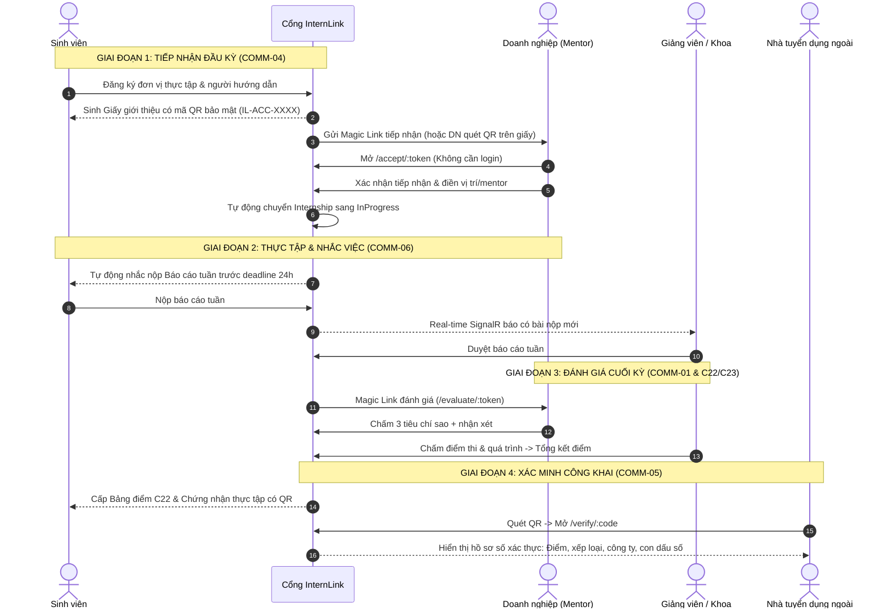

# SPRINT COMM-2: ĐẶC TẢ KIẾN TRÚC & KẾ HOẠCH TRIỂN KHAI TOÀN DIỆN
## KHÉP KÍN TOÀN DIỆN VÒNG ĐỜI THỰC TẬP (END-TO-END INTERNSHIP LIFECYCLE)

> **Căn cứ chiến lược & quy chuẩn dự án:**
> - Kim chỉ nam thương mại: [`docs/INTERNLINK_COMMERCIAL_MASTER_BLUEPRINT.md`](./INTERNLINK_COMMERCIAL_MASTER_BLUEPRINT.md)
> - Bài học thực chiến doanh nghiệp: [`docs/TKS_ENTERPRISE_SYNTHESIS_AND_INTERNLINK_ROADMAP.md`](./TKS_ENTERPRISE_SYNTHESIS_AND_INTERNLINK_ROADMAP.md)
> - Bộ quy tắc thiết kế nghiêm ngặt: [`.agents/rules/ui-design-system.md`](../.agents/rules/ui-design-system.md)

---

## 🎯 1. BỐI CẢNH & MỤC TIÊU CHIẾN LƯỢC

### 1.1 Hiện trạng sau Sprint COMM-1
- **Đầu ra (Exit Stage) đã hoàn chỉnh:** Doanh nghiệp đánh giá không cần tạo tài khoản qua Magic Link/QR (`/evaluate/:token`), Giảng viên chấm điểm tự động theo trọng số động, Quản trị viên xuất hồ sơ kiểm định Bộ GD&ĐT (C22 ZIP & C23 Excel).
- **Bộ lõi Quản trị đã đạt chuẩn:** Hệ thống ma trận phân quyền 8 cờ (`PermissionMatrixView`), cấu hình lưới động (`GridConfigStudioView`), cấu hình quy chế điểm (`GradingRulesConfigView`), nhật ký kiểm toán diff (`AuditLogsView`) đạt chuẩn 100% UI Design System V2.0.

### 1.2 "Nút thắt cổ chai" cần giải quyết ở Sprint COMM-2
Khi đi chào bán phần mềm cho các Trường / Khoa, hai bài toán sống còn ở đầu kỳ và sau khi kết thúc kỳ là:
1. **Khâu đầu kỳ (Onboarding):** Sinh viên làm thế nào để được doanh nghiệp tiếp nhận chính thức? Trường cấp giấy giới thiệu ra sao? Làm sao để Doanh nghiệp ký nhận nhanh gọn mà không bắt họ phải đăng ký tài khoản rườm rà?
2. **Khâu xác thực chống gian lận (Anti-Fraud & Accreditation):** Làm sao để Nhà tuyển dụng bên ngoài và Phòng Đào tạo quét mã QR trên bảng điểm/chứng chỉ của sinh viên để xác thực ngay tính toàn vẹn của hồ sơ thực tập?
3. **Cơ chế giữ nhịp (Engagement & SLA):** Làm sao để sinh viên không quên nộp báo cáo tuần và doanh nghiệp không quên đánh giá khi kết thúc kỳ?

Sprint COMM-2 tập trung giải quyết trọn vẹn 3 bài toán trên thông qua 3 module: **COMM-04**, **COMM-05**, và **COMM-06**.

---

## 🏗️ 2. MÔ HÌNH VÒNG ĐỜI NGHIỆP VỤ KHÉP KÍN (END-TO-END FLOW)



---

## 📋 3. ĐẶC TẢ CHI TIẾT TỪNG PHÂN HỆ

### 📦 MODULE 1: COMM-04 — FLOW TIẾP NHẬN DOANH NGHIỆP QUA MAGIC LINK & GIẤY GIỚI THIỆU QR

#### 1. Mô hình Dữ liệu (Entity & Schema)
Thực thể `CompanyAcceptanceToken` kế thừa `BaseEntity` của Enterprise Framework:
```csharp
public class CompanyAcceptanceToken : BaseEntity
{
    public string Token { get; set; } = null!;           // SHA-256 Hash lưu DB
    public string VerificationCode { get; set; } = null!; // Mã tra cứu: IL-ACC-2026-XXXXX
    public Guid InternshipId { get; set; }
    public Internship Internship { get; set; } = null!;
    public string CompanyName { get; set; } = null!;
    public string? CompanyTaxCode { get; set; }
    public string? Position { get; set; }
    public string? MentorName { get; set; }
    public string? MentorEmail { get; set; }
    public string? MentorPhone { get; set; }
    public DateTime? StartDate { get; set; }
    public DateTime? EndDate { get; set; }
    public DateTime ExpiredAt { get; set; } = DateTime.UtcNow.AddDays(15);
    public bool IsAccepted { get; set; }
    public DateTime? AcceptedAt { get; set; }
    public bool IsRejected { get; set; }
    public DateTime? RejectedAt { get; set; }
    public string? RejectionReason { get; set; }
}
```

#### 2. Backend Endpoints (`CompanyAcceptanceController.cs`)
- `GET /api/v1/public/company-acceptance/verify?token={token}`:
  - Cho phép truy cập ẩn danh (`[AllowAnonymous]`).
  - Kiểm tra SHA-256 token, thời hạn 15 ngày, trạng thái đã xác nhận hay chưa.
  - Trả về thông tin: Sinh viên (Họ tên, MSSV, Lớp, Khoa, Trường), Đợt thực tập, Công ty đề xuất, Vị trí.
- `POST /api/v1/public/company-acceptance/confirm`:
  - Body: `{ token, mentorName, mentorEmail, mentorPhone, position, startDate, endDate, confirmed: true }`.
  - Nghiệp vụ:
    1. Đánh dấu `IsAccepted = true`, lưu thời điểm `AcceptedAt`.
    2. Cập nhật thực thể `Internship`: Gán `SupervisorName`, `Position`, chuyển `Status = InProgress`.
    3. Ghi vết `SysAuditLog` với `ActionType = "COMPANY_ACCEPTANCE_CONFIRMED"`.
    4. Trả về biên nhận điện tử có mã kiểm tra `VerificationCode`.
- `POST /api/v1/public/company-acceptance/reject`:
  - Body: `{ token, reason }`.
  - Đánh dấu từ chối và ghi lý do để sinh viên cập nhật cơ sở thực tập khác.
- `POST /api/v1/student/internships/register-company`:
  - Dành cho sinh viên đăng ký đơn vị thực tập $\rightarrow$ sinh token và mã `IL-ACC-...`.

#### 3. Frontend Public UI: `CompanyQuickAcceptanceView.tsx` (Route `/accept/:token`)
- **Nguyên tắc UI:** Tuân thủ 100% [`.agents/rules/ui-design-system.md`](file:///e:/Downloads/InternLink/.agents/rules/ui-design-system.md):
  - Banner tiêu đề: Chuẩn màu thương hiệu `#026aa7`, bo góc `rounded-xl`, shadow `shadow-2xs`.
  - Khung thông tin sinh viên & giấy giới thiệu: Thẻ chuẩn `rounded-xl border border-slate-200/90 bg-white shadow-2xs`.
  - Form tiếp nhận: Gồm họ tên người hướng dẫn, email/số điện thoại, vị trí công việc, ngày bắt đầu/kết thúc dự kiến.
  - Checkbox xác nhận: `accent-[#026aa7]`.
  - Nút bấm tiếp nhận: `bg-[#026aa7] hover:bg-[#025a8e] text-white text-xs font-bold rounded-lg px-4 py-2`.
  - Nút từ chối: Nút thứ cấp nhẹ nhàng `border-slate-300 text-slate-700 hover:bg-slate-50`.
  - Trạng thái thành công: Icon checkmark màu `#7bc043` kèm nút in biên nhận tiếp nhận.

---

### 📦 MODULE 2: COMM-05 — CỔNG TRA CỨU & XÁC THỰC CÔNG KHAI (`/verify/:code`)

#### 1. Nguyên lý Chống Gian lận (Tamper-Proof Verification)
- Khi sinh viên hoàn thành thực tập và được công nhận điểm, hệ thống sinh một mã bất biến:
  - Định dạng: `IL-VERIFY-{AcademicYear}-{PublicIdPrefix}` (ví dụ: `IL-VERIFY-2026-9A3F1B`).
  - Mã QR in trên Phiếu C22 và Bảng điểm tổng hợp trỏ thẳng tới URL: `https://internlink.edu.vn/verify/{verificationCode}`.

#### 2. Backend Endpoint (`PublicVerificationController.cs`)
- `GET /api/v1/public/verification/{verificationCode}`:
  - Cho phép tra cứu công khai không cần đăng nhập.
  - Tra cứu song song trên:
    1. Bảng `Internship` đã hoàn tất (trạng thái `Completed` hoặc `Graded`).
    2. Bảng `CompanyAcceptanceToken` (tra cứu giấy tiếp nhận thực tập).
  - Trả về DTO minh chứng đào tạo:
    ```json
    {
      "isValid": true,
      "documentType": "INTERNSHIP_TRANSCRIPT",
      "verificationCode": "IL-VERIFY-2026-9A3F1B",
      "studentName": "Nguyễn Minh Anh",
      "studentCode": "SV2024001",
      "facultyName": "Khoa Công nghệ Thông tin",
      "universityName": "Trường Đại học Công nghệ",
      "semester": "Học kỳ 1",
      "academicYear": "2025-2026",
      "companyName": "Công ty Cổ phần Công nghệ FPT",
      "position": "Frontend Developer Intern",
      "internshipPeriod": "01/09/2025 - 15/12/2025",
      "finalScore": 8.5,
      "grade": "Giỏi",
      "certifiedAt": "2025-12-20T10:30:00Z",
      "digitalSignatureSeal": "INTERNLINK-VALIDATED-SHA256-AUTHENTIC"
    }
    ```

#### 3. Frontend Public UI: `PublicVerificationView.tsx` (Route `/verify/:code`)
- Giao diện tra cứu công khai trang trọng, chuẩn mực học thuật:
  - Khung thẻ chính giữa `max-w-2xl mx-auto`.
  - Huy hiệu bảo mật: Con dấu điện tử màu `#7bc043` ("HỒ SƠ HỢP LỆ & ĐÃ ĐƯỢC KHOA CHỨNG THỰC").
  - Lưới thông tin sinh viên, đợt thực tập, đơn vị tiếp nhận và kết quả đánh giá.
  - Nút tải bản tóm tắt xác thực định dạng PDF.

---

### 📦 MODULE 3: COMM-06 — REAL-TIME NOTIFICATION & BACKGROUND DEADLINE REMINDER

#### 1. Kiến trúc SignalR Real-Time (`NotificationHub`)
- Endpoint: `/hubs/notifications`.
- Các sự kiện tức thời:
  - `ReceiveStudentReportSubmitted`: Bắn thông báo đến GVHD khi sinh viên nộp báo cáo tuần mới.
  - `ReceiveReportGradedOrFeedback`: Bắn thông báo đến Sinh viên khi GVHD duyệt bài hoặc yêu cầu nộp lại.
  - `ReceiveCompanyAccepted`: Bắn thông báo đến Sinh viên và Quản trị viên Khoa khi Doanh nghiệp vừa xác nhận tiếp nhận.

#### 2. Dịch vụ Chạy ngầm Tự động nhắc Deadline (`InternshipDeadlineWorker`)
- Kế thừa `BackgroundService` chạy chu kỳ mỗi 1 giờ hoặc hàng ngày vào lúc 08:00 sáng:
  - **Quét 1 (Nhắc nộp báo cáo tuần):** Sinh viên nào có báo cáo tuần sắp đến hạn trong vòng 24 giờ mà chưa nộp $\rightarrow$ Tự động gửi Email & Thông báo chuông.
  - **Quét 2 (Nhắc Doanh nghiệp đánh giá):** Những sinh viên đã hoàn thành tuần thực tập cuối cùng nhưng doanh nghiệp chưa vào link `/evaluate/:token` $\rightarrow$ Tự động gửi email nhắc nhở kèm link trực tiếp cho mentor.
  - **Quét 3 (Cảnh báo Giảng viên chậm duyệt):** Báo cáo của sinh viên đã nộp quá 7 ngày mà giảng viên chưa phản hồi $\rightarrow$ Cảnh báo trên dashboard Giảng viên và Trưởng bộ môn.

---

## 🛠️ 4. BẢNG PHÂN RÃ NHIỆM VỤ (WBS - WORK BREAKDOWN STRUCTURE)

| Mã Task | Phân hệ | Nội dung công việc chi tiết | File đích | Tiêu chuẩn hoàn thành |
|---|---|---|---|---|
| **COMM-2.1** | Backend DB | Tạo entity `CompanyAcceptanceToken`, cấu hình Fluent API, tạo Migration | `CompanyAcceptanceToken.cs`, `AppDbContext.cs` | `dotnet ef database update` thành công |
| **COMM-2.2** | Backend API | Viết `CompanyAcceptanceController` (Verify, Confirm, Reject) | `CompanyAcceptanceController.cs` | Unit test Controller pass 100% |
| **COMM-2.3** | Backend API | Viết `PublicVerificationController` (Tra cứu mã xác thực) | `PublicVerificationController.cs` | Unit test Controller pass 100% |
| **COMM-2.4** | Frontend Public | Xây dựng màn hình tiếp nhận doanh nghiệp `/accept/:token` | `CompanyQuickAcceptanceView.tsx` | Khớp 100% Design System V2.0 |
| **COMM-2.5** | Frontend Public | Xây dựng cổng tra cứu chứng thực `/verify/:code` | `PublicVerificationView.tsx` | Khớp 100% Design System V2.0 |
| **COMM-2.6** | Frontend Routes | Đăng ký 2 public routes mới vào `AppRoutes.tsx` | `AppRoutes.tsx` | Điều hướng chuẩn không cần auth |
| **COMM-2.7** | QA & Test | Viết unit tests Vitest cho 2 trang frontend mới | `CompanyQuickAcceptanceView.test.tsx`, `PublicVerificationView.test.tsx` | Vitest 100% pass |
| **COMM-2.8** | Fullstack Audit | Chạy toàn bộ backend test (418+) và build production frontend | `dotnet test`, `npm run build` | 0 errors, build pass |

---

## 🛡️ 5. TIÊU CHUẨN NGHIỆM THU QA (ACCEPTANCE CRITERIA)

Mỗi task trong Sprint COMM-2 chỉ được đóng khi thỏa mãn toàn bộ checklist sau:

1. **Tuân thủ Design System:**
   - 0 xuất hiện màu cấm (`indigo-*`, `blue-600`, `violet-*`, `emerald-*`).
   - Màu chủ đạo là `#026aa7`, màu hoàn thành/hợp lệ là `#7bc043`.
   - Toàn bộ card dùng `rounded-xl border border-slate-200/90 bg-white shadow-2xs`.
2. **Bảo mật & Ẩn danh:**
   - Các trang công khai (`/accept/:token`, `/verify/:code`) không yêu cầu đăng nhập và không làm rò rỉ thông tin nhạy cảm (không lộ mật khẩu, hash token nguyên bản).
   - Mã token trong CSDL luôn được băm bằng SHA-256 một chiều.
3. **Độ ổn định mã nguồn:**
   - Backend: Toàn bộ Unit Test hiện hữu (418 tests) + Test mới phải pass 100%.
   - Frontend: `npm run build` không có lỗi TypeScript, 0 lỗi JSX.

