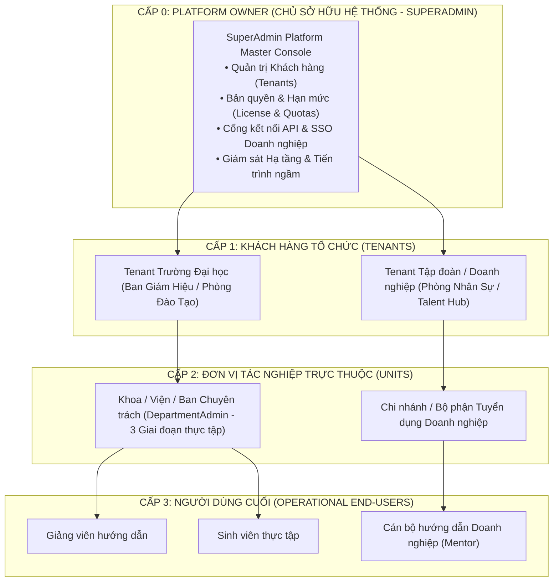
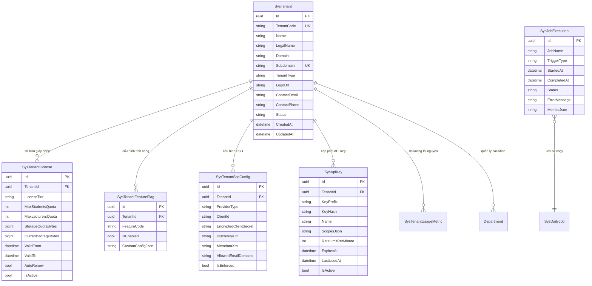
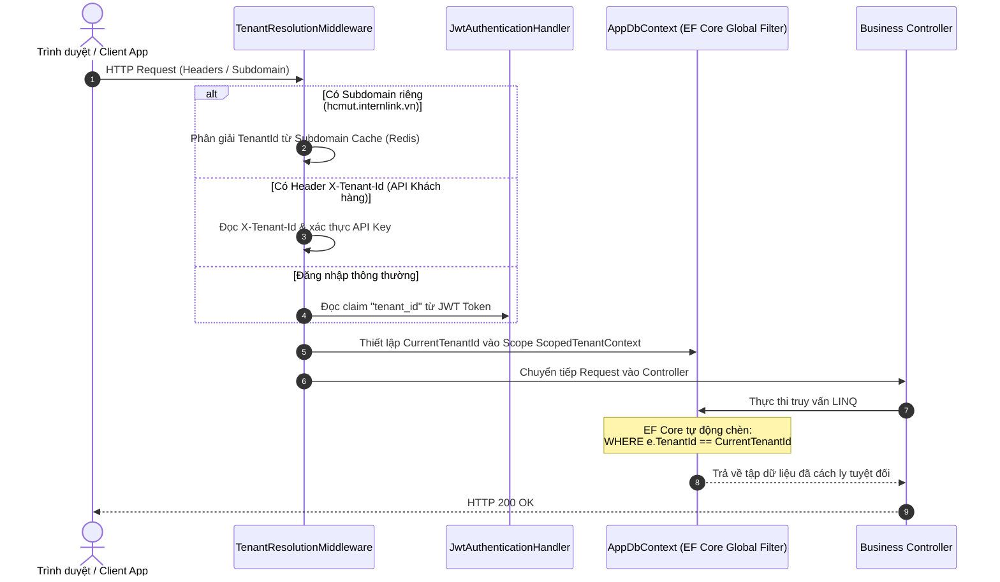

# ĐẶC TẢ KỸ THUẬT KIẾN TRÚC: SUPERADMIN PLATFORM CONSOLE
## Nền tảng Quản trị Trung tâm Doanh nghiệp & Giáo dục (Multi-Tenant B2B SaaS ERP)
**Dự án:** InternLink Enterprise ERP
**Vai trò phê duyệt:** QA Lead & Lead Enterprise Solutions Architect
**Phiên bản tài liệu:** 3.0.0-PROD
**Trạng thái:** Sẵn sàng chuyển giao Dev triển khai (Ready for Dev Execution)

---

## 1. TỔNG QUAN VÀ TUYÊN NGÔN KIẾN TRÚC (ARCHITECTURAL MISSION)

### 1.1. Tuyên ngôn Vị thế
SuperAdmin là **cấp quản trị cao nhất của Chủ sở hữu nền tảng (Platform Owner / Vendor)**. Khi InternLink được thương mại hóa và triển khai cho nhiều Trường Đại học / Học viện (Institutions) và nhiều Tập đoàn / Doanh nghiệp (Enterprises), SuperAdmin đóng vai trò là **Trung tâm Điều hành Nền tảng Đa khách hàng (Multi-Tenant Master Console)**.

### 1.2. Mô hình Phân cấp 4 Tầng (4-Tier Enterprise Hierarchy)


### 1.3. Nguyên tắc Thiết kế Bất biến (Core Principles)
1. **Multi-Tenancy by Design:** Dữ liệu giữa các Trường Đại học và Doanh nghiệp được cách ly logic triệt để bằng `TenantId` ở tầng CSDL (EF Core Global Query Filters). Tuyệt đối không để xảy ra rò rỉ chéo dữ liệu giữa các trường (Zero Cross-Tenant Leakage).
2. **Quota & License Governance:** Mọi tài nguyên tiêu thụ (Sinh viên, Giảng viên, Dung lượng lưu trữ tài liệu, Số lượng API call) đều được kiểm soát bằng giấy phép bản quyền thời gian thực (Real-time License Enforcement).
3. **Open Architecture & Interoperability:** Cung cấp cơ chế cắm ghép linh hoạt: SSO (SAML 2.0, OpenID Connect, LDAP), API Gateway cho hệ thống Đào tạo (SIS/LMS) và Webhook realtime.
4. **Deep Observability:** SuperAdmin có bảng điều khiển sức khỏe hạ tầng (Health Probes) và nhật ký tiến trình ngầm (Background Jobs Console) độc lập.

---

## 2. MÔ HÌNH DỮ LIỆU CSDL MỞ RỘNG (DOMAIN & DATABASE SCHEMA)

Hệ thống bổ sung 7 thực thể quản trị nền tảng vào phân vùng `backend/InternLink/InternLink.Domain/Entities/System/`:



### 2.1. Chi tiết Mã C nguồn C# Entities

#### A. Thực thể Đơn vị Triển khai: `SysTenant.cs`
```csharp
namespace InternLink.Domain.Entities.System;

public enum TenantType
{
    University = 1,     // Trường Đại học / Cao đẳng / Học viện
    Enterprise = 2,     // Tập đoàn / Doanh nghiệp tiếp nhận
    Government = 3      // Sở / Ban ngành Giáo dục
}

public enum TenantStatus
{
    Active = 1,         // Đang hoạt động bình thường
    Trial = 2,          // Đang dùng thử (Trial 30 ngày)
    Suspended = 3,      // Tạm khóa (Chậm thanh toán / Vi phạm hợp đồng)
    Expired = 4         // Đã hết hạn giấy phép
}

public class SysTenant : BaseEntity
{
    public string TenantCode { get; set; } = string.Empty; // Ví dụ: "HCMUT", "NEU", "FPT-CORP"
    public string Name { get; set; } = string.Empty;       // Đại học Bách Khoa TP.HCM
    public string LegalName { get; set; } = string.Empty;  // Tên trên hợp đồng pháp lý
    public string? Domain { get; set; }                    // hcmut.edu.vn (Custom domain)
    public string Subdomain { get; set; } = string.Empty;  // hcmut (hcmut.internlink.vn)
    public TenantType TenantType { get; set; } = TenantType.University;
    public string? LogoUrl { get; set; }
    public string ContactEmail { get; set; } = string.Empty;
    public string ContactPhone { get; set; } = string.Empty;
    public TenantStatus Status { get; set; } = TenantStatus.Active;

    // Quan hệ
    public ICollection<SysTenantLicense> Licenses { get; set; } = new List<SysTenantLicense>();
    public ICollection<SysTenantFeatureFlag> FeatureFlags { get; set; } = new List<SysTenantFeatureFlag>();
    public ICollection<SysTenantSsoConfig> SsoConfigs { get; set; } = new List<SysTenantSsoConfig>();
    public ICollection<SysApiKey> ApiKeys { get; set; } = new List<SysApiKey>();
    public ICollection<Department> Departments { get; set; } = new List<Department>();
}
```

#### B. Thực thể Bản quyền & Hạn mức: `SysTenantLicense.cs`
```csharp
namespace InternLink.Domain.Entities.System;

public enum LicenseTier
{
    Standard = 1,       // Báo cáo tuần, phân công cơ bản, xuất Excel
    Professional = 2,   // Chấm Rubric đa tiêu chí, Smart Excel, Field Policies
    Enterprise = 3      // Cổng SSO trường, Webhook realtime, Dedicated Database
}

public class SysTenantLicense : BaseEntity
{
    public Guid TenantId { get; set; }
    public SysTenant? Tenant { get; set; }
    public LicenseTier LicenseTier { get; set; } = LicenseTier.Standard;

    // Hạn mức tài nguyên (Quotas)
    public int MaxStudentsQuota { get; set; } = 5000;       // Tối đa 5.000 SV kích hoạt / năm
    public int MaxLecturersQuota { get; set; } = 200;       // Tối đa 200 Giảng viên
    public long StorageQuotaBytes { get; set; } = 107374182400; // 100 GB (Byte)
    public long CurrentStorageBytes { get; set; } = 0;      // Đang dùng thực tế

    // Thời hạn bản quyền
    public DateTime ValidFrom { get; set; }
    public DateTime ValidTo { get; set; }
    public bool AutoRenew { get; set; } = false;
    public bool IsActive { get; set; } = true;
}
```

#### C. Thực thể Khóa API & Định danh Doanh nghiệp: `SysApiKey.cs` & `SysTenantSsoConfig.cs`
```csharp
namespace InternLink.Domain.Entities.System;

public class SysApiKey : BaseEntity
{
    public Guid TenantId { get; set; }
    public SysTenant? Tenant { get; set; }
    public string Name { get; set; } = string.Empty; // "SIS Integration Key - Phòng Đào Tạo"
    public string KeyPrefix { get; set; } = string.Empty; // 8 ký tự đầu để nhận diện (ilk_live_abc12345)
    public string KeyHash { get; set; } = string.Empty;   // SHA256(KeySecret)
    public string ScopesJson { get; set; } = "[\"students.read\",\"evaluations.write\"]";
    public int RateLimitPerMinute { get; set; } = 120;     // Mặc định 120 request/phút
    public DateTime? ExpiresAt { get; set; }
    public DateTime? LastUsedAt { get; set; }
    public bool IsActive { get; set; } = true;
}

public class SysTenantSsoConfig : BaseEntity
{
    public Guid TenantId { get; set; }
    public SysTenant? Tenant { get; set; }
    public string ProviderType { get; set; } = "AzureAD"; // AzureAD, GoogleWorkspace, SAML2, LDAP
    public string ClientId { get; set; } = string.Empty;
    public string EncryptedClientSecret { get; set; } = string.Empty; // AES-256 mã hóa
    public string DiscoveryUrl { get; set; } = string.Empty;
    public string AllowedEmailDomains { get; set; } = "@hcmut.edu.vn;@alumni.hcmut.edu.vn";
    public bool IsEnforced { get; set; } = false; // Bắt buộc đăng nhập bằng SSO, cấm đăng nhập local
}
```

---

## 3. CƠ CHẾ BẢO MẬT & CÁCH LY DỮ LIỆU (TENANT RESOLUTION & ISOLATION)

### 3.1. Luồng Giải Quyết Tenant (Tenant Resolution Pipeline)
Mọi request gửi lên máy chủ đều đi qua Middleware `TenantResolutionMiddleware.cs`:



### 3.2. Cấu hình EF Core Global Query Filter
Trong `AppDbContext.cs`:
```csharp
protected override void OnModelCreating(ModelBuilder modelBuilder)
{
    base.OnModelCreating(modelBuilder);

    // Tự động gán Global Filter cách ly Tenant cho mọi thực thể kế thừa ITenantScoped
    foreach (var entityType in modelBuilder.Model.GetEntityTypes())
    {
        if (typeof(ITenantScoped).IsAssignableFrom(entityType.ClrType))
        {
            var parameter = Expression.Parameter(entityType.ClrType, "e");
            // e => EF.Property<Guid>(e, "TenantId") == _currentTenantProvider.TenantId
            var filter = Expression.Lambda(
                Expression.Equal(
                    Expression.Property(parameter, "TenantId"),
                    Expression.Constant(_currentTenantProvider.TenantId)
                ),
                parameter
            );
            entityType.SetQueryFilter(filter);
        }
    }
}
```

> [!CAUTION]
> **Quy định SuperAdmin Bypass:**
> Khi SuperAdmin cần xem dữ liệu tổng hợp toàn trường, API của SuperAdmin sử dụng phương thức `.IgnoreQueryFilters()`. Mỗi thao tác có cờ `.IgnoreQueryFilters()` bắt buộc phải ghi 1 bản ghi vào `SysAuditLog` với cấp độ bảo mật cao nhất (Severity: `SecurityAudit`).

---

## 4. ĐẶC TẢ CHI TIẾT 6 PHÂN HỆ QUẢN TRỊ NỀN TẢNG (F1010 - F1015)

### 4.1. F1010: Quản trị Đơn vị Triển khai (Tenant Directory & Onboarding Studio)
* **Mã chức năng:** `F1010`
* **Mục tiêu:** Quản lý toàn bộ danh sách các Trường Đại học và Tập đoàn Doanh nghiệp tham gia nền tảng.
* **Giao diện & Tính năng:**
  - **CompactActionBar (36px):** Tìm kiếm tức thì theo Mã/Tên trường, Bộ lọc Loại hình (Đại học / Doanh nghiệp), Bộ lọc Trạng thái (Hoạt động / Dùng thử / Tạm khóa), Nút "Tiếp nhận Đơn vị Mới (Onboarding Tenant)".
  - **Lưới dữ liệu DynamicDataGrid:**
    - Cột 1: Logo & Tên đơn vị (Kèm Subdomain `subdomain.internlink.vn`)
    - Cột 2: Mã định danh (`HCMUT`, `NEU`, `FPT-CORP`)
    - Cột 3: Loại hình (Badge `Đại học` hoặc `Doanh nghiệp`)
    - Cột 4: Đại diện pháp lý & Email liên hệ kỹ thuật
    - Cột 5: Số lượng Khoa / Bộ phận trực thuộc
    - Cột 6: Gói giấy phép hiện tại (`Enterprise`, `Professional`, `Standard`)
    - Cột 7: Trạng thái (Badge xanh `#7bc043` Hoạt động / Vàng Dùng thử / Đỏ Khóa)
    - Cột 8 (Ghim phải): Nút "Quản trị Khoa", "Cấu hình Bản quyền", "Tạm ngưng / Kích hoạt".

### 4.2. F1011: Quản lý Bản quyền & Hạn mức (License & Quota Studio)
* **Mã chức năng:** `F1011`
* **Mục tiêu:** Cấp phát thời hạn, giới hạn số lượng sinh viên, dung lượng ổ cứng cho từng trường để phục vụ thu phí và bảo vệ tài nguyên máy chủ.
* **Quy tắc Kiểm soát (Quota Rules):**
  - **Student Quota Alert:** Khi số lượng sinh viên được kích hoạt trong năm đạt 90% quota, hệ thống gửi email cảnh báo cho Ban Giám Hiệu và SuperAdmin. Khi đạt 100%, chặn thao tác "Thêm sinh viên" / "Import Excel sinh viên" và trả mã lỗi `402 Payment Required` (kèm thông điệp liên hệ nâng cấp bản quyền).
  - **Storage Quota Enforcement:** Khi dung lượng tài liệu thực tập (CV, Báo cáo tuần, Phiếu tiếp nhận) vượt quá dung lượng gói, chặn upload file mới và yêu cầu dọn dẹp hoặc mua thêm block lưu trữ.

### 4.3. F1012: Cổng Định danh Doanh nghiệp & Giáo dục (Enterprise SSO Hub)
* **Mã chức năng:** `F1012`
* **Mục tiêu:** Thiết lập kết nối đăng nhập 1-chạm (Single Sign-On) cho từng trường.
* **Form Cấu hình Studio:**
  - Lựa chọn Nhà cung cấp Định danh: `Microsoft Azure AD / Office 365`, `Google Workspace for Education`, `SAML 2.0 IdP`, `CAS / LDAP`.
  - Ô nhập: `Application (Client) ID`, `Directory (Tenant) ID`, `Client Secret (Mã hóa lưu trữ)`, `Discovery Endpoint`.
  - Bộ lọc Tên miền Email cho phép (Domain Whitelist): Ví dụ `@hcmut.edu.vn`, `@student.hcmut.edu.vn`.
  - Switch bắt buộc (SSO Enforced): Khi bật, toàn bộ giảng viên và sinh viên của trường đó bắt buộc phải đăng nhập bằng SSO, giao diện đăng nhập bằng mật khẩu cục bộ sẽ tự động bị ẩn đi.

### 4.4. F1013: Cổng Tích hợp Dữ liệu & Quản trị API Gateway (Integration & Webhook Hub)
* **Mã chức năng:** `F1013`
* **Mục tiêu:** Cấp phát API Keys cho phòng Đào tạo đồng bộ dữ liệu sinh viên từ hệ thống SIS và giám sát Webhook realtime.
* **Tính năng:**
  - Cấp phát API Key: Tạo cặp `KeyPrefix` + `Secret Token` (Secret chỉ hiển thị 1 lần duy nhất lúc tạo), chọn phạm vi quyền (`students:read`, `grades:write`, `evaluations:read`).
  - Rate Limiting Studio: Đặt ngưỡng request tối đa theo từng phút (ví dụ: 60/phút đối với gói Chuẩn, 300/phút đối với gói Doanh nghiệp). Khi vượt quá, trả về mã `429 Too Many Requests`.
  - Webhook Dead-Letter Queue: Bảng thống kê các lần bắn Webhook bị lỗi (Doanh nghiệp hoặc Trường bị sập server), kèm nút bấm "Bắn lại ngay" (Retry Re-dispatch).

### 4.5. F1014: Bảng Chỉ huy Vận hành & Tiến trình Ngầm (System Observability & Background Jobs)
* **Mã chức năng:** `F1014`
* **Mục tiêu:** Theo dõi thời gian thực tình trạng máy chủ và kiểm soát các tác vụ chạy định kỳ.
* **Giao diện & Chỉ số:**
  - **Hàng thẻ Sức khỏe Hạ tầng (Realtime Health Probes):**
    - `SQL Server Database`: Trạng thái Kết nối, Số lượng Connection Pool đang dùng, Thời gian phản hồi truy vấn trung bình (ms).
    - `Redis Cache Engine`: Trạng thái hoạt động, Dung lượng RAM đã cấp, Hit/Miss Ratio (%).
    - `MinIO / S3 Storage Engine`: Trạng thái kết nối, Tổng dung lượng đang lưu trữ.
    - `SMTP Mail Server`: Trạng thái hàng đợi email (Pending / Failed in 24h).
  - **Bảng Quản trị Tiến trình Ngầm (Background Jobs Console):**
    - Danh sách các Job: Sao lưu CSDL tự động (02:00 AM), Quét hạn nộp báo cáo (06:00 AM), Quét hết hạn tài khoản (00:00 AM), Tính toán tổng hợp KPI khoa (Chủ nhật hàng tuần).
    - Cột hiển thị: Tên Job, Lịch chạy CRON, Lần chạy gần nhất, Trạng thái (Thành công / Lỗi), Thời gian thực thi (s), Nút bấm "Kích hoạt Chạy Ngay (Trigger Now)".

### 4.6. F1015: Trung tâm Tuân thủ Pháp lý & Vòng đời Dữ liệu (Compliance & Data Retention Studio)
* **Mã chức năng:** `F1015`
* **Mục tiêu:** Đảm bảo tuân thủ Nghị định 13/2023/NĐ-CP (Bảo vệ dữ liệu cá nhân) và quy chế lưu trữ tài liệu giáo dục đại học.
* **Tính năng:**
  - Cấu hình Vòng đời Hồ sơ (Data Retention Policy): Thiết lập số năm lưu trữ bài nộp và báo cáo (ví dụ: 5 năm). Sau thời gian này, hệ thống tự động chuyển hồ sơ sang chế độ "Lưu trữ Đóng băng" (Cold Archive) để giảm tải CSDL chính.
  - Công cụ Ẩn danh hóa Dữ liệu (Anonymization Tool): Xóa số CCCD, Số điện thoại cá nhân, Địa chỉ riêng của sinh viên sau khi tốt nghiệp theo yêu cầu pháp lý ("Quyền được lãng quên"), nhưng vẫn giữ lại điểm số và số liệu thống kê đào tạo.
* **Quy tắc thực thi ERP-4:** Chính sách mặc định `STUDENT_PII` chờ 3 năm. Hồ sơ chỉ đủ điều kiện khi có ít nhất một kỳ thực tập còn hiệu lực, tất cả kỳ thực tập đó ở trạng thái `Completed`, và ngày kết thúc kỳ gần nhất đã qua mốc retention. Preview và execute dùng cùng quy tắc; execute yêu cầu số lượng preview hiện tại cùng cụm xác nhận `ANONYMIZE`.
* **Phạm vi dữ liệu hiện có:** Model chưa lưu CCCD/địa chỉ sinh viên. Thao tác đổi họ tên thành `Sinh viên đã ẩn danh`, thay email bằng địa chỉ định danh kỹ thuật, xóa điện thoại, gỡ `ResumeUrl` và ảnh đại diện tài khoản; giữ nguyên MSSV, Khoa, kỳ thực tập và điểm học thuật. File CV ngoài kho không bị xóa vật lý. Các giá trị PII cũ tương ứng trong JSON audit cũng được làm sạch.

---

## 5. HỢP ĐỒNG API (API CONTRACTS & DTOS)

Toàn bộ các endpoint của SuperAdmin được đặt dưới tiền tố `/api/v1/system/`:

### 5.1. Nhóm API Quản trị Đơn vị Triển khai (Tenants)
```
GET    /api/v1/system/tenants             - Danh sách Đơn vị triển khai (Phân trang, lọc theo loại hình, trạng thái)
POST   /api/v1/system/tenants             - Tiếp nhận Đơn vị mới (Tạo trường/doanh nghiệp mới)
GET    /api/v1/system/tenants/{id}         - Chi tiết Đơn vị & Thông tin bản quyền
PUT    /api/v1/system/tenants/{id}         - Cập nhật thông tin đơn vị
PATCH  /api/v1/system/tenants/{id}/status  - Đổi trạng thái (Active, Suspended, Expired)
```

**Request DTO Tiếp nhận Đơn vị Mới:**
```csharp
public record CreateTenantRequest(
    [Required, StringLength(20)] string TenantCode,      // "HCMUT"
    [Required, StringLength(200)] string Name,           // "Đại học Bách Khoa TP.HCM"
    [Required, StringLength(50)] string Subdomain,       // "hcmut"
    [Required] TenantType TenantType,                    // University = 1
    [EmailAddress] string ContactEmail,                  // "daotao@hcmut.edu.vn"
    string ContactPhone,                                 // "028 3865 1670"
    LicenseTier LicenseTier,                             // Enterprise = 3
    int MaxStudentsQuota,                                // 10000
    DateTime ValidTo                                     // "2027-11-21T00:00:00Z"
);
```

### 5.2. Nhóm API Quản trị Khóa Tích hợp (API Keys)
```
GET    /api/v1/system/tenants/{tenantId}/api-keys       - Danh sách API Keys của trường
POST   /api/v1/system/tenants/{tenantId}/api-keys       - Cấp API Key mới (Trả về secret 1 lần)
DELETE /api/v1/system/tenants/{tenantId}/api-keys/{id}  - Thu hồi / Xóa API Key ngay lập tức
```

**Response DTO khi Cấp Khóa API mới:**
```csharp
public record CreateApiKeyResponse(
    Guid Id,
    string KeyPrefix,               // "ilk_live_4b8f"
    string SecretKey,               // "ilk_sec_99a8b7c6d5e4f3a2b1... (Chỉ trả về 1 lần)"
    string Name,                    // "Phòng Đào Tạo API Key"
    string[] Scopes,
    int RateLimitPerMinute,
    DateTime? ExpiresAt
);
```

### 5.3. Nhóm API Giám sát Sức khỏe & Tiến trình Ngầm
```
GET    /api/v1/system/health/probes       - Kiểm tra realtime sức khỏe hạ tầng (DB, Redis, S3, SMTP)
GET    /api/v1/system/jobs                - Danh sách các Background Jobs & Lịch sử chạy
POST   /api/v1/system/jobs/{jobName}/run  - Kích hoạt chạy ngay một Job ngầm
```

---

## 6. QUY CHUẨN THIẾT KẾ GIAO DIỆN (UI/UX DESIGN TOKENS)

Tuân thủ nghiêm ngặt chuẩn **TKSolution V11 ERP** đã được chuẩn hóa trong Sprint UI-7 và UI-8:

* **Màu sắc Nhận diện:**
  - Primary Tech Blue: `#026aa7` (Tiêu đề, Header Ribbon, Nút hành động chính).
  - Hover Action: `#025a8e`.
  - Accent Green (Thành công / Kích hoạt): `#7bc043` (Text: `#385d1b`, Background: `#7bc043`/15).
  - Command TopBar Dark: `#0f172a`.
  - **CẤM DÙNG:** Các màu ngoại lai như `indigo-*`, `purple-*`, `violet-*`.
* **Bo góc (Border Radius):**
  - Khung bảng, Card, Drawer, Modal: `rounded-md` (6px).
  - Nút bấm (Button), Ô nhập liệu (Input), Hộp chọn (Select): `rounded-[4px]`.
  - Badge trạng thái, Thẻ phân loại: `rounded-[3px]`.
  - **CẤM DÙNG:** `rounded-xl`, `rounded-full` (ngoại trừ avatar tròn).
* **Mật độ & Kiểu chữ (Density & Typography):**
  - Kích thước chữ nội dung bảng và form: `text-xs` (12px).
  - Kích thước nhãn tiêu đề cột: `text-[11px] font-bold uppercase tracking-wider text-slate-500`.
  - Đệm ô bảng (Cell Padding): `py-1.5 px-2.5`.
  - Loại bỏ hoàn toàn viền bọc kép (Double-border wrap) xung quanh bảng dữ liệu.

---

## 7. BỘ TIÊU CHUẨN KIỂM THỬ QA (TEST STRATEGY & ACCEPTANCE CRITERIA)

Dưới vai trò QA Lead, tôi ban hành bộ tiêu chí nghiệm thu tự động (Automated Verification Gates) bắt buộc cho Dev:

### 7.1. Kiểm thử Cách ly Dữ liệu (Cross-Tenant Negative Security Tests)
1. **Test Case SEC-01:** Tạo `Tenant_A` (Bách Khoa) và `Tenant_B` (Kinh Tế).
   - Dùng tài khoản của `Tenant_A` gọi API lấy danh sách sinh viên.
   - **Kỳ vọng:** Kết quả trả về 100% sinh viên của `Tenant_A`, không chứa bất kỳ bản ghi nào của `Tenant_B`.
2. **Test Case SEC-02:** Dùng tài khoản `Tenant_A` truyền trực tiếp `studentId` của `Tenant_B` vào URL `/api/v1/admin/students/{id}`.
   - **Kỳ vọng:** Máy chủ phải trả về mã lỗi `HTTP 404 Not Found` (không trả 403 để tránh lộ thông tin tồn tại của bản ghi).

### 7.2. Kiểm thử Thực thi Hạn mức Bản quyền (Quota Enforcement Tests)
1. **Test Case LIC-01:** Cấu hình `MaxStudentsQuota = 100`. Tạo 100 sinh viên thành công. Khi tạo sinh viên thứ 101:
   - **Kỳ vọng:** Hệ thống chặn lại, trả về mã lỗi `HTTP 402 Payment Required` với mã lỗi nghiệp vụ `STUDENT_QUOTA_EXCEEDED`.
2. **Test Case LIC-02:** Thiết lập `TenantStatus = Suspended`. Người dùng của trường đăng nhập:
   - **Kỳ vọng:** Chặn đăng nhập, chuyển hướng sang trang thông báo tài khoản trường đang bị tạm khóa và cung cấp email hỗ trợ kỹ thuật của SuperAdmin.

### 7.3. Kiểm thử Giới hạn Tần suất Gọi API (Rate Limiting Tests)
1. **Test Case API-01:** Cấu hình API Key với hạn mức 60 req/phút. Bắn 70 requests trong vòng 30 giây:
   - **Kỳ vọng:** 60 request đầu tiên trả về `HTTP 200 OK`. 10 request sau trả về `HTTP 429 Too Many Requests` kèm header `Retry-After`.

---

## 8. LỘ TRÌNH CHUYỂN GIAO THỰC THI CHO DEV (SPRINT BREAKDOWN)

* **Sprint ERP-1 (Database Migration & Core Multi-Tenancy):**
  - Tạo các thực thể `SysTenant`, `SysTenantLicense`, `SysTenantSsoConfig`, `SysApiKey`.
  - Tạo Migration EF Core `20261122_AddMultiTenantCoreEntities`.
  - Triển khai `TenantResolutionMiddleware` và EF Core Global Query Filter.
* **Sprint ERP-2 (SuperAdmin Tenant Console - F1010 & F1011):**
  - Xây dựng Controller `SysTenantsController.cs` và `SysLicensesController.cs`.
  - Xây dựng Frontend UI: Màn hình F1010 Quản trị Đơn vị và F1011 Quản lý Bản quyền.
* **Sprint ERP-3 (Integration Gateway & Health Monitor - F1013 & F1014):**
  - Xây dựng API Key Authentication Filter và Rate Limiting Middleware.
  - Xây dựng Health Probes Service (`/api/v1/system/health/probes`).
  - Xây dựng Frontend UI: Màn hình F1013 API Gateway và F1014 System Observability.
* **Sprint ERP-4 (SSO Federation & Compliance - F1012 & F1015):**
  - Xây dựng SSO OpenID Connect handler theo từng trường.
  - Xây dựng công cụ Data Archival & Anonymization.
  - QA Sign-off toàn bộ hệ thống trước khi nghiệm thu thương mại.
