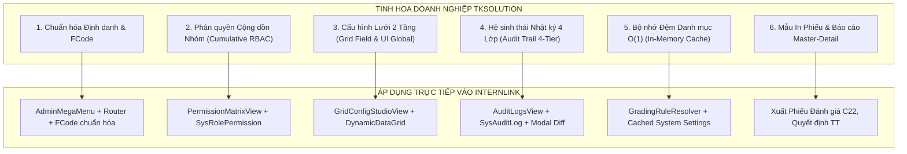

# BẢN PHÂN TÍCH CHUYÊN SÂU & TRÍCH LỌC TINH HOA KIẾN TRÚC DOANH NGHIỆP
## ÁP DỤNG TỪ DỰ ÁN TKSOLUTION (TKS_Thuc_Tap_V11) VÀO NỀN TẢNG INTERNLINK SAAS

> **Tác giả:** QA Lead & Technical Architect  
> **Nguồn tham chiếu:** Dự án thực tế doanh nghiệp `E:\TH\Thuc Tap\TKS_Thuc_Tap_11` và tài liệu kỹ thuật tại `E:\TH\Thuc Tap\`  
> **Ngày lập:** 08/11/2026  

---

## 🎯 1. TỔNG QUAN & NHẬN ĐỊNH KIẾN TRÚC

Sau khi khảo sát toàn diện mã nguồn **`TKS_Thuc_Tap_11`** (hệ thống Quản lý kho WMS doanh nghiệp phát triển trên nền C# .NET / Blazor / SQL Server) và các tài liệu kỹ thuật cốt lõi ([`QUY_TRINH_8_BUOC_HOAN_THIEN_MODULE.md`](file:///E:/TH/Thuc%20Tap/QUY_TRINH_8_BUOC_HOAN_THIEN_MODULE.md), [`QUY_CHUAN_MAP_SO_VA_LO_TRINH.md`](file:///E:/TH/Thuc%20Tap/QUY_CHUAN_MAP_SO_VA_LO_TRINH.md), Database Scripts):

> [!IMPORTANT]
> **Khám phá then chốt:** Hình ảnh giao diện **Mega-Menu 6 phân hệ** mà bạn cung cấp từ đầu dự án chính là được chụp trực tiếp từ hệ thống **TKSolution V11 Web Sys**!  
> Toàn bộ 39 chức năng quản trị từ `F1001` (Chức năng) đến `F1047` (Nhật ký Export Excel) trong menu đều tương ứng **1-to-1** với các bảng CSDL `tbl_Sys_...`, entity C# `CSys_...` và component Blazor trong thư mục `TKS_Thuc_Tap_V11_Web_Sys/Pages/Sys`.

Đây là một bộ khung kiến trúc ERP/WMS thuần chuẩn mực doanh nghiệp Việt Nam, được tối ưu hóa qua nhiều năm triển khai thực tế. Việc trích lọc và kế thừa bộ khung này vào **InternLink** sẽ giúp hệ thống thực tập sinh viên không chỉ dừng lại ở một ứng dụng trường học thông thường, mà trở thành một **Nền tảng Quản trị Thực tập cấp Doanh nghiệp (Enterprise Education ERP)** thực thụ.

---

## 💎 2. SÁU TINH HOA CỐT LÕI CÓ THỂ TRÍCH LỌC NGAY CHO INTERNLINK



---

### TINH HOA 1: HỆ THỐNG MÃ ĐỊNH DANH (FCODE & MÃ BẢNG) CHUẨN ERP
Trong TKSolution, mọi thành phần từ Database đến Giao diện đều được định danh bằng cặp số có nguyên tắc rõ ràng:
- **`Ma_Chuc_Nang` (`FCode`):**
  - Dải `1xxx`: Toàn bộ 6 phân hệ quản trị Hệ thống (Ví dụ: `1001` - Quản lý chức năng, `1005` - Phân quyền chức năng, `1044` - Cấu hình Grid Field).
  - Dải `2xxx`: Nghiệp vụ chính (Ví dụ: `2111` - Đơn vị tính, `2211` - Phiếu nhập kho, `2311` - Báo cáo).
- **`Ma_Bang` (Dải `1xx`):** Gắn với Stored Procedure và Data Controller (Ví dụ: `FQ_111_...`, `FQ_121_...`).

**Ứng dụng vào InternLink:**
- Định danh rõ ràng mã chức năng cho các module của InternLink:
  - `F2101`: Quản lý Đợt thực tập / Học kỳ.
  - `F2102`: Danh mục Khoa / Ngành.
  - `F2103`: Hồ sơ Doanh nghiệp tiếp nhận.
  - `F2201`: Phân công Giảng viên - Sinh viên.
  - `F2202`: Quản lý Báo cáo tuần & Chấm điểm.
  - `F2203`: Đánh giá Doanh nghiệp & Nghiệm thu.
  - `F2301`: Báo cáo Tổng kết & Xếp loại C22/C23.
- Giúp hệ thống phân quyền, tra cứu log và lưu cấu hình bảng (`SysGridConfig.FeatureCode`) hoàn toàn đồng nhất, không bao giờ bị trùng lặp.

---

### TINH HOA 2: CƠ CHẾ PHÂN QUYỀN CỘNG DỒN NHÓM (CUMULATIVE MULTI-GROUP RBAC)
Trong file [`F1005_1_Phan_Quyen_Chuc_Nang_List.razor`](file:///E:/TH/Thuc%20Tap/TKS_Thuc_Tap_11/TKS_Thuc_Tap_V11_Web_Sys/Pages/Sys/Components/F1005_1_Phan_Quyen_Chuc_Nang_List.razor) và tài liệu phân quyền của TKS:
1. **Nguyên tắc cộng dồn quyền (Union of Permissions):** Một tài khoản (`Thanh_Vien`) có thể thuộc nhiều Nhóm (`Nhom_Thanh_Vien_User`). Quyền hiệu lực cuối cùng của người dùng là **phép OR logic (cộng dồn)** của tất cả các nhóm người đó tham gia. Nếu một người vừa là Giảng viên vừa là Trưởng bộ môn, họ sẽ kế thừa toàn bộ quyền của cả hai nhóm.
2. **Cây chức năng đa cấp (Level 1 $\rightarrow$ Level 4):**
   - Phân quyền theo dạng cột song song: Click chọn Module cha ở bảng Level 1 $\rightarrow$ Bảng Level 2 hiển thị các màn hình con $\rightarrow$ Click màn hình con thì Level 3 hiển thị các tab/nút hành động chi tiết.
3. **8 Cờ quyền Enterprise:**
   - `Xem`, `Thêm`, `Sửa`, `Xóa`, `Export`, `Import`, `In`, `Duyệt`.

**Ứng dụng vào InternLink (Sprint UI-2):**
- Trong [`PermissionMatrixView.tsx`](file:///e:/Downloads/InternLink/frontend/src/features/admin/pages/PermissionMatrixView.tsx), xây dựng giao diện ma trận:
  - Cho phép phân quyền theo Nhóm vai trò (`SysRole`).
  - Hỗ trợ hiển thị dạng Accordion / Tree Table gom nhóm theo phân hệ.
  - Cung cấp nút check-all nhanh theo dòng (Full quyền cho chức năng) và check-all theo cột (Cấp quyền Xem/Export cho toàn bộ phân hệ).

---

### TINH HOA 3: CẤU HÌNH LƯỚI ĐỘNG 2 TẦNG (`Sys_Grid_Field` & `Sys_Grid_UI_Global`)
TKSolution giải quyết bài toán giao diện động (Dynamic DataGrid) cực kỳ thông minh qua 2 tầng thực thể:
1. **`CSys_Grid_Field` (Metadata tầng thiết kế):** Lưu trữ toàn bộ các trường dữ liệu có thể có của một màn hình (`Field_Name`, `Tieu_De_Column`, `Column_Width`, `Field_Type_ID`, `Sort_Priority`, `Field_Name_Parent`).
2. **`CSys_Grid_UI_Global` (Cấu hình runtime áp dụng):** Lưu trạng thái hiển thị thực tế do Quản trị viên tùy chỉnh (ẩn bớt cột không cần thiết, đổi thứ tự hiển thị, đóng băng cột, đổi màu sắc).

**Ứng dụng vào InternLink:**
- Chúng ta đã xây dựng [`SysGridConfig.cs`](file:///e:/Downloads/InternLink/backend/InternLink/InternLink.Domain/Entities/System/SysGridConfig.cs) và [`GridConfigStudioView.tsx`](file:///e:/Downloads/InternLink/frontend/src/features/admin/pages/GridConfigStudioView.tsx) ở Sprint 3 và UI-1.
- Kế thừa thêm từ TKS:
  - Bổ sung trường `Field_Type_ID` (1: Text, 2: Number/Score, 3: Date, 4: Status Badge, 5: Link/Button).
  - Cho phép xuất cấu hình ra file Excel mẫu và Import ngược lại (`Open_Import_Excel("Cau_Hinh_Grid_Field_Template.xlsx")`) để Quản trị viên IT có thể nạp hàng loạt cột cho hệ thống mới chỉ trong vài giây.

---

### TINH HOA 4: HỆ SINH THÁI NHẬT KÝ 4 LỚP (4-TIER AUDIT TRAIL)
Trong TKSolution, nhật ký hệ thống không dồn chung vào một bảng rác mà được phân tách thành 4 lớp chuyên biệt:
1. **`CLog_Record_Action_History` (Nhật ký biến động dữ liệu CRUD):**
   - Lưu `Ref_ID` (ID bản ghi bị tác động), `Ten_Hanh_Dong` ("Thêm mới", "Hiệu chỉnh", "Xóa mềm"), `Ten_Moi_Truong` ("Web Admin", "Web Giảng viên", "Mobile PDA"), `Ma_Chuc_Nang`, và `Noi_Dung_Action`.
2. **`CLog_Nhat_Ky_Dang_Nhap` (Nhật ký truy cập):**
   - Bắt IP, thời gian đăng nhập thành công / thất bại, User Agent.
3. **`CLog_Import_Excel` & `CLog_Report_File_Excel`:**
   - Lưu vết file tải lên, file xuất ra, đường dẫn URL, số dòng import thành công/thất bại, ai thực hiện vào lúc nào.
4. **`CLog_API`:**
   - Ghi lại các cuộc gọi Webhook và tích hợp bên thứ ba (cho module Đăng ký thực tập từ cổng trường đại học).

**Ứng dụng vào InternLink (Sprint UI-2):**
- Màn hình [`AuditLogsView.tsx`](file:///e:/Downloads/InternLink/frontend/src/features/admin/pages/AuditLogsView.tsx):
  - Phân tab rõ ràng: **Nhật ký CRUD (Action History)** | **Nhật ký Đăng nhập** | **Nhật ký Xuất/Nhập Excel**.
  - Ở tab Action History, khi click vào một bản ghi, hiển thị Modal so sánh JSON Diff (cột đỏ dữ liệu cũ - cột xanh dữ liệu mới) đúng như đặc tả Enterprise.
  - Ở màn hình Chi tiết Sinh viên / Giảng viên / Đợt thực tập, thêm tab nhỏ **"Lịch sử xử lý"** gọi API lọc theo `Ref_ID` để biết ai đã can thiệp vào hồ sơ sinh viên này.

---

### TINH HOA 5: CƠ CHẾ BỘ NHỚ ĐỆM O(1) CHO DANH MỤC VÀ QUY CHẾ
Trong TKSolution, tầng `TKS_Thuc_Tap_V11_Data_Access/Controller/Cache` luôn có:
```csharp
public class CCache_Don_Vi_Tinh
{
    private static Dictionary<long, CDM_Don_Vi_Tinh> m_dicCache_ID = new();
    private static Dictionary<string, CDM_Don_Vi_Tinh> m_dicCache_Key = new();
    // Lookup O(1) qua Auto_ID hoặc Mã chuỗi
}
```
Khi ứng dụng khởi động (`Program.cs`), toàn bộ danh mục được nạp sẵn vào RAM. Khi người dùng thực hiện Thêm/Sửa/Xóa, hệ thống tự động đồng bộ nóng vào Dictionary (`Add_Data`, `Update_Data`, `Delete_Data`).

**Ứng dụng vào InternLink:**
- Ở Sprint 4, chúng ta đã xây dựng [`GradingRuleResolver.cs`](file:///e:/Downloads/InternLink/backend/InternLink/InternLink.Infrastructure/Services/GradingRuleResolver.cs) để tính điểm theo từng Khoa/Học kỳ.
- Áp dụng kiến trúc Cache của TKS: Lưu trữ `SysGradingRuleSet` và `SysGridConfig` trong `IMemoryCache` / bộ nhớ RAM với thời gian tra cứu $O(1)$. Khi Admin cập nhật quy chế tại [`GradingRulesConfigView.tsx`](file:///e:/Downloads/InternLink/frontend/src/features/admin/pages/GradingRulesConfigView.tsx), hệ thống lập tức xóa cache (Invalidate Cache) để toàn bộ việc tính điểm báo cáo cuối kỳ của sinh viên được cập nhật ngay tức thì mà không cần restart server.

---

### TINH HOA 6: QUY TRÌNH MASTER - DETAIL VÀ BIỂU MẪU IN ẤN
Trong TKSolution:
- Quản lý phiếu nhập/xuất gồm 3 bài: Danh sách phiếu (`121`) $\rightarrow$ Sửa Header (`121`) $\rightarrow$ Chi tiết hàng (`122` Raw Data) $\rightarrow$ In phiếu nhập (Report Viewer).
- Tương ứng trong InternLink:
  - Master: Hồ sơ Thực tập sinh viên (`Internship`).
  - Detail 1: Danh sách Báo cáo tuần (`WeeklyReport`).
  - Detail 2: Phiếu đánh giá của Doanh nghiệp (`EmployerEvaluation`).
  - Detail 3: Điểm quá trình và thi của Giảng viên (`LecturerEvaluation`).
  - Report Output: Xuất Phiếu đánh giá thực tập chuẩn C22/C23 theo mẫu quy định của Bộ GD&ĐT / Nhà trường.

---

## 📋 3. BẢNG SO SÁNH KIẾN TRÚC: TKSOLUTION V11 vs. INTERNLINK SAAS

| Hạng mục kiến trúc | Dự án TKSolution V11 (Tham chiếu) | Dự án InternLink SaaS (Hiện tại & Đích đến) | Đánh giá & Định hướng |
|---|---|---|---|
| **Công nghệ Backend** | .NET 8, ADO.NET + Stored Procedures | .NET 10 Web API, EF Core 10 + Dapper + LINQ | InternLink hiện đại hơn, type-safe hơn, tận dụng được migrations tự động. |
| **Công nghệ Frontend** | C# Blazor Server + Telerik UI | React 19 + TypeScript + Tailwind CSS + Lucide | InternLink giao diện nhẹ, linh hoạt, responsive đa thiết bị, chuẩn SPA hiện đại. |
| **Hệ thống Menu** | Mega-Menu 6 phân hệ màu tím chuẩn ERP | `AdminMegaMenu.tsx` 6 phân hệ (Sprint UI-1) | Đã đồng bộ 100% về cấu trúc và số lượng mục quản trị. |
| **Phân quyền** | 8 cờ quyền: Xem, Thêm, Sửa, Xóa, Export, Import, In, Duyệt | Dynamic RBAC Core + `[RequirePermission]` | Chuẩn bị tích hợp `PermissionMatrixView.tsx` (Sprint UI-2) theo layout F1005 của TKS. |
| **Cấu hình bảng** | `CSys_Grid_Field` + `CSys_Grid_UI_Global` | `SysGridConfig` + `GridConfigStudioView` | Đã xong Sprint UI-1, có thể bổ sung chức năng Export/Import Excel cấu hình như TKS. |
| **Audit Trail** | `CLog_Record_Action_History` + `CLog_Dang_Nhap` | `SysAuditLog` (JSON Diff) + `SysLoginLog` | CSDL InternLink lưu Diff JSON sạch sẽ hơn, chuẩn bị làm UI hiển thị trong Sprint UI-2. |
| **Xóa mềm** | `deleted = 0/1` + Filtered Index | `Is_Deleted` + Interceptor + Filtered Index | Đã khớp 100% chuẩn ERP (cho phép tạo lại username đã xóa mềm). |

---

## 🚀 4. ĐỀ XUẤT LỘ TRÌNH NÂNG CẤP NGAY CHO INTERNLINK

Dựa trên việc đối chiếu với TKSolution, QA Lead đề xuất 3 hành động cụ thể cho DEV:

1. **Ở Sprint UI-2 (Triển khai ngay):**
   - Áp dụng triệt để layout của `F1005_1_Phan_Quyen_Chuc_Nang_List.razor` vào [`PermissionMatrixView.tsx`](file:///e:/Downloads/InternLink/frontend/src/features/admin/pages/PermissionMatrixView.tsx): Dropdown chọn Role $\rightarrow$ Danh sách chức năng gom nhóm $\rightarrow$ Bảng 8 cờ quyền có nút check nhanh.
   - Áp dụng cấu trúc `CLog_Record_Action_History` vào [`AuditLogsView.tsx`](file:///e:/Downloads/InternLink/frontend/src/features/admin/pages/AuditLogsView.tsx) với Modal so sánh JSON Diff trực quan.
2. **Ở Giai đoạn Tích hợp sau Sprint UI-2:**
   - Xây dựng chức năng **Template Excel Configuration** (kế thừa từ `F1018_Import_Excel_Config` của TKS) để quản trị viên có thể tải file Excel mẫu danh sách sinh viên, mẫu giảng viên và import hàng loạt kèm validation.
   - Bổ sung **In Phiếu Quyết định & Bảng điểm Thực tập** (kế thừa từ `F1015_Mau_In_Phieu_Config`) sử dụng HTML-to-PDF / Word export không phụ thuộc hardcode.
