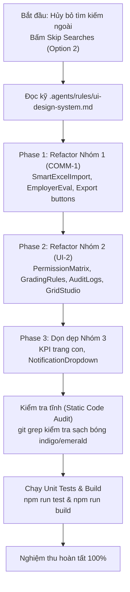

# KẾ HOẠCH REFACTOR TOÀN DIỆN GIAO DIỆN INTERNLINK
## CHUẨN HÓA 100% THEO UI DESIGN SYSTEM V2.0

> **Căn cứ pháp lý & quy chuẩn bắt buộc:**
> - Tài liệu gốc: [`.agents/rules/ui-design-system.md`](../.agents/rules/ui-design-system.md)
> - Tài liệu mở rộng: [`docs/UI_DESIGN_SYSTEM.md`](./UI_DESIGN_SYSTEM.md)
> - Trang tham chiếu chuẩn tuyệt đối (Golden Reference): `/student/dashboard` (`frontend/src/features/student/pages/DashboardView.tsx`)

---

## 1. NGUYÊN NHÂN GỐC RỄ (ROOT CAUSE ANALYSIS)

1. **Phụ thuộc công cụ ngoại lai:** Dev kích hoạt UI/UX skill bên ngoài đòi hỏi script Python (môi trường Windows không có Python), dẫn đến bị chặn và cố tìm kiếm mẫu giao diện chung trên web.
2. **Dùng preset mặc định của Tailwind CSS:** Thay vì dùng design tokens đã định nghĩa của InternLink, Dev dùng các class tiện ích mặc định:
   - Màu xanh Indigo (`indigo-600`, `indigo-700`, `indigo-950`) thay cho Brand Primary `#026aa7`.
   - Màu ngọc lục bảo Emerald (`emerald-600`, `emerald-700`) thay cho trạng thái hoàn thành chuẩn `#7bc043`.
   - Màu tím Violet (`violet-50`, `border-violet-200`) cho badge.
   - Bo góc `rounded-2xl` thay cho Card chuẩn `rounded-xl`.
   - Chiều rộng `max-w-7xl` thay cho Container chuẩn `max-w-[1300px]`.
3. **Vi phạm kỷ luật bố cục:** Đặt KPI cards ở các màn hình con/quản trị cấu hình.

---

## 2. BẢNG TRA CỨU QUY TẮC BẮT BUỘC (QUICK FIX CHEATSHEET)

Dev phải áp dụng đúng bảng chuyển đổi token sau đây trên toàn bộ mã nguồn:

| Thuộc tính UI | CÁM TUYỆT ĐỐI (Hiện tại bị lỗi) | BẮT BUỘC THAY BẰNG (Chuẩn V2.0) |
|---|---|---|
| **Brand Primary CTA** | `bg-indigo-600`, `bg-indigo-700`, `bg-blue-600` | `bg-[#026aa7] hover:bg-[#025a8e] active:bg-[#005082] text-white text-xs font-bold rounded-lg px-4 py-2 transition-colors cursor-pointer` |
| **Focus Ring** | `focus-visible:ring-indigo-600`, `ring-blue-600` | `focus-visible:ring-[#026aa7] focus-visible:outline-none focus-visible:ring-2` |
| **Progress / Checkbox Accent** | `accent-indigo-700`, `accent-indigo-600` | `accent-[#026aa7]` |
| **Hoàn thành / Đạt / Thành công** | `emerald-500`, `emerald-600`, `text-emerald-700`, `bg-emerald-50` | `text-[#7bc043]`, `bg-[#7bc043]/10`, `border-[#7bc043]/30`, icon `#7bc043` |
| **Top Banner Dashboard** | `bg-indigo-950`, `bg-slate-900` | `bg-[#026aa7] px-4 py-2.5 text-white flex items-center justify-between` |
| **Page Container** | `max-w-7xl`, `max-w-6xl`, `space-y-6` lẻ | `mx-auto max-w-[1300px] space-y-4 animate-in fade-in duration-200 font-sans pb-12` |
| **Card / Panel Wrapper** | `rounded-2xl border border-slate-200 bg-white p-6 shadow-sm` | `rounded-xl border border-slate-200/90 bg-white p-4 sm:p-5 shadow-2xs` |
| **Badge phân hệ / Title** | `border-violet-200 bg-violet-50 text-violet-800` | `text-[10.5px] font-medium bg-blue-50 text-[#026aa7] border border-blue-200/80 px-2 py-0.5 rounded-full` |
| **KPI Cards (4 thẻ)** | Xuất hiện ở trang con, trang cấu hình | **CẤM TUYỆT ĐỐI**. Chỉ được phép xuất hiện tại 4 dashboard: `/student/dashboard`, `/lecturer/dashboard`, `/admin/dashboard`, `/superadmin/dashboard`. |

---

## 3. DANH SÁCH CHI TIẾT FILE VÀ HÀNH ĐỘNG CẦN REFACTOR

### 🔴 NHÓM 1: CÁC FILE MỚI PHÁT SINH TRONG SPRINT COMM-1

#### 1. `frontend/src/features/admin/pages/SmartExcelImportView.tsx`
- **Mục tiêu:** Đưa về chuẩn Studio quản trị của InternLink.
- **Các điểm cần sửa:**
  - Dòng 128: Đổi `<main className="mx-auto max-w-7xl space-y-6 p-4 sm:p-6">` thành `mx-auto max-w-[1300px] space-y-4 animate-in fade-in duration-200 font-sans pb-12`.
  - Dòng 130: Đổi `text-indigo-700` thành `text-[#026aa7] font-bold tracking-wider text-xs uppercase`.
  - Dòng 139: Vùng kéo thả file đổi `isDragging ? "border-indigo-500 bg-indigo-50" : ...` thành `border-[#026aa7] bg-blue-50/40`.
  - Dòng 149: Đổi `<UploadCloud className="text-indigo-600" />` thành `text-[#026aa7]`.
  - Dòng 152: Nút "Chọn tệp" đổi `focus-visible:ring-indigo-600` thành `focus-visible:ring-[#026aa7]`.
  - Dòng 156: Icon file thành công đổi `text-emerald-700` thành `text-[#7bc043]`.
  - Dòng 163, 191, 223, 234: Thay toàn bộ `rounded-2xl` thành `rounded-xl border border-slate-200/90 bg-white shadow-2xs`.
  - Dòng 177: Ô chọn mapping đổi `focus-visible:ring-indigo-600` thành `focus-visible:ring-[#026aa7]`.
  - Dòng 185: Nút "Kiểm tra toàn bộ dữ liệu" đổi `border-indigo-200 bg-indigo-50 text-indigo-800` thành `border-blue-200 bg-blue-50 text-[#026aa7] hover:bg-blue-100`.
  - Dòng 239: Nút "Xác nhận nạp dữ liệu" đổi `bg-indigo-700 hover:bg-indigo-800` thành `bg-[#026aa7] hover:bg-[#025a8e] text-white text-xs font-bold rounded-lg px-4 py-2`.
  - Dòng 246: Banner kết quả đổi `border-emerald-200 bg-emerald-50 text-emerald-900` thành `border-[#7bc043]/40 bg-[#7bc043]/10 text-slate-800`.

#### 2. `frontend/src/features/public/pages/EmployerQuickEvaluationView.tsx`
- **Mục tiêu:** Màn hình đánh giá public cho doanh nghiệp phải thể hiện đúng nhận diện thương hiệu trường/khoa.
- **Các điểm cần sửa:**
  - Dòng 152: Loader đổi `text-indigo-600` thành `text-[#026aa7]`.
  - Dòng 161, 188, 208, 241, 257: Thay toàn bộ `rounded-2xl` thành `rounded-xl border border-slate-200/90 bg-white shadow-2xs`.
  - Dòng 162: Icon hoàn thành đổi `text-emerald-600` thành `text-[#7bc043]`.
  - Dòng 174: Nút in biên nhận đổi `bg-indigo-700 hover:bg-indigo-800 focus-visible:ring-indigo-600` thành `bg-[#026aa7] hover:bg-[#025a8e] focus-visible:ring-[#026aa7]`.
  - Dòng 202: Banner tiêu đề đổi `bg-indigo-950 px-5 py-6` thành `bg-[#026aa7] rounded-xl px-5 py-4 text-white shadow-2xs`.
  - Dòng 203, 205: Đổi `text-indigo-200` và `text-indigo-100` thành `text-white/80` và `text-white/90`.
  - Dòng 245, 249, 253, 260: Textarea/input đổi `focus-visible:ring-indigo-600` thành `focus-visible:ring-[#026aa7]`.
  - Dòng 263: Checkbox đổi `text-indigo-700 focus-visible:ring-indigo-600` thành `accent-[#026aa7] focus-visible:ring-[#026aa7]`.
  - Dòng 274: Nút gửi đánh giá đổi `rounded-xl bg-indigo-700 hover:bg-indigo-800 focus-visible:ring-indigo-600` thành `rounded-lg bg-[#026aa7] hover:bg-[#025a8e] focus-visible:ring-[#026aa7]`.

#### 3. `frontend/src/features/admin/pages/DashboardView.tsx`
- **Mục tiêu:** Chuẩn hóa nút xuất C23 và thanh tiến độ.
- **Các điểm cần sửa:**
  - Dòng 326: Đổi `bg-indigo-700 hover:bg-indigo-800` thành `bg-[#026aa7] hover:bg-[#025a8e] text-white text-xs font-bold rounded-lg px-3 min-h-9`.
  - Dòng 334: Đổi `accent-indigo-700` thành `accent-[#026aa7]`.

#### 4. `frontend/src/features/lecturer/pages/SummaryView.tsx`
- **Mục tiêu:** Chuẩn hóa thanh tiến độ export.
- **Các điểm cần sửa:**
  - Dòng 595: Đổi `accent-indigo-700` thành `accent-[#026aa7]`.

---

### 🟡 NHÓM 2: CÁC FILE MÀN HÌNH TRONG SPRINT UI-2

#### 5. `frontend/src/features/admin/pages/PermissionMatrixView.tsx`
- **Mục tiêu:** Ma trận quyền chuẩn hóa container, card token và nút bấm.
- **Các điểm cần sửa:**
  - Dòng 110: Bọc root div bằng `mx-auto max-w-[1300px] space-y-4 animate-in fade-in duration-200 font-sans pb-12`.
  - Dòng 116: Đổi `badgeColor="border-violet-200 bg-violet-50 text-violet-800"` thành badge xanh tiêu chuẩn của dự án: `border-blue-200 bg-blue-50 text-[#026aa7]`.
  - Dòng 119: Đổi `rounded-2xl border border-slate-200 bg-white p-4 shadow-sm sm:p-6` thành `rounded-xl border border-slate-200/90 bg-white p-4 sm:p-5 shadow-2xs`.
  - Dòng 130, 142, 151: Đổi `focus-visible:ring-indigo-600` thành `focus-visible:ring-[#026aa7]`.
  - Dòng 151: Nút "Lưu ma trận quyền" đổi `bg-indigo-600 hover:bg-indigo-700` thành `bg-[#026aa7] hover:bg-[#025a8e] text-white text-xs font-bold rounded-lg`.

#### 6. `frontend/src/features/admin/pages/GradingRulesConfigView.tsx`
- **Mục tiêu:** Chuẩn hóa Studio cấu hình quy chế điểm.
- **Các điểm cần sửa:**
  - Bọc container: `mx-auto max-w-[1300px] space-y-4 animate-in fade-in duration-200 font-sans pb-12`.
  - Dòng 123: Đổi `rounded-2xl border border-slate-200 bg-white p-4 shadow-sm sm:p-6` thành `rounded-xl border border-slate-200/90 bg-white p-4 sm:p-5 shadow-2xs`.
  - Dòng 131, 148, 196, 220, 229, 244, 259, 268, 291: Đổi toàn bộ `focus-visible:ring-indigo-600` thành `focus-visible:ring-[#026aa7]`.
  - Dòng 203: Nhãn "Tổng trọng số: ... Hợp lệ" đổi `text-emerald-700` thành `text-[#7bc043] font-bold`.
  - Dòng 268: Checkbox đổi `accent-indigo-600` thành `accent-[#026aa7]`.
  - Dòng 291: Nút "Lưu quy chế / Áp dụng" đổi `bg-indigo-600 hover:bg-indigo-700` thành `bg-[#026aa7] hover:bg-[#025a8e] text-white text-xs font-bold rounded-lg`.

#### 7. `frontend/src/features/admin/pages/AuditLogsView.tsx`
- **Mục tiêu:** Màn hình nhật ký kiểm toán và modal diff JSON.
- **Các điểm cần sửa:**
  - Bọc container: `mx-auto max-w-[1300px] space-y-4 animate-in fade-in duration-200 font-sans pb-12`.
  - Dòng 101: Đổi `rounded-2xl border border-slate-200 bg-white p-4 shadow-sm sm:p-6` thành `rounded-xl border border-slate-200/90 bg-white p-4 sm:p-5 shadow-2xs`.
  - Dòng 116, 126, 135, 151, 156, 209, 278: Đổi toàn bộ `focus-visible:ring-indigo-600` thành `focus-visible:ring-[#026aa7]`.
  - Dòng 156: Nút "Lọc nhật ký" đổi `bg-indigo-600 hover:bg-indigo-700` thành `bg-[#026aa7] hover:bg-[#025a8e] text-white text-xs font-bold rounded-lg`.
  - Dòng 209: Nút "Xem Diff chi tiết" đổi `text-indigo-700 hover:bg-indigo-50` thành `text-[#026aa7] hover:bg-blue-50 font-semibold`.
  - Dòng 262: Modal xem JSON diff đổi `rounded-2xl` thành `rounded-xl border border-slate-200 shadow-xl`.

#### 8. `frontend/src/features/admin/pages/GridConfigStudioView.tsx`
- **Mục tiêu:** Chuẩn hóa giao diện Grid Studio từ Sprint UI-1.
- **Các điểm cần sửa:**
  - Dòng 198, 236: Đổi `rounded-2xl` thành `rounded-xl border border-slate-200/90 bg-white shadow-2xs`.
  - Đảm bảo các nút CTA lưu cấu hình dùng `bg-[#026aa7] hover:bg-[#025a8e]`.

---

### 🔵 NHÓM 3: KỶ LUẬT KPI CARDS VÀ DỌN DẸP TRANG CON

#### 9. `frontend/src/features/student/pages/WeeklyReportsView.tsx`
- **Vi phạm:** Đang tồn tại khối KPI cards 4 ô trên trang con báo cáo tuần (dòng 540-560), dùng `border-emerald-300`, `bg-emerald-50`, `text-emerald-700`.
- **Hành động bắt buộc:**
  - Xóa hoặc tái cấu trúc thẻ KPI 4 ô này thành bảng tóm tắt tiến độ inline nhẹ nhàng (progress bar hoặc summary list), không mô phỏng dạng KPI Dashboard theo đúng §3 của bộ luật.
  - Thay toàn bộ màu `emerald-*` thành `#7bc043` cho trạng thái nộp bài đúng hạn.

#### 10. `frontend/src/components/common/NotificationDropdown.tsx`
- Dòng 391: Đổi `text-indigo-600` thành `text-[#026aa7]`.
- Dòng 387: Đổi `text-emerald-600` thành `text-[#7bc043]`.

---

## 4. QUY TRÌNH THỰC HIỆN DÀNH CHO DEV (WORKFLOW BẮT BUỘC)



### Các lệnh kiểm tra tự động trước khi báo cáo xong:

1. **Kiểm tra không còn màu cấm `indigo`:**
   ```powershell
   git grep --no-index -n "indigo" frontend/src/features/admin/ frontend/src/features/public/
   ```
   *(Kết quả mong muốn: Không có dòng nào vi phạm)*

2. **Kiểm tra không còn bo góc `rounded-2xl` trên các card giao diện mới:**
   ```powershell
   git grep --no-index -n "rounded-2xl" frontend/src/features/admin/pages/ frontend/src/features/public/pages/
   ```
   *(Kết quả mong muốn: Không còn thẻ card nào dùng `rounded-2xl`)*

3. **Chạy kiểm thử các trang đã sửa:**
   ```powershell
   npm --prefix frontend test -- src/test/SmartExcelImportView.test.tsx src/test/EmployerQuickEvaluationView.test.tsx src/test/PermissionMatrixView.test.tsx src/test/GradingRulesConfigView.test.tsx src/test/AuditLogsView.test.tsx
   ```

4. **Biên dịch Production:**
   ```powershell
   npm --prefix frontend run build
   ```
   *(Kết quả mong muốn: 0 errors, build thành công)*

---

## 5. CHECKLIST NGHIỆM THU CUỐI CÙNG (DÀNH CHO QA LEAD / USER)

- [ ] Toàn bộ nút CTA chính có mã màu `#026aa7`, hover `#025a8e`.
- [ ] Không còn bất kỳ class `bg-indigo-*`, `text-indigo-*`, `ring-indigo-*` nào trên các phân hệ mới.
- [ ] Mọi chỉ báo thành công / hoàn thành / đạt chuẩn dùng mã xanh lá vôi `#7bc043`, không dùng `emerald`.
- [ ] Độ rộng toàn bộ trang quản trị chuẩn `mx-auto max-w-[1300px]`.
- [ ] Card dùng chuẩn bo góc `rounded-xl border border-slate-200/90 bg-white shadow-2xs`.
- [ ] Chỉ duy nhất 4 Dashboard có 4 thẻ KPI. Không có thẻ KPI nào ở trang con cấu hình.
- [ ] `npm run build` kết thúc thành công.

