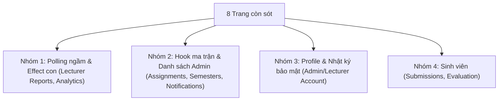

# BẢN TỔNG HỢP & PHÂN CÔNG DEV: KHẮC PHỤC TRIỆT ĐỂ REQUEST THỪA TRÊN 8 TRANG CÒN SÓT

> **Người giao việc:** Tech Lead Thạch (Project Owner) & Antigravity (QA Lead / DevOps)  
> **Người thực hiện:** DEV Frontend Team  
> **Mục tiêu:** Xử lý tận gốc các component con, hook ẩn và polling ngầm đang gây bão request trên 8 trang còn sót, đưa toàn bộ về chuẩn React Query Caching (<10ms, 0 request khi quay lại trang).

---

## I. BẢNG TỔNG HỢP NGUYÊN NHÂN & GIẢI PHÁP CHO TỪNG TRANG



| STT | Route | File nguồn & Vị trí code | Nguyên nhân kỹ thuật phát sinh request | Giải pháp bắt buộc cho DEV |
| :---: | :--- | :--- | :--- | :--- |
| **1** | `/lecturer/reports` | • `hooks/useLecturerReportsQuery.ts` (L119, L127)<br>• `features/lecturer/pages/ReportsView.tsx` (L68-79) | **1.** `useLecturerReportsQuery` đang bật `refetchInterval: 10_000` (polling ngầm mỗi 10 giây bắn 5 request!).<br>**2.** `ReportsView` gọi `semesterReportScheduleService.getSchedules` trong `useEffect`. | **1.** Tắt `refetchInterval` (hoặc chỉ refetch khi có mutation/websocket).<br>**2.** Đưa `getSchedules` vào `useQuery(queryKeys.lecturer.schedules.list({ semesterId }))`. |
| **2** | `/admin/semesters` | • `components/EvidenceDeadlinePanel.tsx` (L33-59)<br>• `components/SchoolAcademicTermsPanel.tsx` (L49-59) | Component con `EvidenceDeadlinePanel` và `SchoolAcademicTermsPanel` bên trong trang đang tự gọi `useEffect` tải hạn nộp và học kỳ trường riêng biệt mỗi lần mở trang. | Chuyển cả 2 panel con sang `useQuery`: <br>• `queryKeys.admin.evidenceDeadline(semesterId)`<br>• `queryKeys.admin.schoolTerms.all`. |
| **3** | `/admin/assignments` | • `hooks/useAdminAssignmentMatrix.ts` (L33-60) | Hook ma trận phân công đang gọi song song 3 API nặng (`getAll` GV, `getAll` SV, `getAll` Phân công) bằng `useEffect` trần trụi, chưa bọc `useQuery`. | Chuyển `useAdminAssignmentMatrix` sang `useQuery(queryKeys.admin.assignments.matrix({ semesterId, departmentId }))` với `staleTime: 5 phút`. |
| **4** | `/admin/notifications` | • `hooks/useAdminNotifications.ts` (L68-93) | Hook `useAdminNotifications` gọi `adminNotificationsService.getCampaigns(100)` trong `useEffect` trần trụi. | Chuyển `fetchCampaigns` sang `useQuery(queryKeys.admin.notifications.list())`, invalidate sau khi gửi broadcast hoặc xóa campaign. |
| **5** | `/admin/account`<br>`/lecturer/account` | • `features/admin/pages/AccountView.tsx` (L173-190)<br>• `features/lecturer/pages/AccountView.tsx` | Mỗi lần vào trang tài khoản, `useEffect` lại gọi `authService.getSessions()` và `authService.getActivity(30)`. | Bọc 2 API này vào `useQuery(queryKeys.auth.sessions())` và `useQuery(queryKeys.auth.activity(userId))` với `staleTime: 5 phút`. |
| **6** | `/student/submissions` | • `features/student/pages/SubmissionsView.tsx` (L224, L264-273) | **1.** `isLoading = submissionsQuery.isFetching` gây chớp nháy loading khi query revalidate.<br>**2.** `useEffect` gọi `getEvidenceDeadline(selectedSemesterId)`. | **1.** Đổi sang `isPending` hoặc `isLoading && !data`.<br>**2.** Đưa `getEvidenceDeadline` vào `useQuery(queryKeys.student.evidenceDeadline(semesterId))`. |
| **7** | `/student/evaluation` | • `features/student/pages/EvaluationView.tsx` (L40-60) | Component `EvidencePhoto` gọi API download từng ảnh minh chứng (`downloadAsset`) bằng `useEffect` riêng cho mỗi ảnh, nộp 3 ảnh là bắn 3 request. | Bọc download asset vào cache hoặc tạo blob cache có khóa `{ submissionId, assetId }` để không tải lại ảnh đã xem. |
| **8** | `/lecturer/analytics` | • `components/LecturerAnalytics.tsx` (L57-118) | Component này bắn **15 requests ngầm** (4 API stats + duyệt N kỳ mỗi kỳ 2 API) hoàn toàn qua `useEffect`. | Đưa toàn bộ vào 2 query: `queryKeys.lecturer.analytics(semesterId)` và `queryKeys.lecturer.analyticsComparison()`. |

---

## II. HƯỚNG DẪN CODE MẪU CHO DEV

### 1. Sửa `frontend/src/hooks/useLecturerReportsQuery.ts` (Triệt tiêu Polling 10s)
```diff
- refetchInterval: 10_000,
- refetchIntervalInBackground: false,
+ // Tắt polling liên tục để tránh spam 5 request mỗi 10 giây; 
+ // dữ liệu sẽ tự làm mới qua invalidation khi có action duyệt bài.
+ refetchInterval: false,
```

### 2. Sửa `frontend/src/hooks/useAdminAssignmentMatrix.ts` (Chuyển sang useQuery)
```typescript
export function useAdminAssignmentMatrix(
  enabled: boolean,
  semesterId?: string | null,
  onError?: (msg: string) => void,
  departmentId?: string | null,
) {
  const query = useQuery({
    queryKey: queryKeys.admin.assignments.matrix({ semesterId: semesterId ?? "all", departmentId: departmentId ?? "all" }),
    enabled,
    staleTime: 5 * 60 * 1000,
    queryFn: async () => {
      const effectiveSemesterId = semesterId === "all" || !semesterId ? undefined : semesterId;
      const effectiveDepartmentId = departmentId === "all" || !departmentId ? undefined : departmentId;
      const [lecturerDtos, studentDtos, allAssignments] = await Promise.all([
        adminLecturersService.getAll(0, 500, effectiveSemesterId, effectiveDepartmentId),
        adminStudentsService.getAll(0, 500, effectiveSemesterId, effectiveDepartmentId),
        adminAssignmentsService.getAll(effectiveSemesterId, effectiveDepartmentId),
      ]);
      const { studentAssignment, lecturerCounts } = buildAssignmentMaps(lecturerDtos, allAssignments);
      return {
        lecturers: lecturerDtos.map((l) => mapLecturerDtoToAssignmentRow(l, lecturerCounts.get(l.id) ?? 0)),
        students: studentDtos.map((s) => mapStudentDtoToAssignmentRow(s, studentAssignment.get(s.id))),
      };
    },
  });

  return {
    lecturers: query.data?.lecturers ?? [],
    students: query.data?.students ?? [],
    isLoading: query.isLoading,
    error: query.error ? getApiErrorMessage(query.error) : null,
    refetch: query.refetch,
    // ...giữ nguyên các state/setter chọn GV
  };
}
```

### 3. Sửa `frontend/src/hooks/useAdminNotifications.ts`
```typescript
export const useAdminNotifications = (): UseAdminNotificationsState => {
  const queryClient = useQueryClient();
  const query = useQuery({
    queryKey: queryKeys.admin.notifications.list(),
    staleTime: 5 * 60 * 1000,
    queryFn: async () => {
      const campaigns = await adminNotificationsService.getCampaigns(100);
      return campaigns.map(mapCampaignToAdminRow);
    },
  });

  const broadcastMutation = useMutation({
    mutationFn: adminNotificationsService.broadcast,
    onSuccess: () => {
      void queryClient.invalidateQueries({ queryKey: queryKeys.admin.notifications.all });
    },
  });

  // ...
};
```

---

## III. TIÊU CHÍ NGHIỆM THU QA (ACCEPTANCE CRITERIA)

1. **Không còn bất kỳ `refetchInterval` tự động nào:** Trừ khi người dùng chủ động bấm nút "Làm mới" hoặc kích hoạt mutation.
2. **Kiểm tra Network chuyển trang:**
   - Điều hướng vòng lặp: `/lecturer/reports` ➔ `/admin/semesters` ➔ `/admin/assignments` ➔ `/admin/notifications` ➔ `/admin/account` ➔ `/student/submissions` ➔ `/student/evaluation` ➔ quay lại `/lecturer/reports`.
   - **Kết quả mong đợi:** Tất cả các trang đã vào ở vòng 1 khi quay lại ở vòng 2 **phải phát sinh 0 request**, thời gian render < 10ms.
3. **TypeScript:** `npm run typecheck` đạt 0 lỗi.
4. **Unit test:** Chạy toàn bộ test suites Vitest PASS 100%.
