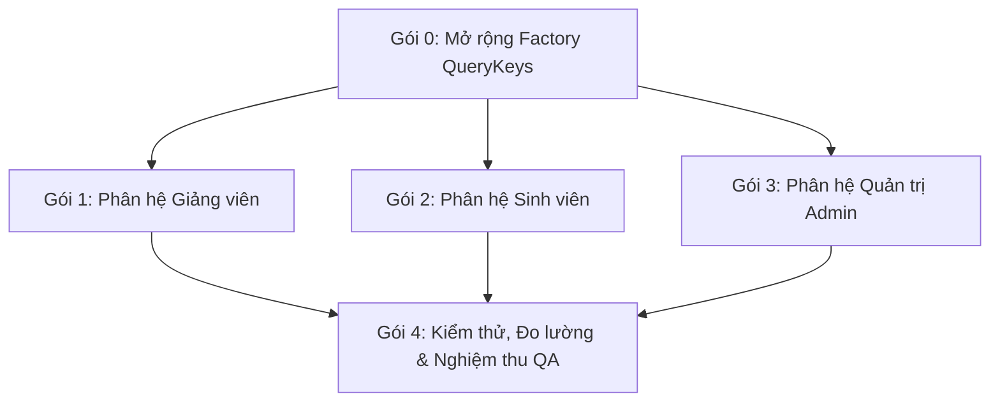

# KẾ HOẠCH CHI TIẾT CHO DEV: TRIỂN KHAI REACT QUERY CACHING & INVALIDATION TOÀN DIỆN CHO CẢ 3 PHÂN HỆ

> **Người giao việc:** Tech Lead Thạch (Project Owner) & Antigravity (QA Lead / DevOps)  
> **Người thực hiện:** DEV Frontend Team  
> **Mục tiêu:** Xóa bỏ 100% hiện tượng gọi lại Backend API khi điều hướng giữa các trang (Navigation), đảm bảo chuyển trang tức thì (<10ms, đọc từ RAM cache), loại bỏ hoàn toàn các `useEffect` fetch dữ liệu trần trụi.

---

## I. NGUYÊN TẮC BẮT BUỘC (DEFINITION OF DONE - DoD)

1. **Không dùng `useEffect` để fetch dữ liệu:** Mọi màn hình đọc dữ liệu từ server PHẢI dùng `useQuery` với query key định nghĩa tập trung trong `frontend/src/lib/queryKeys.ts`.
2. **Cô lập dữ liệu (Cache Isolation):** Mọi query key danh sách phải đóng gói `semesterId` (hoặc `userId`, `departmentId`). Đổi học kỳ hoặc đổi người dùng = đổi key, không bao giờ đọc lẫn lộn dữ liệu cũ.
3. **Kế thừa cấu hình Global:** Tận dụng `staleTime: 5 phút`, `gcTime: 20 phút`, `refetchOnWindowFocus: false` từ `queryClient.ts`.
4. **Invalidation chính xác sau Mutation:** Mọi hành động Thêm / Sửa / Xóa / Nộp / Điểm danh / Chấm điểm PHẢI gọi `queryClient.invalidateQueries({ queryKey: queryKeys.xxx })` để tự động làm mới dữ liệu liên quan.
5. **Tiêu chuẩn kiểm thử:** `npm run typecheck` đạt 0 lỗi, toàn bộ unit test Vitest PASS, không vi phạm ESLint.

---

## II. CHI TIẾT PHÂN CÔNG THEO 4 GÓI CÔNG VIỆC



---

### GÓI 0: MỞ RỘNG FACTORY QUERY KEYS
**File cần sửa:** `frontend/src/lib/queryKeys.ts`

DEV cần bổ sung các namespace còn thiếu vào `queryKeys`:
```typescript
// 1. Phân hệ Giảng viên
lecturer: {
  ...
  history: (semesterId?: string | null) => [...queryKeys.lecturer.all, "history", semesterScope(semesterId)] as const,
  assignedSemesters: (lecturerId?: string | null) => [...queryKeys.lecturer.all, "assigned-semesters", lecturerId ?? "mine"] as const,
  attendance: (params: QueryParams) => [...queryKeys.lecturer.all, "attendance", params] as const,
  summary: (params: QueryParams) => [...queryKeys.lecturer.all, "summary", params] as const,
  templates: (params: QueryParams = {}) => [...queryKeys.lecturer.all, "templates", params] as const,
}

// 2. Phân hệ Sinh viên
student: {
  ...
  attendance: (params: QueryParams = {}) => [...queryKeys.student.all, "attendance", params] as const,
  evaluation: (params: QueryParams = {}) => [...queryKeys.student.all, "evaluation", params] as const,
  internship: (userId?: string | null) => [...queryKeys.student.all, "internship", userId ?? "mine"] as const,
  templates: (params: QueryParams = {}) => [...queryKeys.student.all, "templates", params] as const,
}

// 3. Phân hệ Admin
admin: {
  ...
  attendance: {
    all: ["admin", "attendance"] as const,
    list: (params: QueryParams) => [...queryKeys.admin.attendance.all, "list", params] as const,
    session: (id: string) => [...queryKeys.admin.attendance.all, "session", id] as const,
  },
  reportArchive: {
    all: ["admin", "report-archive"] as const,
    list: (params: QueryParams) => [...queryKeys.admin.reportArchive.all, "list", params] as const,
  },
  departments: {
    all: ["admin", "departments"] as const,
    list: (params: QueryParams = {}) => [...queryKeys.admin.departments.all, "list", params] as const,
  },
  settings: {
    all: ["admin", "settings"] as const,
    data: (params: QueryParams = {}) => [...queryKeys.admin.settings.all, "data", params] as const,
  },
  accountRequests: {
    all: ["admin", "account-requests"] as const,
    list: (params: QueryParams = {}) => [...queryKeys.admin.accountRequests.all, "list", params] as const,
  },
  backups: {
    all: ["admin", "backups"] as const,
    list: (params: QueryParams = {}) => [...queryKeys.admin.backups.all, "list", params] as const,
  }
}
```

---

### GÓI 1: PHÂN HỆ GIẢNG VIÊN (LECTURER)

| Trang | File cần xử lý | Việc cần làm |
| :--- | :--- | :--- |
| **Lịch sử hướng dẫn** | `frontend/src/features/lecturer/pages/LecturerHistoryView.tsx` | • Thay thế `useEffect` gọi `getAssignedSemesters()` bằng `useQuery(queryKeys.lecturer.assignedSemesters())`.<br>• Thay thế `getSemesterHistory(semesterId)` bằng `useQuery(queryKeys.lecturer.history(semesterId))`.<br>• Nút Thử lại: gọi `queryClient.invalidateQueries`. |
| **Quản lý điểm danh** | `frontend/src/features/lecturer/pages/AttendanceManagementView.tsx` | • Đổi `loadSessions()` thành `useQuery(queryKeys.lecturer.attendance({ semesterId }))`.<br>• Đổi `loadAssignedStudents()` thành `useQuery(queryKeys.lecturer.students.list({ semesterId }))`.<br>• Sau khi tạo/sửa/xóa/chấm điểm: Invalidate query `attendance`. |
| **Phiếu chấm & Tiêu chí** | `frontend/src/features/lecturer/pages/InternshipEvaluationView.tsx` | • Chuyển các lệnh fetch tiêu chí, danh sách sinh viên chấm điểm sang `useQuery(queryKeys.lecturer.evaluations.list({ semesterId }))`.<br>• Sau khi lưu nháp/chốt điểm: Invalidate evaluation và portal stats. |
| **Tổng kết kỳ thực tập** | `frontend/src/features/lecturer/pages/SummaryView.tsx` | • Đổi fetch danh sách sinh viên tổng kết sang `useQuery(queryKeys.lecturer.summary({ semesterId }))`.<br>• Invalidate sau khi cập nhật ghi chú sinh viên. |
| **Biểu mẫu & Thông báo** | `TemplatesView.tsx`, `NotificationsView.tsx` | • Chuyển fetch danh sách biểu mẫu và thông báo sang `useQuery`. |

---

### GÓI 2: PHÂN HỆ SINH VIÊN (STUDENT)

| Trang | File cần xử lý | Việc cần làm |
| :--- | :--- | :--- |
| **Lịch sử điểm danh** | `frontend/src/features/student/pages/StudentAttendanceView.tsx` | • Chuyển `studentAttendanceService.getAttendanceHistory()` sang `useQuery(queryKeys.student.attendance.list())`.<br>• Cache 5 phút, bấm F5 hoặc chuyển trang lấy ngay từ RAM. |
| **Kết quả đánh giá** | `frontend/src/features/student/pages/EvaluationView.tsx` | • Chuyển các lời gọi `getEvaluation()` và `getCriteria()` sang `useQuery(queryKeys.student.evaluation.detail())`. |
| **Thông tin thực tập** | `frontend/src/features/student/pages/InternshipView.tsx` | • Chuyển `studentInternshipService.getMyInternship()` sang `useQuery(queryKeys.student.internship.detail(userId))`. |
| **Chi tiết báo cáo tuần** | `frontend/src/features/student/pages/WeeklyReportsView.tsx` | • Tái sử dụng hook `useStudentWeeklyReportsQuery` hoặc `useWeeklyReports` đã có cache.<br>• Invalidate sau khi sinh viên nộp báo cáo tuần mới. |
| **Phản hồi & Biểu mẫu** | `FeedbackView.tsx`, `TemplatesView.tsx`, `NotificationsView.tsx` | • Chuyển sang `useQuery` tương ứng trong namespace `student`. |

---

### GÓI 3: PHÂN HỆ QUẢN TRỊ ADMIN

| Trang | File cần xử lý | Việc cần làm |
| :--- | :--- | :--- |
| **Điểm danh toàn trường** | `frontend/src/features/admin/pages/AttendanceView.tsx` | • Chuyển fetch điểm danh theo kỳ/khoa sang `useQuery(queryKeys.admin.attendance.list({ semesterId, departmentId }))`. |
| **Lưu trữ báo cáo** | `frontend/src/features/admin/pages/ReportArchiveView.tsx` | • Chuyển `reportArchiveService.getArchives()` sang `useQuery(queryKeys.admin.reportArchive.list({ semesterId }))`. |
| **Yêu cầu tài khoản** | `frontend/src/features/admin/pages/AccountRequestsView.tsx` | • Chuyển danh sách phê duyệt sang `useQuery(queryKeys.admin.accountRequests.list())`.<br>• Invalidate sau khi Duyệt / Từ chối yêu cầu. |
| **Khoa / Bộ môn** | `frontend/src/features/admin/pages/DepartmentsView.tsx` | • Chuyển fetch danh sách khoa sang `useQuery(queryKeys.admin.departments.list())`.<br>• Invalidate khi thêm/sửa khoa. |
| **Cài đặt & Sao lưu** | `SettingsView.tsx`, `BackupsView.tsx`, `TemplatesView.tsx` | • Chuyển các API fetch cấu hình, backup, biểu mẫu sang `useQuery`. |

---

## III. QUY TRÌNH KIỂM CHỨNG & TIÊU CHÍ NGHIỆM THU (QA CRITERIA)

DEV sau khi hoàn thành từng gói cần thực hiện tự kiểm tra:
1. **Kiểm tra mã nguồn:**
   ```bash
   npm run typecheck
   npx eslint <danh_sách_file_đã_sửa>
   ```
2. **Kiểm tra Unit Test:**
   ```bash
   npx vitest run --maxWorkers=1
   ```
3. **Kiểm chứng Network trên Browser (Tiêu chí then chốt):**
   - Đăng nhập tài khoản Giảng viên ➔ vào `/lecturer/dashboard` ➔ sang `/lecturer/history` ➔ quay lại `/lecturer/dashboard` ➔ sang lại `/lecturer/history`.
   - **Yêu cầu:** Ở lần quay lại thứ hai, tab Network **KHÔNG ĐƯỢC PHÉP** xuất hiện thêm bất kỳ HTTP GET request nào đến `/api/lecturer/history/...` hay `/api/lecturer/portal/...`.
   - Lặp lại quy trình tương tự với tài khoản Sinh viên (`/student/dashboard` ➔ `/student/attendance` ➔ `/student/dashboard`) và Admin.

---
**Hạn chót hoàn thành:** DEV tiến hành theo thứ tự Gói 0 ➔ Gói 1 ➔ Gói 2 ➔ Gói 3.  
Báo cáo lại kết quả cho Tech Lead Thạch và QA Lead Antigravity ngay sau khi xong từng gói.
