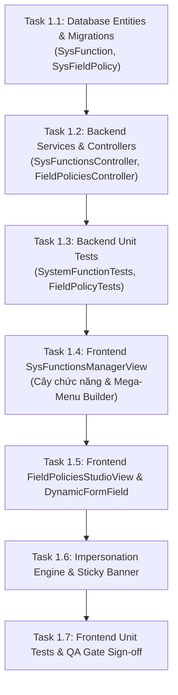

# KẾ HOẠCH TRIỂN KHAI KỸ THUẬT: GIAI ĐOẠN 1
## SUPERADMIN UI CONFIGURATION ENGINE (BẢN DÀNH CHO DEVELOPER)

**Mã tài liệu:** `PLAN-PHASE-1-SUPERADMIN-ENGINE`  
**Phiên bản:** `1.0.0-PROD`  
**Phê duyệt bởi:** Technical Architect & QA Lead  
**Thời gian áp dụng:** Ngay lập tức  
**Phạm vi:** Backend .NET 10 (Clean Architecture) & Frontend React 19 + TypeScript  

---

## 1. TỔNG QUAN VÀ MỤC TIÊU GIAI ĐOẠN 1

Giai đoạn 1 xây dựng nền tảng **Cấu hình Động Toàn diện (Zero-Hardcoding UI Engine)** cho phép tài khoản Quản trị Cấp cao nhất (`SuperAdmin`) có toàn quyền cấu hình, điều phối và mô phỏng giao diện cho toàn bộ hệ thống B2B SaaS InternLink mà không phải sửa source code hay deploy lại:

```
┌─────────────────────────────────────────────────────────────────────────────┐
│                       SUPERADMIN UI CONFIGURATION ENGINE                    │
├───────────────────┬───────────────────┬─────────────────┬───────────────────┤
│  [1.1] Tree Menu  │  [1.2] Dynamic    │ [1.3] Matrix    │ [1.4] Field       │
│  & Function Studio│  Grid Studio (DONE│ Permission (DONE│ Policy Engine     │
│  SysFunction      │  SysGridConfig    │ SysPermission   │ SysFieldPolicy    │
├───────────────────┴───────────────────┴─────────────────┴───────────────────┤
│                     [1.5] ROLE IMPERSONATION STUDIO                         │
│         Chuyển đổi góc nhìn trực quan (Admin Khoa / GV / DN / SV)           │
└─────────────────────────────────────────────────────────────────────────────┘
```

### 1.1. Tình trạng hiện tại (Trạng thái Bàn giao)
- ✅ **Step 1.2 (Grid Studio)**: Đã hoàn thành bảng `SysGridConfig` mở rộng (`RoleId`, `TenantId`, `FrozenSide`), controller API và giao diện [GridConfigStudioView.tsx](file:///e:/Downloads/InternLink/frontend/src/features/admin/views/GridConfigStudioView.tsx).
- ✅ **Step 1.3 (Permission Matrix)**: Đã hoàn thành giao diện [PermissionMatrixView.tsx](file:///e:/Downloads/InternLink/frontend/src/features/admin/views/PermissionMatrixView.tsx) với chức năng chọn tất cả dòng/cột.
- ⏳ **Hạng mục cần Dev triển khai tiếp**:
  - **Task 1.1**: Quản lý Cây Chức năng & Menu Studio (`SysFunction` Tree Drag-and-Drop).
  - **Task 1.4**: Dynamic Form Engine & Chính sách trường dữ liệu (`SysFieldPolicy`).
  - **Task 1.5**: Role Impersonation Studio (Mô phỏng góc nhìn người dùng).

---

## 2. KIẾN TRÚC DỮ LIỆU CHI TIẾT (DATABASE ENTITIES & MIGRATION)

Tất cả các bảng bắt buộc kế thừa `BaseEntity` (Dual-key: `AutoId` BIGINT PK Clustered + `PublicId` GUID AK, Soft-delete và Audit fields đầy đủ).

### 2.1. Bảng `Sys_Functions` (Entity: `InternLink.Domain.Entities.Rbac.SysFunction`)
Entity `SysFunction` đã có sẵn trong codebase tại `InternLink.Domain.Entities.Rbac.SysFunction` với cấu trúc cha-con (`ParentId`, `Children`), `Code`, `Name`, `ModuleCode`, `SortOrder`, `IsAction`, `IsActive`.
Để phục vụ trọn vẹn Mega-Menu Builder và Studio quản trị chức năng theo chuẩn TKS_V11, Dev mở rộng thêm các thuộc tính:

```csharp
namespace InternLink.Domain.Entities.Rbac;

public class SysFunction : BaseEntity
{
    // === CÁC THUỘC TÍNH ĐÃ CÓ SẴN TRONG CODEBASE ===
    public string Code { get; set; } = null!; // Mã chuẩn F1001..F1047 hoặc PermissionCode
    public string Name { get; set; } = null!; // Tên hiển thị tiếng Việt
    public string ModuleCode { get; set; } = null!; // 6 Nhóm: "SYSTEM", "STUDENT", "LECTURER", "COMPANY", "EVALUATION", "ACCREDITATION"
    public string? Description { get; set; }
    public long? ParentId { get; set; }
    public SysFunction? Parent { get; set; }
    public ICollection<SysFunction> Children { get; set; } = new List<SysFunction>();
    public ICollection<SysRolePermission> RolePermissions { get; set; } = new List<SysRolePermission>();
    public int SortOrder { get; set; }
    public bool IsAction { get; set; }
    public bool IsActive { get; set; } = true;

    // === THUỘC TÍNH MỞ RỘNG MỚI CHO GIAI ĐOẠN 1 ===
    public string? FuncUrl { get; set; } // Đường dẫn FE (e.g. "/admin/smart-import")
    public string? IconName { get; set; } = "Folder"; // Tên icon Lucide
    public string? BadgeText { get; set; } // "Mới", "Beta", "Hot"
    public bool IsVisibleInMenu { get; set; } = true; // Trạng thái hiển thị trên Mega-Menu
    
    // Cờ quyền mặc định của chức năng (Quy chuẩn TKS_V11)
    public bool IsView { get; set; } = true;
    public bool IsNew { get; set; } = true;
    public bool IsEdit { get; set; } = true;
    public bool IsDelete { get; set; } = true;
    public bool IsExport { get; set; } = true;
}
```

*Cấu hình Fluent API trong `AppDbContext.cs`:*
- Đã có Index duy nhất và Self-referencing FK trong Migration `Add_Dynamic_RBAC_Core`.
- Khi bổ sung thuộc tính mới, Dev chỉ cần chạy lệnh `dotnet ef migrations add AddMenuAttributesToSysFunctions`.

### 2.2. Bảng `Sys_Field_Policies` (Entity: `SysFieldPolicy`)
Lưu trữ chính sách hiển thị, bắt buộc và chỉ đọc của từng trường trong từng Form động theo vai trò người dùng.

```csharp
namespace InternLink.Domain.Entities;

public class SysFieldPolicy : BaseEntity
{
    public string FormCode { get; set; } = string.Empty; // e.g. "FORM_STUDENT_PROFILE", "FORM_EVALUATION"
    public string FieldKey { get; set; } = string.Empty; // e.g. "Gpa", "CompanyTaxCode", "FinalScore"
    public long? RoleId { get; set; } // null = Áp dụng mặc định cho tất cả vai trò
    public SysRole? Role { get; set; }

    public bool IsVisible { get; set; } = true;
    public bool IsRequired { get; set; } = false;
    public bool IsReadOnly { get; set; } = false;

    public string? CustomLabel { get; set; } // Nhãn tiếng Việt ghi đè (nếu Khoa/Trường muốn gọi khác đi)
    public string? DefaultValue { get; set; } // Giá trị mặc định (JSON hoặc Text)
    public string? ValidationRegex { get; set; } // Regex kiểm tra hợp lệ tùy biến
    public string? ErrorMessage { get; set; } // Thông báo lỗi khi regex sai
    public int SortOrder { get; set; } = 0;
}
```

*Cấu hình Fluent API:*
- Composite Unique Index: `(FormCode, FieldKey, RoleId)` với Filter `[IsDeleted] = 0`.

---

## 3. BACKEND API SPECIFICATIONS (.NET 10)

Tất cả các Controller dưới đây đặt trong `InternLink.API/Controllers/System/` và bắt buộc có attribute:
`[Authorize(Roles = "SuperAdmin")]` (hoặc Policy phân quyền tương đương).

### 3.1. Chức năng Quản lý Cây Chức năng (`SysFunctionsController`)
Route: `/api/v1/system/functions`

| Method | Endpoint | Mô tả | Request Body / Params | Response |
| :--- | :--- | :--- | :--- | :--- |
| `GET` | `/tree` | Lấy toàn bộ cây chức năng phân cấp | `?includeHidden=true/false` | `List<SysFunctionTreeDto>` |
| `GET` | `/{id}` | Lấy chi tiết 1 chức năng theo PublicId | URL parameter `id` (GUID) | `SysFunctionDetailDto` |
| `POST` | `/` | Tạo mới chức năng | `CreateSysFunctionRequest` | `SysFunctionDetailDto` (201 Created) |
| `PUT` | `/{id}` | Cập nhật thông tin chức năng | `UpdateSysFunctionRequest` | `SysFunctionDetailDto` |
| `DELETE`| `/{id}` | Xóa mềm chức năng | URL parameter `id` (GUID) | 204 No Content |
| `PUT` | `/reorder` | Sắp xếp lại thứ tự / cha-con hàng loạt | `ReorderFunctionsRequest` | 200 OK |

**DTO Cây Chức Năng (`SysFunctionTreeDto`):**
```csharp
public record SysFunctionTreeDto(
    Guid Id,
    long AutoId,
    string MaChucNang,
    string TenChucNang,
    long? ParentId,
    string ModuleGroup,
    int SortPriority,
    string FuncUrl,
    string IconName,
    string? BadgeText,
    bool IsVisibleInMenu,
    bool IsView,
    bool IsNew,
    bool IsEdit,
    bool IsDelete,
    bool IsExport,
    List<SysFunctionTreeDto> Children
);

public record ReorderFunctionsRequest(
    List<FunctionReorderItem> Items
);

public record FunctionReorderItem(
    Guid Id,
    long? NewParentId,
    int NewSortPriority
);
```

### 3.2. Chức năng Cấu hình Chính sách Trường (`SysFieldPoliciesController`)
Route: `/api/v1/system/field-policies`

| Method | Endpoint | Mô tả | Request Body / Params | Response |
| :--- | :--- | :--- | :--- | :--- |
| `GET` | `/{formCode}` | Lấy chính sách trường cho 1 form theo role | `?roleId={roleId}` | `List<SysFieldPolicyDto>` |
| `PUT` | `/{formCode}` | Cập nhật danh sách chính sách trường | `UpsertFieldPoliciesRequest` | `List<SysFieldPolicyDto>` |

### 3.3. Endpoint Hỗ trợ Impersonation (`SystemImpersonationController`)
Route: `/api/v1/system/impersonation`

| Method | Endpoint | Mô tả | Response |
| :--- | :--- | :--- | :--- |
| `GET` | `/available-targets` | Lấy danh sách Vai trò & Tài khoản mẫu có thể mô phỏng | `List<ImpersonationTargetDto>` |
| `POST`| `/token` | Cấp token mô phỏng có thời hạn (hoặc trả thông tin ngữ cảnh) | `ImpersonationContextDto` |

---

## 4. FRONTEND UI & INTERACTION SPECIFICATIONS (REACT 19)

### 4.1. Quy tắc Thiết kế Bắt buộc (Design Law & UI Tokens)
- **Primary Color:** `#026aa7` (Blue 700), Hover: `#025a8e` (Blue 800)
- **Success Color:** `#7bc043` (Green 600)
- **Cấm Tuyệt Đối:** `indigo-*`, `violet-*`, `emerald-*`, `blue-600`
- **Container chuẩn:** `mx-auto max-w-[1300px] p-6`
- **Card chuẩn:** `rounded-xl border border-slate-200/90 bg-white p-6 shadow-2xs`
- **Ngôn ngữ:** 100% Tiếng Việt thân thiện với nghiệp vụ đào tạo đại học.

---

### 4.2. Màn hình 1: Quản trị Cây Chức năng & Menu Builder (`SysFunctionsManagerView.tsx`)
**Đường dẫn file:** `frontend/src/features/admin/views/SysFunctionsManagerView.tsx`

#### Layout & Tính năng cốt lõi:
1. **Header:** 
   - Tiêu đề: `"Quản lý Danh mục Chức năng & Cấu trúc Mega-Menu"`
   - Nút hành động: `"+ Thêm chức năng mới"`, `"Lưu cấu trúc thứ tự"`, `"Tải lại cây"`.
2. **Khu vực hiển thị Cây (Tree View 2 cột):**
   - **Cột trái (60%):** Cây chức năng phân cấp theo 6 Nhóm Module (Hệ thống, Sinh viên, Giảng viên, Doanh nghiệp, Đánh giá, Khảo thí).
     - Mỗi nút hiển thị: Icon, `MaChucNang` (tag xám nhạt `bg-slate-100 font-mono`), `TenChucNang`, Badge trạng thái hiển thị trên Menu (`Hiển thị` màu `#7bc043`, `Ẩn` màu `#94a3b8`).
     - Hỗ trợ nút mũi tên `Lên / Xuống` hoặc kéo thả (Drag-and-Drop) để đổi `SortPriority` và cấp `Parent`.
   - **Cột phải (40% - Detail Drawer/Panel):** Form biên tập nhanh chức năng đang chọn:
     - `Mã chức năng` (Readonly khi edit, ví dụ `F1001`)
     - `Tên chức năng` (Input)
     - `Nhóm Module` (Select 6 module)
     - `Đường dẫn (URL)` (Input, ví dụ `/admin/smart-import`)
     - `Icon Lucide` (Dropdown chọn icon có preview trực quan)
     - `Huy hiệu (Badge)` (Input: "Mới", "Beta"...)
     - `Checkboxes quyền khả dụng`: [x] Xem, [x] Thêm, [x] Sửa, [x] Xóa, [x] Xuất dữ liệu
     - `Checkbox`: [x] Hiển thị trên Mega-Menu

---

### 4.3. Màn hình 2: Dynamic Field Policies Studio (`FieldPoliciesStudioView.tsx`)
**Đường dẫn file:** `frontend/src/features/admin/views/FieldPoliciesStudioView.tsx`

#### Layout & Tính năng:
1. **Thanh chọn Form & Vai trò:**
   - Dropdown `Chọn Biểu Mẫu`:
     - `FORM_STUDENT_PROFILE` (Hồ sơ sinh viên)
     - `FORM_COMPANY_REGISTRATION` (Phiếu tiếp nhận doanh nghiệp)
     - `FORM_WEEKLY_REPORT` (Phiếu nộp báo cáo tuần)
     - `FORM_EMPLOYER_EVALUATION` (Phiếu đánh giá thực tập của doanh nghiệp)
   - Dropdown `Chọn Vai Trò Áp Dụng`: `Tất cả (Mặc định)`, `Admin Khoa`, `Giảng viên`, `Doanh nghiệp`, `Sinh viên`.
2. **Bảng cấu hình chính sách trường:**
   - Cột: `Mã trường`, `Tên gốc`, `Tên ghi đè (Tiếng Việt)`, `Hiển thị (Visible)`, `Bắt buộc (Required)`, `Chỉ đọc (Readonly)`, `Quy tắc Regex`, `Thao tác`.
   - Toggle switch nhanh cho 3 thuộc tính: *Ẩn/Hiện*, *Bắt buộc*, *Chỉ đọc*.

#### Component Tái sử dụng: `<DynamicFormField />`
**Đường dẫn file:** `frontend/src/components/common/DynamicFormField.tsx`
- Tự động đọc chính sách từ API (hoặc cache context).
- Nếu `IsVisible == false` -> Không render DOM.
- Nếu `IsRequired == true` -> Thêm dấu sao đỏ `*` và validate form bắt buộc.
- Nếu `IsReadOnly == true` -> Render ô input disabled với giao diện xám nhạt chống sửa.

---

### 4.4. Màn hình 3 & Engine: Role Impersonation Studio
**Đường dẫn file:** 
- `frontend/src/context/ImpersonationContext.tsx`
- `frontend/src/features/admin/components/SuperAdminImpersonationBanner.tsx`

#### Cơ chế hoạt động:
1. **Banner Cảnh báo Ghim Đầu Trang (Top Sticky Warning Banner):**
   - Khi SuperAdmin kích hoạt mô phỏng một vai trò:
     - Banner màu vàng hổ phách (`bg-amber-500 text-slate-900 border-b border-amber-600 font-medium py-2 px-4 flex items-center justify-between z-50 sticky top-0`).
     - Nội dung: *"⚡ CHẾ ĐỘ MÔ PHỎNG: Bạn đang xem giao diện với tư cách [Giảng viên Hướng dẫn: TS. Nguyễn Văn A]. Toàn bộ dữ liệu và menu hiển thị theo quyền của vai trò này."*
     - Nút bấm: `[Thoát chế độ mô phỏng]` màu trắng viền đen, lập tức hoàn trả giao diện SuperAdmin gốc.
2. **Tác động lên Client & API:**
   - Client lưu `impersonatedRole` trong `sessionStorage`.
   - `apiClient.ts` tự động chèn HTTP Header: `X-Impersonate-Role: Lecturer` (hoặc `Student`, `Employer`).
   - Mega-Menu và các trang tự động hiển thị đúng tập menu và grid layout đã cấu hình cho vai trò đó.

---

## 5. LỘ TRÌNH TRIỂN KHAI CHO DEVELOPER (TASK BY TASK)



### Chi tiết từng Task:

#### **Task 1.1: Tạo Entities & EF Core Migration (Backend)**
- [ ] Tạo `SysFunction.cs` trong `InternLink.Domain/Entities/`.
- [ ] Tạo `SysFieldPolicy.cs` trong `InternLink.Domain/Entities/`.
- [ ] Khai báo `DbSet<SysFunction>` và `DbSet<SysFieldPolicy>` trong `AppDbContext.cs`.
- [ ] Cấu hình Fluent API (Unique Index với filter soft-delete, Self-referencing FK).
- [ ] Chạy lệnh `dotnet ef migrations add AddSysFunctionsAndFieldPolicies` và kiểm tra `HasPendingModelChanges() == false`.

#### **Task 1.2: Xây dựng Service & Controller (Backend)**
- [ ] Tạo `ISysFunctionService.cs` và `SysFunctionService.cs` (CRUD, dựng Tree, Reorder).
- [ ] Viết Data Seeder cho các chức năng chuẩn từ `F1001` đến `F1047` theo tài liệu TKS_V11.
- [ ] Tạo `SysFunctionsController.cs` với các action: `GetTree`, `GetById`, `Create`, `Update`, `Delete`, `Reorder`.
- [ ] Tạo `ISysFieldPolicyService.cs` và `SysFieldPoliciesController.cs`.

#### **Task 1.3: Viết Backend Unit Tests**
- [ ] Tạo `SystemFunctionServiceTests.cs` (tối thiểu 8 test cases: CRUD, phân cấp cha con, reorder đổi SortPriority, ngăn vòng lặp cha-con).
- [ ] Tạo `FieldPolicyServiceTests.cs` (tối thiểu 5 test cases: Lấy policy theo role, fallback về default, upsert chính sách).
- [ ] Chạy `dotnet test` đảm bảo 100% tests pass.

#### **Task 1.4: Xây dựng Giao diện Cây Chức năng (Frontend)**
- [ ] Tạo API client wrapper trong `frontend/src/api/systemFunctionsApi.ts`.
- [ ] Viết component `SysFunctionsManagerView.tsx` với Tree navigation và Drawer sửa nhanh.
- [ ] Kết nối `AdminMegaMenu.tsx` để render các mục menu theo dữ liệu động từ API `SysFunction` (kèm fallback tĩnh nếu chưa có mạng).
- [ ] Thêm route `/admin/functions` vào hệ thống định tuyến Admin.

#### **Task 1.5: Xây dựng Field Policies Studio & Dynamic Component (Frontend)**
- [ ] Tạo `FieldPoliciesStudioView.tsx` trong `features/admin/views/`.
- [ ] Tạo component `<DynamicFormField />` trong `components/common/`.
- [ ] Áp dụng thử nghiệm trên 1 form mẫu (`FORM_COMPANY_REGISTRATION` hoặc `FORM_WEEKLY_REPORT`).

#### **Task 1.6: Xây dựng Role Impersonation Engine (Frontend & Backend)**
- [ ] Tạo `ImpersonationContext.tsx` quản lý trạng thái giả lập.
- [ ] Tạo `SuperAdminImpersonationBanner.tsx` ghim cố định ở đầu trang khi đang mô phỏng.
- [ ] Thêm nút `"Mô phỏng góc nhìn"` trên thanh header của SuperAdmin.

#### **Task 1.7: Viết Frontend Unit Tests & Chạy QA Gate**
- [ ] Tạo `SysFunctionsManagerView.test.tsx` (tối thiểu 4 tests: Render cây, tìm kiếm, mở modal tạo mới, đổi thứ tự).
- [ ] Tạo `FieldPoliciesStudioView.test.tsx` (tối thiểu 3 tests).
- [ ] Tạo `SuperAdminImpersonation.test.tsx` (tối thiểu 3 tests: Bật banner, chèn header, thoát chế độ).
- [ ] Chạy quét màu cấm `indigo|violet`.
- [ ] Chạy `npm run test` và `npm run build`.

---

## 6. TIÊU CHUẨN NGHIỆM THU QA (ACCEPTANCE CRITERIA)

Một Task chỉ được coi là **DONE** khi đáp ứng đầy đủ các tiêu chí:

1. **Backend Tests:** Tất cả test mới và 420 test hiện có phải **100% PASSED**.
2. **Frontend Tests:** Tất cả test mới và 176 test hiện có phải **100% PASSED**.
3. **Build:** `npm run build` không phát sinh lỗi hoặc cảnh báo gãy bundle.
4. **Zero-Hardcoding:** Không có danh mục menu hoặc quy tắc trường nào bị fix cứng trong JSX/TSX.
5. **Brand Compliance:** 100% tuân thủ bảng màu `#026aa7`, không sót bất kỳ class màu cấm nào.
6. **Bilingual Rule:** UI hiển thị tiếng Việt chuẩn mực, code comment và commit message chuẩn tiếng Anh chuyên nghiệp.
