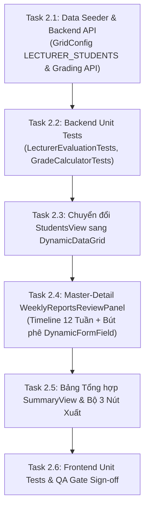

# KẾ HOẠCH TRIỂN KHAI KỸ THUẬT: GIAI ĐOẠN 2
## LECTURER WORKSPACE & EVALUATION ENGINE
### (PHÂN HỆ GIẢNG VIÊN HƯỚNG DẪN & ĐÁNH GIÁ THỰC TẬP ĐỒNG BỘ)

**Mã tài liệu:** `PLAN-PHASE-2-LECTURER-WORKSPACE`  
**Phiên bản:** `1.0.0-PROD`  
**Phê duyệt bởi:** Technical Architect & QA Lead  
**Thời gian áp dụng:** Ngay sau khi nghiệm thu Giai đoạn 1  
**Phạm vi:** Backend .NET 10 & Frontend React 19 + TypeScript  

---

## 1. MỤC TIÊU VÀ BỐI CẢNH GIAI ĐOẠN 2

Giai đoạn 2 chuyển đổi toàn diện Phân hệ Giảng viên (`Lecturer Workspace`) từ mô hình giao diện tĩnh sang **mô hình vận hành động kế thừa hoàn toàn từ SuperAdmin Configuration Engine** đã xây dựng ở Giai đoạn 1:

```
┌─────────────────────────────────────────────────────────────────────────────┐
│                      GIAI ĐOẠN 2: LECTURER WORKSPACE ENGINE                 │
├───────────────────┬───────────────────┬─────────────────┬───────────────────┤
│  [2.1] Grid Động  │ [2.2] Master-     │ [2.3] Đánh giá  │ [2.4] Xuất Bộ 3   │
│  Sinh viên Hướng  │ Detail Bút phê    │ Cuối kỳ 3 Bên   │ Báo cáo Kiểm định │
│  dẫn (Role Grid)  │ Báo cáo 12 Tuần   │ Quy chế Đào tạo │ (ZIP / XLS / DOC) │
├───────────────────┴───────────────────┴─────────────────┴───────────────────┤
│                 TÍCH HỢP NỀN TẢNG CẤU HÌNH SUPERADMIN ĐÃ CÓ:                │
│    SysGridConfig  │  SysFieldPolicy   │  SysGradingRuleSet │ SysFunction RBAC│
└─────────────────────────────────────────────────────────────────────────────┘
```

### Yêu cầu cốt lõi:
1. **Áp dụng Grid Studio:** Màn hình danh sách sinh viên thực tập của Giảng viên phải hiển thị theo `SysGridConfig` dành cho Role `Lecturer` (ghim cột STT, Mã SV, Họ tên bên trái, ẩn/hiện cột động theo cấu hình Khoa/Trường).
2. **Master-Detail Bút phê Báo cáo Tuần:** Giao diện theo dõi 12-15 tuần thực tập trực quan, xem tài liệu nộp (PDF preview) và biểu mẫu chấm điểm áp dụng `<DynamicFormField />` theo `SysFieldPolicy`.
3. **Bộ máy Tính điểm Đồng bộ:** Tích hợp trực tiếp `SysGradingRuleSet` (trọng số điểm DN, điểm GV, điểm Báo cáo cuối kỳ), loại bỏ triệt để hardcode 40/60 hay 50/50.
4. **Bộ 3 Báo cáo Kiểm định Thương mại:** Chuẩn hóa xuất báo cáo (Hồ sơ ZIP, Bảng điểm Excel, Báo cáo Word) có phân quyền `CanExport`.

---

## 2. THIẾT KẾ KIẾN TRÚC KỸ THUẬT & API CONTRACTS

### 2.1. Cấu hình Grid Mặc định cho Giảng viên (`LECTURER_STUDENTS`)
Dev bổ sung Seed cấu hình Grid mặc định cho màn hình sinh viên của Giảng viên trong `SystemRbacSeeder.cs`:

- **ScreenCode:** `LECTURER_STUDENTS`
- **RoleId:** Gắn với Role `Lecturer` (và bản ghi fallback `RoleId = null`)
- **FrozenSide:** `"left"` (Ghim bên trái: `studentCode`, `fullName`)
- **Default Columns:**
  - `studentCode`: "Mã sinh viên" (w: 120px, pinned: left, visible: true)
  - `fullName`: "Họ và tên" (w: 180px, pinned: left, visible: true)
  - `className`: "Lớp sinh hoạt" (w: 110px, visible: true)
  - `companyName`: "Doanh nghiệp thực tập" (w: 200px, visible: true)
  - `progressWeeks`: "Tiến độ báo cáo" (w: 130px, visible: true)
  - `employerScore`: "Điểm DN" (w: 100px, visible: true)
  - `lecturerScore`: "Điểm GV" (w: 100px, visible: true)
  - `finalGrade`: "Điểm tổng kết" (w: 110px, visible: true)
  - `actions`: "Thao tác" (w: 140px, pinned: right, visible: true)

### 2.2. Backend APIs Mở rộng (.NET 10)
Tất cả các endpoint đặt trong `InternLink.API/Controllers/Lecturer/` hoặc `InternLink.API/Controllers/Grading/` với `[Authorize(Roles = "Lecturer,SuperAdmin")]`:

| Method | Endpoint | Mô tả | Request / Query | Response DTO |
| :--- | :--- | :--- | :--- | :--- |
| `GET` | `/api/v1/lecturer/students` | Lấy danh sách SV có phân trang kèm thông tin điểm & tiến độ | `?semesterId=&keyword=&page=&pageSize=` | `PagedResult<LecturerAssignedStudentDto>` |
| `GET` | `/api/v1/lecturer/students/{studentId}/timeline` | Lấy tiến độ 12 tuần và chi tiết nộp báo cáo của 1 SV | URL param `studentId` (GUID) | `StudentWeeklyTimelineDto` |
| `POST`| `/api/v1/lecturer/weekly-reports/{reportId}/grade` | Chấm điểm & ghi nhận xét báo cáo tuần | `GradeWeeklyReportRequest` | `WeeklyReportEvaluationDto` |
| `GET` | `/api/v1/lecturer/evaluations/summary` | Bảng tổng hợp điểm thực tập cả đợt của các SV phụ trách | `?semesterId=` | `LecturerEvaluationSummaryDto` |
| `POST`| `/api/v1/lecturer/evaluations/finalize` | Chốt sổ điểm học kỳ (Khóa không cho sửa trừ khi Admin mở lại) | `FinalizeGradingSessionRequest` | `GradingSessionStatusDto` |

**DTO Cấu trúc Timeline Tuần (`StudentWeeklyTimelineDto`):**
```csharp
public record StudentWeeklyTimelineDto(
    Guid StudentId,
    string StudentCode,
    string FullName,
    string CompanyName,
    string? MentorName,
    int TotalWeeks,
    int SubmittedWeeks,
    int ApprovedWeeks,
    decimal? AverageWeeklyScore,
    List<WeeklyReportItemDto> Weeks
);

public record WeeklyReportItemDto(
    int WeekNumber,
    string Title,
    DateTimeOffset DueDate,
    string Status, // "NotSubmitted", "Submitted", "Approved", "Rejected", "Late"
    DateTimeOffset? SubmittedAt,
    string? ReportContent,
    List<ReportAttachmentDto> Attachments,
    decimal? Score,
    string? Feedback,
    DateTimeOffset? GradedAt
);

public record GradeWeeklyReportRequest(
    decimal Score,
    string? Feedback,
    bool IsApproved
);
```

### 2.3. Quy tắc Tính điểm Chuẩn Bộ GD&ĐT (`InternshipGradeCalculator.cs`)
Tích hợp trực tiếp bảng `SysGradingRuleSet` (được cấu hình bởi SuperAdmin/Admin khoa):
- **Trọng số điểm:**
  $$\text{FinalScore} = (\text{EmployerScore} \times W_{DN}) + (\text{WeeklyReportsAvg} \times W_{BC}) + (\text{FinalDefenseScore} \times W_{CK})$$
  *(Với điều kiện $W_{DN} + W_{BC} + W_{CK} = 100\%$)*
- **Quy đổi Thang 4 & Điểm chữ (Quy chế 43/2007 & TT 08/2021 Bộ GD&ĐT):**
  - $8.5 - 10.0 \rightarrow 4.0$ (A - Xuất sắc / Giỏi)
  - $7.0 - 8.4 \rightarrow 3.0$ (B - Khá)
  - $5.5 - 6.9 \rightarrow 2.0$ (C - Trung bình)
  - $4.0 - 5.4 \rightarrow 1.0$ (D - Trung bình yếu)
  - $< 4.0 \rightarrow 0.0$ (F - Không đạt / Học lại)
- Không hardcode các mốc điểm trong Frontend; Backend trả về cả `Score10`, `Score4`, `LetterGrade`.

---

## 3. THIẾT KẾ FRONTEND (REACT 19 & TAILWIND V4)

### 3.1. Màn hình 1: Danh sách Sinh viên Hướng dẫn (`StudentsView.tsx`)
**Đường dẫn:** `frontend/src/features/lecturer/pages/StudentsView.tsx`

#### Chi tiết triển khai:
1. **Chuyển đổi sang `<DynamicDataGrid />`:**
   - Thay thế toàn bộ thẻ `<table>` tĩnh bằng component `DynamicDataGrid`.
   - Truyền `screenCode="LECTURER_STUDENTS"` và `roleId={currentRoleId}`.
   - Bảng tự động tải cột, độ rộng, thứ tự và thuộc tính ghim (`FrozenSide`) từ API `SysGridConfigs`.
2. **Khu vực Bộ lọc & Tác vụ nhanh:**
   - Dropdown chọn Học kỳ (`SemesterSelect`).
   - Ô tìm kiếm Sinh viên (Debounce 350ms, gọi API `skip/take` chuẩn).
   - Nút `"Xuất danh sách (Excel)"`: Kiểm tra quyền `CanExport` qua `useSystemMenu()` / `PermissionGuard`. Nếu không có quyền, tự động ẩn nút.
3. **Mỗi dòng dữ liệu:**
   - Badge trạng thái thực tập (Đang thực tập, Hoàn thành, Cảnh báo thiếu báo cáo).
   - Nút hành động: `"Vào không gian chấm điểm"` dẫn tới Master-Detail Workspace.

---

### 3.2. Màn hình 2: Master - Detail Bút phê Báo cáo 12 Tuần (`StudentReportsTab.tsx` & `WeeklyReportsReviewPanel.tsx`)
**Đường dẫn:** 
- `frontend/src/features/lecturer/components/StudentReportsTab.tsx`
- `frontend/src/features/lecturer/components/WeeklyReportsReviewPanel.tsx`

#### Bố cục giao diện Master - Detail:
1. **Nửa trên (Master Progress & Timeline Strip):**
   - Dải thẻ ngang thể hiện từ Tuần 1 đến Tuần 12 (hoặc số tuần theo học kỳ).
   - Mã màu trạng thái:
     - Xanh lá (`#7bc043` / `bg-emerald-50 text-emerald-700`): Đã duyệt & cho điểm.
     - Xanh dương (`#026aa7` / `bg-[#026aa7]/10 text-[#026aa7]`): Đã nộp, chờ GV chấm.
     - Vàng cam (`bg-amber-50 text-amber-700`): Nộp muộn sau hạn chót.
     - Xám nhạt (`bg-slate-100 text-slate-500`): Chưa nộp / Tuần tương lai.
   - Click chọn tuần -> Tải ngay chi tiết tuần đó ở nửa dưới.
2. **Nửa dưới (Detail Workspace - Chia 2 cột 60/40):**
   - **Cột trái (60%):** Khung xem bài nộp:
     - Tiêu đề báo cáo, tóm tắt công việc trong tuần, số giờ làm việc.
     - Trình xem tài liệu đính kèm (PDF viewer nhúng hoặc link tải an toàn).
     - Lịch sử chỉnh sửa bài nộp của sinh viên.
   - **Cột phải (40%):** Bảng Bút phê của Giảng viên:
     - Tích hợp `<DynamicFormField />` áp dụng `formCode="FORM_WEEKLY_REPORT"`:
       - Trường "Điểm đánh giá" (Thang điểm 10, validate $0 \le X \le 10$).
       - Trường "Nhận xét của Giảng viên" (Bắt buộc nếu điểm $< 5.0$).
     - Hai nút thao tác:
       - `[Chấp thuận & Lưu điểm]` (Màu chủ đạo `#026aa7`).
       - `[Yêu cầu nộp lại]` (Màu viền xám cảnh báo, yêu cầu nhập lý do).

---

### 3.3. Màn hình 3: Bảng Tổng hợp Kết quả & Bộ nút Xuất Báo cáo (`SummaryView.tsx`)
**Đường dẫn:** `frontend/src/features/lecturer/pages/SummaryView.tsx`

#### Chi tiết triển khai:
1. **Dải KPI Cards Tổng kết Đợt:**
   - 4 thẻ KPI chuẩn: *Tổng số SV phụ trách*, *Đã hoàn thành đánh giá*, *Chờ chấm điểm*, *Điểm TB toàn đoàn*.
2. **Bảng Tổng kết Đánh giá Đồng bộ:**
   - Hiển thị bảng chi tiết: Mã SV, Họ tên, Đơn vị thực tập, Điểm Doanh nghiệp (từ Magic Link), Điểm Báo cáo tuần (TB), Điểm Báo cáo cuối kỳ, Điểm tổng kết hệ 10, Điểm chữ.
3. **Bộ 3 Nút Xuất Báo cáo Chuẩn Thương mại:**
   - 📦 **Nút 1: "Hồ sơ đánh giá SV (ZIP)"**  
     - Tải file ZIP phân cấp: mỗi sinh viên một thư mục gồm Phiếu tiếp nhận DN, Báo cáo tuần và Báo cáo lưu khoa PDF.
   - 📊 **Nút 2: "Bảng tổng hợp kết quả (Excel)"**  
     - Tải file Excel chuẩn bảng điểm nộp phòng Đào tạo (có chữ ký cột, công thức tính điểm).
   - 📄 **Nút 3: "Báo cáo tổng kết đợt thực tập (Word)"**  
     - Sinh file Word `.docx` tự động điền các số liệu thống kê của giảng viên.
   - *Ràng buộc:* Tất cả nút xuất được bọc bởi `PermissionGuard` kiểm tra cờ `CanExport`.

---

## 4. KẾ HOẠCH TRIỂN KHAI CHO DEVELOPER (TASK BY TASK)



### Bảng công việc chi tiết:

#### **Task 2.1: Bổ sung Data Seeder & Backend API**
- [ ] Bổ sung Seed Grid Config `LECTURER_STUDENTS` trong `SystemRbacSeeder.cs` (ghim `studentCode`, `fullName` bên trái).
- [ ] Bổ sung endpoints chấm điểm và timeline tuần trong `LecturerProfileService` / `InternshipGradingService`.
- [ ] Tích hợp tính điểm chuẩn Bộ GD&ĐT qua `InternshipGradeCalculator.cs` dựa trên `SysGradingRuleSet`.

#### **Task 2.2: Backend Unit Tests**
- [ ] Bổ sung test cases trong `InternshipGradingServiceTests.cs` (tính điểm theo trọng số tùy biến, khóa sổ điểm).
- [ ] Bổ sung test cases trong `AttendanceServiceTests.cs` & `LecturerProfileServiceTests.cs`.
- [ ] Đảm bảo `dotnet test` đạt **100% PASSED** (không rớt test nào trong 425 test cũ).

#### **Task 2.3: Tích hợp `DynamicDataGrid` vào `StudentsView.tsx` (Lecturer)**
- [ ] Thay thế thẻ table tĩnh bằng `<DynamicDataGrid screenCode="LECTURER_STUDENTS" ... />`.
- [ ] Kiểm tra tính năng ghim cột bên trái khi cuộn ngang màn hình.
- [ ] Đảm bảo khi SuperAdmin đổi thứ tự cột trong Grid Studio, giao diện Giảng viên cập nhật tương ứng.

#### **Task 2.4: Hoàn thiện Master - Detail Bút phê Báo cáo Tuần**
- [ ] Nâng cấp `WeeklyReportTimeline.tsx` hiển thị trực quan dải tuần tiến độ.
- [ ] Tích hợp `<DynamicFormField formCode="FORM_WEEKLY_REPORT" ... />` vào form cho điểm và nhận xét của giảng viên.
- [ ] Kết nối API cập nhật trạng thái duyệt và điểm số tuần real-time.

#### **Task 2.5: Chuẩn hóa `SummaryView.tsx` & Bộ 3 Nút Xuất**
- [ ] Khớp dữ liệu điểm doanh nghiệp, điểm tuần và điểm cuối kỳ lên bảng tổng hợp.
- [ ] Kiểm tra điều kiện bật/tắt nút xuất theo quyền `CanExport` trong RBAC.
- [ ] Đảm bảo không còn bất kỳ nhãn nội bộ cũ (C22, C23) trong toàn bộ phân hệ Giảng viên.

#### **Task 2.6: Frontend Unit Tests & QA Gate Sign-off**
- [ ] Viết test cho `StudentsView.test.tsx` (kiểm tra DynamicDataGrid nạp đúng cột role Lecturer).
- [ ] Viết test cho `WeeklyReportsReviewPanel.test.tsx` (chọn tuần, nhập điểm qua DynamicFormField, lưu thành công).
- [ ] Viết test cho `SummaryView.test.tsx` (hiển thị đúng 3 nút xuất thương mại, tính điểm chữ chính xác).
- [ ] Quét màu cấm `indigo|violet`, chạy `npm run typecheck`, `npm test` và `npm run build`.

---

## 5. TIÊU CHUẨN NGHIỆM THU QA (ACCEPTANCE CRITERIA)

| Tiêu chí | Ngưỡng chấp nhận (Pass Condition) |
| :--- | :--- |
| **Backend Suite** | Toàn bộ test cũ (425) + test mới phải **100% PASSED**. |
| **Frontend Suite** | Toàn bộ test cũ (182) + test mới phải **100% PASSED**. |
| **Typecheck** | `npm run typecheck` đạt **0 errors** (đã bao gồm fix lỗi TS2367 cũ). |
| **Build** | `npm run build` thành công, không lỗi type hay gãy chunk. |
| **Zero-Hardcoding** | Trọng số điểm lấy từ `SysGradingRuleSet`, cột lấy từ `SysGridConfig`, trường lấy từ `SysFieldPolicy`. |
| **Brand Colors** | Tuyệt đối tuân thủ `#026aa7` (Primary), `#025a8e` (Hover), `#7bc043` (Success). Cấm `indigo-*`, `violet-*`. |
| **Container & Cards** | Container `mx-auto max-w-[1300px] p-6`, Card chuẩn `rounded-xl border border-slate-200/90 bg-white`. |

