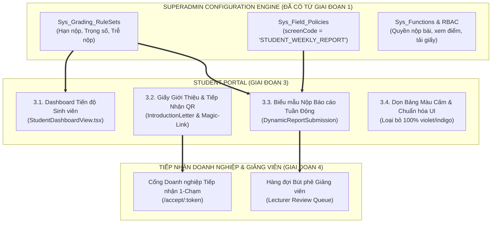

# KẾ HOẠCH TRIỂN KHAI KỸ THUẬT: GIAI ĐOẠN 3
## STUDENT PORTAL & COMPLIANCE SUBMISSION ENGINE
### (PHÂN HỆ CỔNG THÔNG TIN SINH VIÊN, BIỂU MẪU ĐỘNG & BẢNG TIẾN ĐỘ THỰC TẬP)

> **Mã tài liệu:** `PLAN-PHASE-3-STUDENT-PORTAL`  
> **Cấp độ:** Kiến trúc Kỹ thuật & Đặc tả Thực thi (Technical Specification)  
> **Phiên bản:** `1.0.0-PROD`  
> **Người phê duyệt:** Technical Architect & QA Lead  
> **Thời gian kích hoạt:** Ngay sau khi nghiệm thu 100% Giai đoạn 2  
> **Phạm vi áp dụng:** Phân hệ Sinh viên (`frontend/src/features/student`) & Backend Student APIs (`InternLink.API/Controllers/Student*`)

---

## 1. MỤC TIÊU VÀ PHẠM VI GIAI ĐOẠN 3

Sau khi hoàn thành và nghiệm thu tuyệt đối **Giai đoạn 1 (SuperAdmin Configuration Engine)** và **Giai đoạn 2 (Lecturer Workspace & Evaluation Engine)**, Giai đoạn 3 tập trung chuyển đổi toàn bộ **Phân hệ Sinh viên (Student Portal)** để khớp nối hoàn hảo vào hệ sinh thái dữ liệu động và chính sách cấu hình tập trung.

---

## 2. BỐN HẠNG MỤC TRIỂN KHAI TRỌNG TÂM (WORK PACKAGES)

### 3.1. Dashboard Tiến độ Sinh viên Động (`StudentDashboardView.tsx`)
- **Vấn đề tồn đọng:** Hiện tại giao diện vẫn còn một số chuỗi fallback dữ liệu giả lập (mock strings như `C23A`, `C23A.TH2`).
- **Nhiệm vụ của Dev:**
  1. Loại bỏ 100% các chuỗi hardcode giả lập. Kết nối trực tiếp vào hook `useStudentWorkspace` và API `GET /api/v1/student/dashboard-progress`.
  2. Hiển thị thanh tiến độ tuần thực tế (Weekly Timeline Strip) đồng bộ với tiến độ kỳ thực tập đã cấu hình tại `Sys_Semesters` và `Sys_Grading_RuleSets`.
  3. Hiển thị trạng thái phân công: Doanh nghiệp tiếp nhận, Giảng viên hướng dẫn (kèm email/số điện thoại liên hệ), và trạng thái hồ sơ thực tập (`NotStarted` $\rightarrow$ `InProgress` $\rightarrow$ `Completed`).

### 3.2. Module Giấy Giới Thiệu & Tiếp Nhận Doanh Nghiệp Điện Tử (QR & Magic-Link)
- **Nghiệp vụ:** Sinh viên cần mang Giấy giới thiệu thực tập đến Doanh nghiệp. Hệ thống cần số hóa quy trình này thành liên kết tiếp nhận 1-chạm:
  1. **Sinh mã định danh hồ sơ:** Format chuẩn `IL-ACC-YYYY-XXXXX` (Ví dụ: `IL-ACC-2026-08124`).
  2. **Tạo QR Code & Magic Link:** Dẫn thẳng đến URL Cổng Doanh nghiệp `/accept/{token}` (chuẩn bị cho Giai đoạn 4).
  3. **Tải PDF Giấy Giới Thiệu:** Nút tải file PDF Giấy giới thiệu chính thức có mã vạch/QR bảo mật và thông tin sinh viên, lớp, ngành học từ hệ thống.

### 3.3. Biểu Mẫu Nộp Báo Cáo Tuần Động (Dynamic Field Policy Form)
- **Kế thừa Giai đoạn 1:** Tích hợp `DynamicFormField` với `screenCode = "STUDENT_WEEKLY_REPORT"`.
- **Chính sách trường:**
  - `workSummary`: Nội dung công việc trong tuần (bắt buộc).
  - `keyResults`: Kết quả / sản phẩm đạt được (áp dụng chính sách trường động).
  - `blockers`: Khó khăn, vướng mắc cần giảng viên / mentor hỗ trợ (tùy chọn).
  - `attachments`: File minh chứng báo cáo hoặc link sản phẩm (hỗ trợ upload PDF/DOCX tối đa 20MB, validate định dạng).
- **Kiểm soát hạn nộp & phạt trễ (Deadline Engine):**
  - Đọc quy chế từ `Sys_Grading_RuleSets` của học kỳ hiện hành.
  - Hiển thị badge: **"Đúng hạn"** (xanh `#7bc043`), **"Sắp hết hạn"** (vàng cam), **"Nộp trễ"** (đỏ thắm).
  - Nếu quá hạn nộp cho phép theo quy chế: Khóa nút nộp và hiển thị thông báo hướng dẫn liên hệ Giảng viên hướng dẫn để xin mở nộp bù.

### 3.4. Dọn Dẹp Mã Màu Cấm & Chuẩn Hóa UI Toàn Diện Phân Hệ Sinh Viên
- **Vị trí tồn dư màu cấm:**
  - `frontend/src/features/student/pages/AccountView.tsx`: 11 vị trí dùng `text-violet-700`, `border-violet-400`, `bg-violet-50`, `text-indigo-500`.
  - `frontend/src/features/student/pages/NotificationsView.tsx`: 4 vị trí dùng `bg-indigo-50`, `text-indigo-700`, `border-indigo-200`.
- **Quy chuẩn chuyển đổi:**
  - Thay thế toàn bộ sang hệ màu chính thống:
    + Accent / Focus: `#026aa7` (`text-[#026aa7]`, `border-[#026aa7]`, `focus:border-[#026aa7]`, `bg-[#026aa7]/10`).
    + Badges / Icons: `slate-*` trung tính hoặc `#026aa7`.
  - Giữ vững quy tắc: Container `max-w-[1300px]`, Card `rounded-xl border border-slate-200/90 bg-white shadow-2xs`.

---

## 3. DANH MỤC API BACKEND CẦN KIỂM DUYỆT (API CONTRACTS)

| Method | Endpoint | Mô tả | Authorization |
|:---:|:---|:---|:---:|
| `GET` | `/api/v1/student/dashboard-progress` | Lấy tiến độ tuần, trạng thái hồ sơ, thông tin GVHD & DN | `RequireStudent` |
| `GET` | `/api/v1/student/introduction-letter` | Lấy dữ liệu giấy giới thiệu, mã tra cứu & token QR | `RequireStudent` |
| `GET` | `/api/v1/student/weekly-reports/{weekNumber}` | Lấy chi tiết báo cáo tuần và nhận xét của GV/DN | `RequireStudent` |
| `POST` | `/api/v1/student/weekly-reports/{weekNumber}` | Nộp hoặc cập nhật báo cáo tuần (kèm đính kèm) | `RequireStudent` |
| `GET` | `/api/v1/system/field-policies/STUDENT_WEEKLY_REPORT`| Lấy chính sách trường biểu mẫu nộp báo cáo | `RequireStudent` |

---

## 4. TIÊU CHÍ NGHIỆM THU QA (ACCEPTANCE CRITERIA & GATES)

1. **Hàng rào Mã Màu (Zero-Tolerance Banned Colors):**
   - Quét `git grep -E "indigo|violet" frontend/src/features/student` phải trả về **0 kết quả**.
2. **Kiểm tra Kiểu Dữ liệu (Typecheck):**
   - `npm --prefix frontend run typecheck` chạy hoàn tất với **0 lỗi**.
3. **Bộ Test Hồi quy (Regression Test Suites):**
   - Backend tests: Tối thiểu $\ge 431$ test cases pass 100%.
   - Frontend tests: Bổ sung test suites mới cho Student Portal, tổng số tests phải đạt $\ge 195$ tests pass 100%.
4. **Không Có Dữ Liệu Giả (Zero Mock Strings):**
   - Tuyệt đối không còn hardcode `C23A`, `C23A.TH2` hay các trường fallback giả lập trong giao diện sinh viên.
5. **Biểu Mẫu Tự Thích Ứng (Dynamic Field Policy Compliance):**
   - Khi SuperAdmin thay đổi chính sách trường trên Studio (ví dụ: đổi trường `keyResults` thành bắt buộc), form sinh viên tự động hiển thị dấu `*` và validate ngay lập tức.
