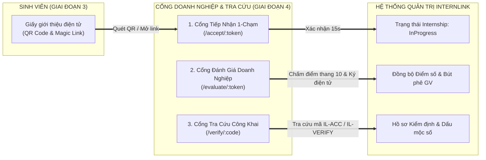

# KẾ HOẠCH TRIỂN KHAI KỸ THUẬT: GIAI ĐOẠN 4
## EMPLOYER PORTAL & PUBLIC VERIFICATION ENGINE
### (CỔNG TIẾP NHẬN DOANH NGHIỆP 1-CHẠM, ĐÁNH GIÁ THỰC TẬP & TRA CỨU CÔNG KHAI)

> **Mã tài liệu:** `PLAN-PHASE-4-EMPLOYER-PORTAL`  
> **Cấp độ:** Kiến trúc Kỹ thuật & Đặc tả Thực thi (Technical Specification)  
> **Phiên bản:** `1.0.0-PROD`  
> **Người phê duyệt:** Technical Architect & QA Lead  
> **Thời gian kích hoạt:** Ngay sau khi nghiệm thu 100% Giai đoạn 3  
> **Phạm vi áp dụng:** Public / Employer Flow (`/accept/:token`, `/evaluate/:token`, `/verify/:code`) & Backend Public/Employer Controllers

---

## 1. BỐI CẢNH VÀ MỤC TIÊU GIAI ĐOẠN 4

Ở Giai đoạn 3, hệ thống đã trang bị cho sinh viên **Giấy giới thiệu điện tử tích hợp QR Code và Magic Link bảo mật** (thời hạn 15 ngày, mã băm `IL-ACC-YYYY-XXXXX`, mã hóa Data Protection).

Giai đoạn 4 sẽ hiện thực hóa đầu tiếp nhận của liên kết này — **Cổng Doanh nghiệp & Tra cứu Công khai** — nhằm mang lại trải nghiệm frictionless (không ma sát), không đòi hỏi cán bộ doanh nghiệp hay nhà tuyển dụng phải tạo tài khoản rườm rà:

---

## 2. BA HẠNG MỤC TRIỂN KHAI TRỌNG TÂM (WORK PACKAGES)

### 4.1. Cổng Tiếp Nhận Doanh Nghiệp 1-Chạm (`/accept/:token`)
- **Tuyến đường Frontend:** `frontend/src/features/public/pages/CompanyQuickAcceptanceView.tsx` gắn tại route `/accept/:token` trong `AppRoutes.tsx`.
- **Nghiệp vụ cốt lõi:**
  1. Mentor quét mã QR trên Giấy giới thiệu hoặc mở Magic Link.
  2. Giao diện tự động xác thực token (thông qua API `GET /api/v1/public/internship-acceptance/verify?token=...`).
  3. Hiển thị thông tin sinh viên: Họ tên, MSSV, Lớp, Ngành, Vị trí thực tập dự kiến, Đơn vị tiếp nhận.
  4. Form xác nhận ngắn gọn:
     - Họ tên cán bộ tiếp nhận / Người hướng dẫn trực tiếp (Mentor).
     - Số điện thoại & Email liên hệ.
     - Bộ phận / Phòng ban công tác.
     - Ngày bắt đầu thực tế & Ngày kết thúc dự kiến.
     - Nút bấm lớn: **"Xác nhận Tiếp nhận Sinh viên Thực tập"** (`#026aa7`).
  5. Sau khi bấm xác nhận: Hệ thống cập nhật trạng thái `Internship` sang `InProgress`, lưu thông tin mentor, hiển thị màn hình thông báo thành công và thông tin liên hệ hỗ trợ.
- **Backend API:**
  - `GET /api/v1/public/internship-acceptance/verify`: Dùng `IDataProtector` giải mã purpose `"InternLink.StudentInternshipAcceptance.v1"`, kiểm tra hạn dùng (15 ngày), trả về dữ liệu xem trước.
  - `POST /api/v1/public/internship-acceptance/confirm`: Nhận thông tin tiếp nhận, cập nhật `Internship`, kích hoạt tiến trình nộp báo cáo tuần của sinh viên.

### 4.2. Cổng Đánh Giá Doanh Nghiệp 1-Chạm (`/evaluate/:token`)
- **Tuyến đường Frontend:** `EmployerQuickEvaluationView.tsx` gắn tại route `/evaluate/:token`.
- **Nghiệp vụ cốt lõi:**
  1. Vào cuối kỳ thực tập, hệ thống gửi Magic Link đánh giá tới Email/SĐT của Mentor.
  2. Mentor mở link, giao diện tự động nạp thang tiêu chí đánh giá từ cấu hình `Sys_Grading_RuleSets` của Nhà trường (thang điểm 10, phân rã theo 3 nhóm: Thái độ/Ý thức, Kỹ năng chuyên môn, Kỷ luật lao động).
  3. Mentor chấm điểm từng tiêu chí, nhập nhận xét tổng quan, và ký điện tử / xác nhận.
  4. Hệ thống tính điểm trung bình doanh nghiệp, đồng bộ thẳng vào bảng điểm của Giảng viên (`Lecturer Workspace`).

### 4.3. Cổng Tra Cứu Công Khai & Xác Thực Văn Bằng (`/verify/:code`)
- **Tuyến đường Frontend:** `frontend/src/features/public/pages/PublicVerificationView.tsx` gắn tại route `/verify/:code`.
- **Nghiệp vụ cốt lõi:**
  1. Cho phép nhà tuyển dụng, đoàn kiểm định hoặc phụ huynh tra cứu tính xác thực của Giấy giới thiệu (`IL-ACC-YYYY-XXXXX`) hoặc Báo cáo kiểm định hoàn thành thực tập (`IL-VERIFY-YYYY-XXXXX`).
  2. Hiển thị thông tin minh bạch: Sinh viên, Khóa học, Học kỳ, Doanh nghiệp thực tập, Kết quả đánh giá chung, và Dấu xác thực số chính thức của Nhà trường.
  3. Không để lộ thông tin nhạy cảm (ẩn số CCCD, chỉ hiển thị số đuôi SĐT/Email nếu cần).

---

## 3. THIẾT KẾ BẢO MẬT & API CONTRACTS

### 3.1. Cơ chế Token Bảo mật Data Protection
- Khóa bảo vệ: `IDataProtector` với Purpose:
  + Tiếp nhận: `"InternLink.StudentInternshipAcceptance.v1"`
  + Đánh giá: `"InternLink.EmployerEvaluation.v1"`
- Payload chứa `(InternshipId, StudentId, ExpiresAtUtc, Nonce)` chống giả mạo hoặc chỉnh sửa URL.
- Xử lý hết hạn: Trả về mã lỗi thân thiện khi token quá 15 ngày (*"Liên kết tiếp nhận đã hết hạn. Vui lòng yêu cầu sinh viên tạo mã mới."*).

### 3.2. Danh mục Endpoint Backend

| Method | Endpoint | Quyền hạn | Mô tả |
|:---:|:---|:---:|:---|
| `GET` | `/api/v1/public/internship-acceptance/verify` | `AllowAnonymous` | Xác thực token & lấy thông tin sinh viên/đợt thực tập |
| `POST` | `/api/v1/public/internship-acceptance/confirm` | `AllowAnonymous` | Mentor xác nhận tiếp nhận & kích hoạt trạng thái InProgress |
| `GET` | `/api/v1/public/employer-evaluations/verify` | `AllowAnonymous` | Xác thực token đánh giá & nạp rubric tiêu chuẩn |
| `POST` | `/api/v1/public/employer-evaluations/submit` | `AllowAnonymous` | Gửi bảng điểm đánh giá doanh nghiệp & nhận xét |
| `GET` | `/api/v1/public/verifications/{referenceCode}` | `AllowAnonymous` | Tra cứu công khai hồ sơ thực tập theo mã định danh |

---

## 4. QUY CHUẨN GIAO DIỆN & CÔNG THÁI HỌC (UI SYSTEM V2.0)

- **Mobile-First 100%:** Mentor và Nhà tuyển dụng chủ yếu truy cập từ Smartphone khi quét QR code. Giao diện form phải tối ưu bấm 1-chạm, nút bấm cao $\ge 44\text{px}$ (chuẩn touch target).
- **Hệ màu nhận diện:**
  - Nền trang: `bg-slate-50` sạch sẽ, tối giản.
  - Card trung tâm: `max-w-xl mx-auto rounded-2xl border border-slate-200/90 bg-white p-6 shadow-sm`.
  - Brand Accent: `#026aa7`, Success: `#7bc043`, không dùng bất kỳ mã màu `indigo` hay `violet`.
  - Header: Logo InternLink, phù hiệu chứng nhận bảo mật SSL/TLS.

---

## 5. TIÊU CHÍ NGHIỆM THU QA (ACCEPTANCE GATES)

1. **Hàng rào Mã Màu:** 0 màu cấm `indigo-*` / `violet-*` trong toàn bộ `features/public`.
2. **Kiểm tra Kiểu Dữ liệu (Typecheck):** `npm run typecheck` chạy hoàn tất 0 lỗi (`tsc -b`).
3. **Bộ Test Tự động:**
   - Backend tests: $\ge 438$ tests pass 100%.
   - Frontend tests: Thêm unit test cho `CompanyQuickAcceptanceView` và `PublicVerificationView`, tổng số tests $\ge 200$ tests pass 100%.
4. **Build Production:** `npm run build` và `dotnet build` hoàn thành 0 lỗi/cảnh báo.
