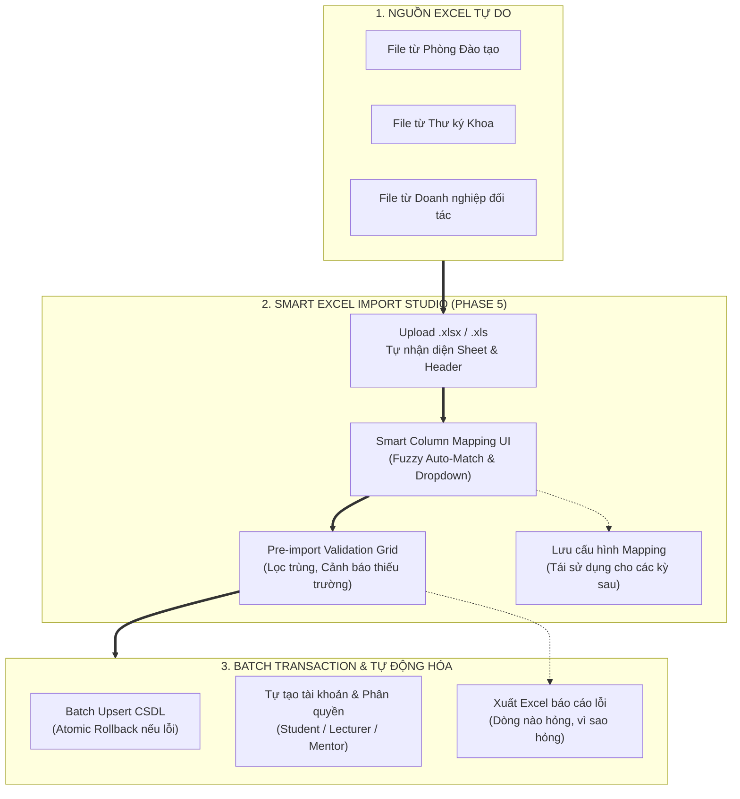
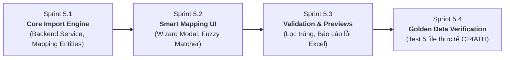

# KẾ HOẠCH TRIỂN KHAI KỸ THUẬT: GIAI ĐOẠN 5
## SMART EXCEL IMPORT STUDIO & MULTI-FACULTY ARCHITECTURE
### (HỆ THỐNG NHẬP DỮ LIỆU THÔNG MINH KÉO-THẢ MAPPING & MỞ RỘNG TOÀN TRƯỜNG)

> **Mã tài liệu:** `PLAN-PHASE-5-SMART-EXCEL-MULTI-FACULTY`  
> **Cấp độ:** Kiến trúc Kỹ thuật & Kế hoạch Thực thi (Execution Master Plan)  
> **Phiên bản:** `1.0.0-PROD`  
> **Người phê duyệt:** Technical Architect & QA Lead  
> **Thời gian kích hoạt:** Ngay sau khi nghiệm thu v1.0.0-PROD (`04bdff2`)  
> **Tài liệu tham chiếu:** `docs/specifications/SPEC-02-SMART-IMPORT-EXPORT-MAPPING.md`  
> **Bộ dữ liệu kiểm chứng thực tế:** `E:\Downloads\TTTN_C24ATH\Import` (Dữ liệu lớp C24ATH)

---

## 1. BỐI CẢNH VÀ BÀI TOÁN KỸ THUẬT GIAI ĐOẠN 5

Trong kỳ vận hành thực tế vừa qua của lớp C24ATH, khâu chuẩn bị đầu kỳ đòi hỏi nạp 5 file Excel khác nhau:
1. `danh-sach-SV.xlsx`: Danh sách sinh viên đủ điều kiện thực tập.
2. `danh-sach-GV.xlsx`: Danh sách giảng viên phụ trách hướng dẫn.
3. `danh-sach-doanh-nghiep.xlsx`: Danh mục công ty/cơ quan tiếp nhận.
4. `danh-sach-phan-cong-GVHD.xlsx`: Bảng phân bổ sinh viên cho giảng viên.
5. `danh-sach-SV-thuc-tap-taiDN.xlsx`: Thông tin doanh nghiệp sinh viên thực tế đến thực tập.

### Nỗi đau lớn nhất hiện nay:
* **Khác biệt mẫu biểu:** Mỗi trường, mỗi khoa, thậm chí mỗi học kỳ định dạng file Excel lại khác nhau (thứ tự cột, tên cột, hàng tiêu đề nằm ở dòng 1 hoặc dòng 3-4, có merge cell...).
* **Phụ thuộc kỹ thuật:** Cán bộ Khoa/Thầy Cô không thể tự nạp nếu không nhờ lập trình viên viết script nạp CSDL.
* **Nguy cơ lỗi dữ liệu:** Trùng MSSV, sai email, thiếu mã ngành dẫn đến hỏng liên kết dữ liệu trong suốt kỳ.



---

## 2. BỐN PHÂN HỆ CỐT LÕI CỦA GIAI ĐOẠN 5

### 5.1. Phân hệ 1: Smart Column Mapping Engine (Frontend + Backend)
* **Frontend Component:** `SmartExcelImporterModal.tsx` & `ColumnMappingStep.tsx`
  - Cho phép người dùng upload file, chọn Sheet cần đọc.
  - Tự động quét dòng Header (bỏ qua các dòng tiêu đề cơ quan/trường học ở trên).
  - Tự động gợi ý ánh xạ (Auto Suggestion) bằng thuật toán so khớp mờ (Fuzzy matching Levenshtein/Regex):
    * Cột nguồn `"Mã SV"`, `"MSSV"`, `"Mã sinh viên"` $\rightarrow$ Trường đích `StudentCode`
    * Cột nguồn `"Họ và tên"`, `"Họ tên"`, `"Tên SV"` $\rightarrow$ Trường đích `FullName`
    * Cột nguồn `"Điện thoại"`, `"SĐT"`, `"Mobile"` $\rightarrow$ Trường đích `PhoneNumber`
    * Cột nguồn `"Đơn vị thực tập"`, `"Công ty"`, `"Tên DN"` $\rightarrow$ Trường đích `CompanyName`
  - Cho phép chọn cột thủ công qua dropdown, lưu lại cấu hình thành **Template** (ví dụ: *"Template Phòng Đào tạo ĐH"*).

### 5.2. Phân hệ 2: Live Validation & Diff Preview
* **Frontend Component:** `ImportPreviewStep.tsx`
  - Đọc và validate trực tiếp dữ liệu trước khi đẩy xuống server.
  - Hiển thị bảng màu trực quan:
    * 🟢 **Xanh (Valid):** Dòng dữ liệu hợp lệ, sẵn sàng nạp.
    * 🟡 **Vàng (Warning):** Trùng lặp (đã có trong hệ thống, sẽ thực hiện cập nhật ghi đè - Upsert).
    * 🔴 **Đỏ (Error):** Thiếu thông tin bắt buộc (thiếu MSSV, Email sai cú pháp, không tìm thấy Khoa/Lớp tương ứng).
  - Thống kê tổng quan: *Tổng số: 120 dòng | Hợp lệ: 115 dòng | Lỗi cần sửa: 5 dòng*.

### 5.3. Phân hệ 3: Batch Processor & Account Auto-Provisioning (Backend)
* **Backend Services:** `ISmartExcelImportService.cs` & `SmartExcelImportService.cs`
  - Kế thừa đặc tả `SPEC-02-SMART-IMPORT-EXPORT-MAPPING.md`.
  - Sử dụng `ExcelDataReader` và `ClosedXML` để stream dữ liệu hiệu năng cao.
  - Sử dụng EF Core Execution Strategy / Transaction: Đảm bảo tính nguyên tử (Atomicity).
  - Tự động sinh tài khoản người dùng (`SysUser`), băm mật khẩu chuẩn PBKDF2/Argon2, gán đúng `SysRole` (Student hoặc Lecturer) và ánh xạ vào `SysUserRole`.
  - Sinh file Excel báo cáo kết quả: Dòng nào thành công, dòng nào thất bại kèm lý do cụ thể ở cột cuối cùng.

### 5.4. Phân hệ 4: Multi-Faculty Scoping & Department Workspaces
* Tách biệt hoàn toàn không gian làm việc của các Khoa:
  - Admin Khoa CNTT chỉ nhìn thấy sinh viên, giảng viên, đợt thực tập và rubric của Khoa CNTT.
  - Mở rộng hỗ trợ các Khoa khác (Khoa Kinh tế, Khoa Ngoại ngữ, v.v.) chỉ bằng 1 thao tác kích hoạt mà không cần sửa code.

---

## 3. CƠ SỞ DỮ LIỆU & ENTITIES (THEO CHUẨN SPEC-02)

Kế thừa trực tiếp thiết kế từ `SPEC-02-SMART-IMPORT-EXPORT-MAPPING.md`:

```sql
-- 1. BẢNG LƯU CẤU HÌNH MẪU ÁNH XẠ (MAPPING PRESET)
CREATE TABLE [dbo].[Sys_Excel_Mappings] (
    [Auto_ID]             BIGINT IDENTITY(1,1) NOT NULL,
    [Public_ID]           UNIQUEIDENTIFIER NOT NULL DEFAULT NEWID(),
    [Mapping_Code]        NVARCHAR(50) NOT NULL,          -- Mã cấu hình (VD: MAP_CNTT_IUH)
    [Mapping_Name]        NVARCHAR(200) NOT NULL,         -- Tên mẫu (VD: Mẫu danh sách SV Khoa CNTT)
    [Target_Entity]       NVARCHAR(100) NOT NULL,         -- Bảng đích (Students, Internships, Lecturers, Companies)
    [Start_Row_Index]     INT NOT NULL DEFAULT 2,         -- Dòng bắt đầu chứa dữ liệu (Bỏ qua header)
    [Tenant_ID]           NVARCHAR(50) NULL,              -- Mã trường / Tenant
    [Department_ID]       UNIQUEIDENTIFIER NULL,          -- Mã Khoa
    [Ghi_Chu]             NVARCHAR(1000) NULL,
    [CreatedAt]           DATETIME2 NOT NULL DEFAULT SYSUTCDATETIME(),
    [CreatedBy]           NVARCHAR(100) NULL,
    [UpdatedAt]           DATETIME2 NULL,
    [UpdatedBy]           NVARCHAR(100) NULL,
    CONSTRAINT [PK_Sys_Excel_Mappings] PRIMARY KEY CLUSTERED ([Auto_ID]),
    CONSTRAINT [AK_Sys_Excel_Mappings_Public_ID] UNIQUE NONCLUSTERED ([Public_ID])
);

-- 2. BẢNG CHI TIẾT ÁNH XẠ TỪNG CỘT DỮ LIỆU
CREATE TABLE [dbo].[Sys_Excel_Mapping_Details] (
    [Auto_ID]             BIGINT IDENTITY(1,1) NOT NULL,
    [Public_ID]           UNIQUEIDENTIFIER NOT NULL DEFAULT NEWID(),
    [Mapping_ID]          BIGINT NOT NULL,                -- Khóa ngoại liên kết bảng Sys_Excel_Mappings
    [System_Field_Code]   NVARCHAR(50) NOT NULL,          -- Trường đích trong CSDL (StudentCode, FullName...)
    [Excel_Column_Name]   NVARCHAR(100) NOT NULL,         -- Tên cột trong file Excel ("MSSV", "Mã SV"...)
    [Excel_Column_Index]  INT NOT NULL,                   -- Vị trí cột (0 = Cột A, 1 = Cột B...)
    [Is_Required]         BIT NOT NULL DEFAULT 0,         -- Bắt buộc phải có giá trị
    [Default_Value]       NVARCHAR(250) NULL,             -- Giá trị mặc định nếu rỗng
    [Transform_Rule]      NVARCHAR(100) NULL,             -- Quy tắc biến đổi (TRIM, UPPER, SPLIT_NAME, DATE_VN)
    CONSTRAINT [PK_Sys_Excel_Mapping_Details] PRIMARY KEY CLUSTERED ([Auto_ID]),
    CONSTRAINT [FK_MappingDetails_Parent] FOREIGN KEY ([Mapping_ID]) REFERENCES [dbo].[Sys_Excel_Mappings] ([Auto_ID]) ON DELETE CASCADE
);
```

---

## 4. LỘ TRÌNH 4 SPRINT TRIỂN KHAI GIAI ĐOẠN 5



* **Sprint 5.1 (Backend Engine):** Tạo Entities `SysExcelMapping`, `SysExcelMappingDetail`, `ISmartExcelImportService`, Controller `ExcelImportController` (.NET 10, ClosedXML / ExcelDataReader).
* **Sprint 5.2 (Frontend Wizard):** Xây dựng Modal 3 bước (1. Upload file $\rightarrow$ 2. Cấu hình cột Mapping $\rightarrow$ 3. Xem trước và xác nhận).
* **Sprint 5.3 (Validation & An toàn dữ liệu):** Cơ chế lọc trùng, kiểm tra quan hệ khóa ngoại (Foreign Key Lookup), sinh tài khoản tự động và xuất file lỗi.
* **Sprint 5.4 (Kiểm thử thực chiến Golden Data):** Dùng trực tiếp 5 file thực tế trong `E:\Downloads\TTTN_C24ATH\Import` để kiểm thử nạp toàn bộ lớp C24ATH từ đầu đến cuối!

---

*(Bản kế hoạch này là kim chỉ nam kỹ thuật chính thức để khởi động nhánh `feature/phase5-smart-excel-and-multi-faculty`).*
