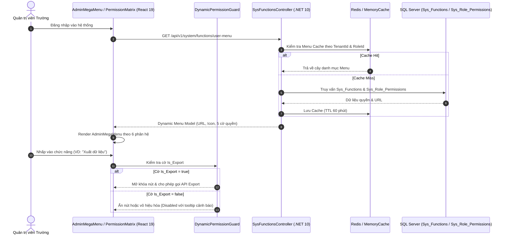

# ĐẶC TẢ KỸ THUẬT PHÂN HỆ SPEC-01
# QUẢN TRỊ DANH MỤC CHỨC NĂNG & PHÂN QUYỀN ĐỘNG (DYNAMIC RBAC & SYSTEM FUNCTIONS)

> **Mã tài liệu:** SPEC-01-RBAC-FUNC  
> **Dự án:** Nền tảng Quản trị Thực tập InternLink (B2B SaaS)  
> **Cấp bảo mật:** Nội bộ / Đối tác Triển khai  
> **Phiên bản:** 2.0 Enterprise  
> **Kế thừa kiến trúc:** Module Quản trị Hệ thống TKSolution V11 (`tbl_Sys_Chuc_Nang`)  
> **Trạng thái:** Sẵn sàng cho triển khai và chuyển đổi sang Word (.docx)

---

## 1. TỔNG QUAN VÀ BỐI CẢNH NGHIỆP VỤ (EXECUTIVE OVERVIEW)

### 1.1 Vấn đề của mô hình cũ (Legacy Hardcoded RBAC)
Trong các phiên bản phần mềm đóng gói hoặc hệ thống quản lý sinh viên truyền thống:
- Các chức năng, đường dẫn (URL), và menu điều hướng thường bị hardcode cứng trong mã nguồn frontend hoặc backend.
- Khi cần mở thêm một chức năng cho một Khoa/Trường cụ thể, đội ngũ kỹ thuật phải sửa code, build lại và deploy lại toàn bộ ứng dụng.
- Quyền hạn chỉ dừng lại ở mức vai trò chung chung (`Admin`, `Lecturer`, `Student`), không kiểm soát được chi tiết: ai được xem, ai được thêm mới, ai được sửa, ai được xóa, và ai được phép xuất file báo cáo.

### 1.2 Mục tiêu của Phân hệ SPEC-01
- **Kế thừa tinh hoa từ TKSolution V11:** Chuyển đổi toàn bộ việc điều hướng và phân quyền sang mô hình hướng dữ liệu (Data-driven Dynamic RBAC).
- **Bộ 5 cờ quyền chuẩn mực:** Mỗi chức năng được kiểm soát độc lập qua 5 quyền thao tác: `Is_View` (Xem), `Is_New` (Thêm), `Is_Edit` (Sửa), `Is_Delete` (Xóa), `Is_Export` (Xuất báo cáo).
- **Hỗ trợ Multi-Tenancy (`Khach_Hang_ID`):** Cho phép kích hoạt hoặc ẩn các phân hệ cao cấp theo từng Trường Đại học / Khoa viện dựa trên gói thuê bao B2B SaaS.
- **Dynamic Mega Menu:** Giao diện Quản trị viên tự động dựng cây điều hướng 6 nhóm phân hệ trực tiếp từ CSDL.

---

## 2. KIẾN TRÚC VÀ LUỒNG DỮ LIỆU (ARCHITECTURE & DATA FLOW)



---

## 3. THIẾT KẾ CƠ SỞ DỮ LIỆU (DATABASE SCHEMA)

Kế thừa trực tiếp cấu trúc từ bảng gốc `[TKS_Thuc_Tap_V11].[dbo].[tbl_Sys_Chuc_Nang]`:

```sql
-- 1. BẢNG DANH MỤC CHỨC NĂNG HỆ THỐNG
CREATE TABLE [dbo].[Sys_Functions] (
    [Auto_ID]                BIGINT IDENTITY(1,1) NOT NULL,
    [Public_ID]              UNIQUEIDENTIFIER NOT NULL DEFAULT NEWID(),
    [Ma_Chuc_Nang]           NVARCHAR(50) NOT NULL,          -- Mã định danh duy nhất (VD: F101, F102)
    [Ten_Chuc_Nang]          NVARCHAR(200) NOT NULL,         -- Tên hiển thị (VD: "Cấu hình lưới dữ liệu")
    [Sort_Priority]          INT NOT NULL DEFAULT 0,         -- Thứ tự sắp xếp trên Menu
    [Chuc_Nang_Parent_ID]    BIGINT NULL,                    -- Khóa ngoại phân cấp cây Cha - Con
    [Nhom_Chuc_Nang_ID]      NVARCHAR(50) NOT NULL,          -- Mã phân hệ (SYS, ACC, CFG, LOG, IT, API)
    [Func_URL]               NVARCHAR(250) NULL,             -- Đường dẫn Route React (/admin/grid-config)
    [Image_URL]              NVARCHAR(100) NULL,             -- Icon Lucide (settings, table, shield...)
    [Is_View]                BIT NOT NULL DEFAULT 1,         -- Cho phép quyền Xem mặc định
    [Is_New]                 BIT NOT NULL DEFAULT 0,         -- Cho phép quyền Thêm mặc định
    [Is_Edit]                BIT NOT NULL DEFAULT 0,         -- Cho phép quyền Sửa mặc định
    [Is_Delete]              BIT NOT NULL DEFAULT 0,         -- Cho phép quyền Xóa mặc định
    [Is_Export]              BIT NOT NULL DEFAULT 0,         -- Cho phép quyền Xuất Excel/PDF
    [Khach_Hang_ID]          NVARCHAR(50) NULL,              -- Mã Tenant (NULL = Toàn hệ thống)
    [Ghi_Chu]                NVARCHAR(1000) NULL,
    [IsDeleted]              BIT NOT NULL DEFAULT 0,
    [CreatedAt]              DATETIME2 NOT NULL DEFAULT SYSUTCDATETIME(),
    [CreatedBy]              NVARCHAR(100) NULL,
    [Created_By_Function]    NVARCHAR(100) NULL,
    [UpdatedAt]              DATETIME2 NULL,
    [UpdatedBy]              NVARCHAR(100) NULL,
    [Updated_By_Function]    NVARCHAR(100) NULL,
    CONSTRAINT [PK_Sys_Functions] PRIMARY KEY CLUSTERED ([Auto_ID]),
    CONSTRAINT [AK_Sys_Functions_Public_ID] UNIQUE NONCLUSTERED ([Public_ID]),
    CONSTRAINT [UQ_Sys_Functions_Code] UNIQUE NONCLUSTERED ([Ma_Chuc_Nang], [Khach_Hang_ID]),
    CONSTRAINT [FK_Sys_Functions_Parent] FOREIGN KEY ([Chuc_Nang_Parent_ID]) REFERENCES [dbo].[Sys_Functions] ([Auto_ID])
);

-- 2. BẢNG PHÂN QUYỀN VAI TRÒ THEO TỪNG CHỨC NĂNG (PERMISSION MATRIX)
CREATE TABLE [dbo].[Sys_Role_Permissions] (
    [Auto_ID]             BIGINT IDENTITY(1,1) NOT NULL,
    [Public_ID]           UNIQUEIDENTIFIER NOT NULL DEFAULT NEWID(),
    [Role_ID]             BIGINT NOT NULL,                -- Khóa ngoại bảng Sys_Roles
    [Function_ID]         BIGINT NOT NULL,                -- Khóa ngoại bảng Sys_Functions
    [Can_View]            BIT NOT NULL DEFAULT 0,
    [Can_New]             BIT NOT NULL DEFAULT 0,
    [Can_Edit]            BIT NOT NULL DEFAULT 0,
    [Can_Delete]          BIT NOT NULL DEFAULT 0,
    [Can_Export]          BIT NOT NULL DEFAULT 0,
    [CreatedAt]           DATETIME2 NOT NULL DEFAULT SYSUTCDATETIME(),
    [CreatedBy]           NVARCHAR(100) NULL,
    [UpdatedAt]           DATETIME2 NULL,
    [UpdatedBy]           NVARCHAR(100) NULL,
    CONSTRAINT [PK_Sys_Role_Permissions] PRIMARY KEY CLUSTERED ([Auto_ID]),
    CONSTRAINT [AK_Sys_Role_Permissions_Public_ID] UNIQUE NONCLUSTERED ([Public_ID]),
    CONSTRAINT [UQ_Role_Function] UNIQUE NONCLUSTERED ([Role_ID], [Function_ID]),
    CONSTRAINT [FK_RolePerm_Role] FOREIGN KEY ([Role_ID]) REFERENCES [dbo].[Sys_Roles] ([Auto_ID]),
    CONSTRAINT [FK_RolePerm_Func] FOREIGN KEY ([Function_ID]) REFERENCES [dbo].[Sys_Functions] ([Auto_ID])
);
```

---

## 4. ĐẶC TẢ GIAO DIỆN LẬP TRÌNH ỨNG DỤNG (BACKEND API CONTRACTS)

### 4.1 Danh sách Endpoints

| STT | Phương thức | Đường dẫn API | Mục đích | Quyền tối thiểu |
|---|---|---|---|---|
| 1 | `GET` | `/api/v1/system/functions/tree` | Lấy toàn bộ cây danh mục phân hệ & chức năng | `SysAdmin` |
| 2 | `GET` | `/api/v1/system/functions/user-menu` | Lấy danh mục menu tương ứng quyền người dùng hiện tại | Đăng nhập |
| 3 | `POST` | `/api/v1/system/functions` | Tạo mới một chức năng hoặc route trong hệ thống | `SysAdmin` |
| 4 | `PUT` | `/api/v1/system/functions/{id}` | Cập nhật cấu hình URL, Icon, thứ tự hiển thị | `SysAdmin` |
| 5 | `DELETE` | `/api/v1/system/functions/{id}` | Xóa mềm chức năng khỏi hệ thống | `SysAdmin` |
| 6 | `GET` | `/api/v1/system/permissions/matrix` | Lấy ma trận phân quyền 5 cờ cho các vai trò | `SysAdmin` |
| 7 | `PUT` | `/api/v1/system/permissions/matrix` | Cập nhật đồng loạt các cờ quyền cho một vai trò | `SysAdmin` |

### 4.2 C# Data Transfer Objects (DTOs)

```csharp
namespace InternLink.Application.DTOs.System;

public record SysFunctionDto(
    Guid PublicId,
    string Code,
    string Name,
    int SortPriority,
    Guid? ParentPublicId,
    string ModuleCode,
    string? FuncUrl,
    string? ImageUrl,
    bool IsView,
    bool IsNew,
    bool IsEdit,
    bool IsDelete,
    bool IsExport,
    string? TenantId,
    List<SysFunctionDto> Children
);

public record UpdateRolePermissionMatrixRequest(
    Guid RolePublicId,
    List<RoleFunctionPermissionItem> Permissions
);

public record RoleFunctionPermissionItem(
    Guid FunctionPublicId,
    bool CanView,
    bool CanNew,
    bool CanEdit,
    bool CanDelete,
    bool CanExport
);
```

---

## 5. ĐẶC TẢ GIAO DIỆN NGƯỜI DÙNG (FRONTEND UI SPECIFICATION)

### 5.1 Phân bổ Màn hình & Token Thiết kế
- **File triển khai:** `frontend/src/features/admin/components/AdminMegaMenu.tsx` và `PermissionMatrixView.tsx`.
- **Token giao diện bắt buộc:**
  - Container chính: `mx-auto max-w-[1300px]`
  - Khung Panel: `rounded-xl border border-slate-200/90 bg-white shadow-2xs`
  - Nút Primary CTA: `#026aa7` (Hover: `#025a8e`, Focus ring: `ring-[#026aa7]`)
  - Trạng thái cấp quyền thành công: `#7bc043`
  - Cấm sử dụng các mã màu: `indigo-*`, `violet-*`, `emerald-*`.

### 5.2 6 Phân hệ Menu Chuẩn (Mega Menu Columns)
1. **HỆ THỐNG (SYS):** Quản lý cấu hình chung, thông số trường đại học, học kỳ niên khóa.
2. **TÀI KHOẢN (ACC):** Phân quyền vai trò, quản lý sinh viên, giảng viên, tài khoản doanh nghiệp.
3. **CẤU HÌNH (CFG):** Studio cấu hình lưới (`GridConfigStudioView`), cấu hình quy chế chấm điểm.
4. **NHẬT KÝ (LOG):** Nhật ký kiểm toán (`AuditLogsView`), nhật ký truy cập hệ thống.
5. **CẤU HÌNH IT (IT):** Nhập dữ liệu thông minh (`SmartExcelImportView`), xuất dữ liệu hàng loạt.
6. **API & TÍCH HỢP (API):** Webhooks, cấu hình SSO, tài liệu Swagger nội bộ.

---

## 6. MA TRẬN KIỂM THỬ VÀ NGHIỆM THU QA (TEST MATRIX)

| Test ID | Tình huống kiểm thử | Dữ liệu đầu vào | Kết quả mong đợi |
|---|---|---|---|
| `TC-RBAC-01` | Lấy danh mục Menu động theo quyền Giảng viên | Token Giảng viên | Chỉ hiển thị các chức năng có `Can_View = true`, ẩn toàn bộ menu cấu hình IT |
| `TC-RBAC-02` | Thao tác nút Xuất file khi không có cờ `Is_Export` | User chỉ có cờ `Can_View` | Nút "Xuất Excel" bị disabled, API trả về `403 Forbidden` nếu cố ý gọi trực tiếp |
| `TC-RBAC-03` | Cập nhật ma trận quyền 5 cờ cho vai trò Mentor | Bật `Can_Edit`, tắt `Can_Delete` | Lưu thành công, sinh audit log ghi nhận người sửa và thời gian |
| `TC-RBAC-04` | Phân lập dữ liệu theo trường (`Khach_Hang_ID`) | Tenant A truy vấn Menu | Không hiển thị các chức năng riêng biệt của Tenant B |

