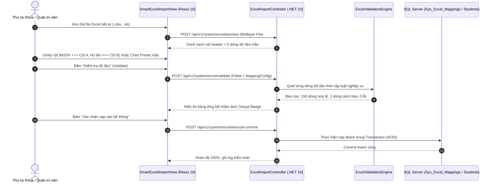

# ĐẶC TẢ KỸ THUẬT PHÂN HỆ SPEC-02
# NHẬP / XUẤT DỮ LIỆU THÔNG MINH CẤU HÌNH THEO KHOA & TRƯỜNG (SMART IMPORT / EXPORT MAPPING ENGINE)

> **Mã tài liệu:** SPEC-02-SMART-MAPPING  
> **Dự án:** Nền tảng Quản trị Thực tập InternLink (B2B SaaS)  
> **Cấp bảo mật:** Nội bộ / Đối tác Triển khai  
> **Phiên bản:** 2.0 Enterprise  
> **Kế thừa kiến trúc:** Cơ chế xử lý F1018 từ TKSolution V11  
> **Trạng thái:** Sẵn sàng cho triển khai và chuyển đổi sang Word (.docx)

---

## 1. TỔNG QUAN VÀ BỐI CẢNH NGHIỆP VỤ (EXECUTIVE OVERVIEW)

### 1.1 Vấn đề thực tế tại các Trường Đại học & Cao đẳng
- **Sự phân mảnh định dạng:** Mỗi trường, thậm chí mỗi khoa trong cùng một trường (Khoa CNTT, Khoa Kinh tế, Khoa Ngoại ngữ...) đều sở hữu một biểu mẫu Excel sinh viên thực tập riêng biệt:
  - Khoa CNTT đặt cột: `MSSV | Họ và tên | Lớp sinh hoạt | Số ĐT | Email`
  - Khoa Kinh tế đặt cột: `Mã SV | Họ đệm | Tên | Giới tính | GVHD Phụ trách`
- **Sự bế tắc của phần mềm cứng nhắc:** Các phần mềm đóng gói thông thường bắt buộc nhà trường phải copy-paste dữ liệu sang "file Excel mẫu của hệ thống". Điều này gây ức chế tột độ cho thư ký khoa và giảng viên, làm tăng tỷ lệ sai sót dữ liệu.
- **Rủi ro rò rỉ dữ liệu qua Zalo/Excel:** Quá trình gửi file Excel qua lại trên các nhóm chat Zalo khiến dữ liệu cá nhân sinh viên và điểm số bị lộ lọt, không có lịch sử kiểm toán (Audit Trail).

### 1.2 Giải pháp Đột phá của InternLink (Smart Import & Mapping Studio)
- **Tự động đọc Header & Gợi ý Ánh xạ:** Hệ thống trích xuất dòng tiêu đề file Excel bất kỳ và hiển thị 5 dòng xem trước. Sử dụng thuật toán so khớp chuỗi (Levenshtein distance / fuzzy matching) để tự động nối cột Excel tương ứng với trường CSDL InternLink.
- **Lưu cấu hình mẫu (Preset) theo từng Khoa/Trường:** Một khi đã ánh xạ xong, Quản trị viên lưu thành cấu hình: *"Mẫu nhập Khoa CNTT - ĐH Công nghiệp"*. Lần sau chỉ cần kéo thả file và bấm Xác nhận.
- **Thẩm định 2 tầng (Two-phase Validation):** Kiểm tra toàn bộ lỗi logic (trùng mã sinh viên, sai định dạng email, mã giảng viên không tồn tại) và xuất báo cáo lỗi chi tiết từng dòng trước khi nạp vào CSDL.

---

## 2. KIẾN TRÚC VÀ QUY TRÌNH 3 BƯỚC (WORKFLOW & ARCHITECTURE)



---

## 3. THIẾT KẾ CƠ SỞ DỮ LIỆU (DATABASE SCHEMA)

```sql
-- 1. BẢNG LƯU CẤU HÌNH MẪU ÁNH XẠ (MAPPING PRESET)
CREATE TABLE [dbo].[Sys_Excel_Mappings] (
    [Auto_ID]             BIGINT IDENTITY(1,1) NOT NULL,
    [Public_ID]           UNIQUEIDENTIFIER NOT NULL DEFAULT NEWID(),
    [Mapping_Code]        NVARCHAR(50) NOT NULL,          -- Mã cấu hình (VD: MAP_CNTT_IUH)
    [Mapping_Name]        NVARCHAR(200) NOT NULL,         -- Tên mẫu (VD: Mẫu danh sách SV Khoa CNTT)
    [Target_Entity]       NVARCHAR(100) NOT NULL,         -- Bảng đích (Students, Internships, Lecturers)
    [Start_Row_Index]     INT NOT NULL DEFAULT 2,         -- Dòng bắt đầu chứa dữ liệu (Bỏ qua header)
    [Khach_Hang_ID]       NVARCHAR(50) NULL,              -- Mã trường / Khoa
    [Ghi_Chu]             NVARCHAR(1000) NULL,
    [CreatedAt]           DATETIME2 NOT NULL DEFAULT SYSUTCDATETIME(),
    [CreatedBy]           NVARCHAR(100) NULL,
    [UpdatedAt]           DATETIME2 NULL,
    [UpdatedBy]           NVARCHAR(100) NULL,
    CONSTRAINT [PK_Sys_Excel_Mappings] PRIMARY KEY CLUSTERED ([Auto_ID]),
    CONSTRAINT [AK_Sys_Excel_Mappings_Public_ID] UNIQUE NONCLUSTERED ([Public_ID]),
    CONSTRAINT [UQ_Sys_Excel_Mappings_Code] UNIQUE NONCLUSTERED ([Mapping_Code], [Khach_Hang_ID])
);

-- 2. BẢNG CHI TIẾT ÁNH XẠ TỪNG CỘT DỮ LIỆU
CREATE TABLE [dbo].[Sys_Excel_Mapping_Details] (
    [Auto_ID]             BIGINT IDENTITY(1,1) NOT NULL,
    [Public_ID]           UNIQUEIDENTIFIER NOT NULL DEFAULT NEWID(),
    [Mapping_ID]          BIGINT NOT NULL,                -- Khóa ngoại liên kết bảng Sys_Excel_Mappings
    [System_Field_Code]   NVARCHAR(50) NOT NULL,          -- Trường đích trong CSDL (StudentCode, FullName...)
    [Excel_Column_Name]   NVARCHAR(100) NOT NULL,         -- Tên cột trong file Excel ("MSSV", "Mã SV"...)
    [Excel_Column_Index]  INT NOT NULL,                   -- Vị trí cột (0 = Cột A, 1 = Cột B...)
    [Is_Required]         BIT NOT NULL DEFAULT 0,         -- Bắt buộc phải có giá trị
    [Default_Value]       NVARCHAR(250) NULL,             -- Giá trị mặc định nếu rỗng
    [Transform_Rule]      NVARCHAR(100) NULL,             -- Quy tắc biến đổi (TRIM, UPPER, SPLIT_NAME, DATE_VN)
    CONSTRAINT [PK_Sys_Excel_Mapping_Details] PRIMARY KEY CLUSTERED ([Auto_ID]),
    CONSTRAINT [FK_MappingDetails_Parent] FOREIGN KEY ([Mapping_ID]) REFERENCES [dbo].[Sys_Excel_Mappings] ([Auto_ID]) ON DELETE CASCADE
);
```

---

## 4. ĐẶC TẢ GIAO DIỆN LẬP TRÌNH ỨNG DỤNG (BACKEND API CONTRACTS)

### 4.1 Danh sách Endpoints

| STT | Phương thức | Đường dẫn API | Mục đích |
|---|---|---|---|
| 1 | `POST` | `/api/v1/system/excel/preview` | Upload file tạm, phân tích header và trả về 5 dòng mẫu |
| 2 | `GET` | `/api/v1/system/excel/mappings` | Lấy danh sách các mẫu mapping đã lưu của đơn vị |
| 3 | `POST` | `/api/v1/system/excel/mappings` | Lưu mẫu mapping mới cho Khoa/Trường |
| 4 | `POST` | `/api/v1/system/excel/validate` | Kiểm tra toàn diện tính toàn vẹn dữ liệu trước khi nạp |
| 5 | `POST` | `/api/v1/system/excel/execute-import` | Thực thi nạp chính thức vào hệ thống trong Transaction |
| 6 | `POST` | `/api/v1/system/excel/export-custom` | Xuất dữ liệu động theo danh sách cột quản trị viên cấu hình |

### 4.2 C# Data Transfer Objects (DTOs)

```csharp
namespace InternLink.Application.DTOs.System;

public record ExcelPreviewResponse(
    string TemporaryFileId,
    string FileName,
    int TotalRows,
    List<string> HeaderColumns,
    List<Dictionary<string, string>> SampleRows
);

public record ExcelValidationRequest(
    string TemporaryFileId,
    string TargetEntity,
    List<ColumnMappingItem> Mappings
);

public record ColumnMappingItem(
    string SystemFieldCode,
    int ExcelColumnIndex,
    bool IsRequired,
    string? DefaultValue,
    string? TransformRule
);

public record ExcelValidationResult(
    bool IsValid,
    int TotalRecords,
    int ValidRecordsCount,
    int ErrorRecordsCount,
    List<RowValidationError> Errors
);

public record RowValidationError(
    int RowIndex,
    string ColumnField,
    string ErrorMessage,
    string RawValue
);
```

---

## 5. ĐẶC TẢ GIAO DIỆN NGƯỜI DÙNG (FRONTEND UI SPECIFICATION)

### 5.1 Giao diện Màn hình `SmartExcelImportView.tsx`
- **Vị trí tuyến đường:** `/admin/smart-excel-import`
- **Tuân thủ quy chuẩn UI InternLink:**
  - Tiêu đề màn hình: Khung `PageHeader` chuyên nghiệp với badge `IMPORT STUDIO`.
  - Khung bao bọc: `mx-auto max-w-[1300px]`
  - Các khối Card: `rounded-xl border border-slate-200/90 bg-white p-5 shadow-2xs`
  - Màu chủ đạo cho nút và thanh tiến trình: `#026aa7`
  - Màu xác nhận thành công và số liệu hợp lệ: `#7bc043`
  - Bảng ánh xạ: Cho phép kéo thả (Drag and Drop) hoặc chọn Select Box tương thích nhanh.

### 5.2 Xử lý Xuất báo cáo Động (Dynamic Export Studio)
- Cho phép người dùng tùy chọn:
  - Chọn những cột nào muốn xuất ra file Excel.
  - Sắp xếp thứ tự cột trước khi xuất.
  - Tải về file kết quả có format chuẩn (Font Calibri/Segoe UI, Border nét mảnh, Header phủ màu xám xanh chuyên nghiệp, Auto-fit độ rộng cột).

---

## 6. MA TRẬN KIỂM THỬ VÀ NGHIỆM THU QA (TEST MATRIX)

| Test ID | Tình huống kiểm thử | Dữ liệu đầu vào | Kết quả mong đợi |
|---|---|---|---|
| `TC-IMP-01` | Đọc file Excel không chuẩn dòng tiêu đề | File có tiêu đề ở dòng 3 | Đọc chính xác dòng 3 làm header, lấy đúng các dòng phía dưới |
| `TC-IMP-02` | Tự động khớp cột theo tên gần đúng | Cột Excel là "Mã Số SV" | Hệ thống tự động gợi ý nối với trường `StudentCode` |
| `TC-IMP-03` | Phát hiện trùng khóa chính (MSSV đã có trong CSDL) | File chứa MSSV "SV2026001" đã tồn tại | Báo cáo chi tiết dòng lỗi: "Mã sinh viên SV2026001 đã tồn tại trong đợt này", ngăn chặn nạp đè nếu không tick cờ Override |
| `TC-IMP-04` | Xử lý file dữ liệu lớn (Bulk Import 2,000 sinh viên) | File Excel dung lượng 5MB | Xử lý ngầm qua Transaction trong dưới 3 giây, hiển thị thanh tiến trình trực quan |

