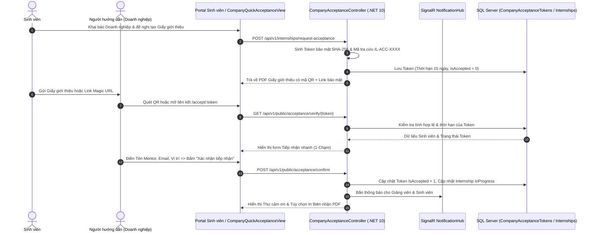

# ĐẶC TẢ KỸ THUẬT PHÂN HỆ SPEC-03
# TIẾP NHẬN DOANH NGHIỆP 1-CHẠM QUA MAGIC LINK & GIẤY GIỚI THIỆU QR (FRICTIONLESS ONBOARDING & QR LETTER)

> **Mã tài liệu:** SPEC-03-MAGIC-ONBOARDING  
> **Dự án:** Nền tảng Quản trị Thực tập InternLink (B2B SaaS)  
> **Cấp bảo mật:** Nội bộ / Đối tác Triển khai  
> **Phiên bản:** 2.0 Enterprise  
> **Mục tiêu cốt lõi:** Xóa bỏ thủ tục giấy tờ, loại bỏ yêu cầu đăng ký tài khoản rườm rà cho Doanh nghiệp, thay thế tin nhắn Zalo phân tán bằng quy trình số hóa chuẩn quốc tế  
> **Trạng thái:** Sẵn sàng cho triển khai và chuyển đổi sang Word (.docx)

---

## 1. TỔNG QUAN VÀ BỐI CẢNH NGHIỆP VỤ (EXECUTIVE OVERVIEW)

### 1.1 "Điểm nghẽn" kinh niên trong quan hệ Nhà trường - Doanh nghiệp
- **Thủ tục hành chính rườm rà:** Sinh viên phải đến phòng đào tạo lấy Giấy giới thiệu giấy có đóng dấu mộc đỏ, sau đó mang nộp trực tiếp tại doanh nghiệp. Giấy tờ dễ bị thất lạc, rách nát hoặc mất hàng tuần để luân chuyển.
- **Rào cản tạo tài khoản cho Doanh nghiệp:** Đa số các phần mềm hiện nay bắt buộc người hướng dẫn tại doanh nghiệp (Mentor / HR) phải trải qua các bước: đăng ký tài khoản, kích hoạt email, đặt mật khẩu phức tạp. Doanh nghiệp quá bận rộn nên thường từ chối hoặc bỏ qua, khiến giảng viên phải đi xin thông tin qua Zalo rất bị động.
- **Gian lận thực tập (Internship Fraud):** Sinh viên tự làm giả giấy tiếp nhận thực tập của công ty "ma" hoặc nhờ người quen đóng mộc khống mà nhà trường không có công cụ số để hậu kiểm tức thời.

### 1.2 Giải pháp Đột phá của InternLink (1-Touch Magic Link & QR Code)
- **Giấy giới thiệu điện tử tích hợp QR độc bản:** Hệ thống tự động tạo Giấy giới thiệu thực tập chuẩn A4 có mã bảo mật `IL-ACC-YYYY-XXXXX` và mã QR Code.
- **Tiếp nhận 1-Chạm không cần tài khoản:** Người hướng dẫn (Mentor) tại doanh nghiệp chỉ cần:
  1. Quét mã QR trên bản in hoặc nhấp vào liên kết bảo mật gửi qua Email / tin nhắn (`https://internlink.vn/accept/{token}`).
  2. Màn hình `CompanyQuickAcceptanceView.tsx` mở ra ngay lập tức: hiển thị đầy đủ thông tin sinh viên, trường đại học, đợt thực tập.
  3. Mentor nhập Họ tên của mình, Vị trí phân công (VD: *Fresher React/NodeJS*) và bấm **"Xác nhận tiếp nhận sinh viên"**.
- **Tự động kích hoạt toàn chu trình:** Ngay khi doanh nghiệp bấm xác nhận, hệ thống tự động:
  - Chuyển trạng thái thực tập sang `InProgress`.
  - Cập nhật thông tin Mentor và Doanh nghiệp vào hồ sơ.
  - Tự động mở hạn nộp Báo cáo tuần số 1 cho sinh viên.
  - Bắn thông báo real-time cho Giảng viên phụ trách.

---

## 2. KIẾN TRÚC VÀ SƠ ĐỒ LUỒNG NGHIỆP VỤ (SEQUENCE WORKFLOW)



---

## 3. THIẾT KẾ CƠ SỞ DỮ LIỆU (DATABASE SCHEMA)

```sql
CREATE TABLE [dbo].[CompanyAcceptanceTokens] (
    [Auto_ID]             BIGINT IDENTITY(1,1) NOT NULL,
    [Public_ID]           UNIQUEIDENTIFIER NOT NULL DEFAULT NEWID(),
    [Token]               NVARCHAR(128) NOT NULL,         -- SHA-256 Hash của Secret Token ngẫu nhiên
    [VerificationCode]    NVARCHAR(50) NOT NULL,          -- Mã tra cứu công khai (VD: IL-ACC-2026-88992)
    [InternshipId]        BIGINT NOT NULL,                -- Liên kết hồ sơ thực tập của sinh viên
    [CompanyName]         NVARCHAR(200) NOT NULL,         -- Tên doanh nghiệp tiếp nhận
    [MentorName]          NVARCHAR(150) NULL,             -- Họ tên người hướng dẫn tại DN
    [MentorEmail]         NVARCHAR(150) NULL,             -- Email người hướng dẫn
    [Position]            NVARCHAR(150) NULL,             -- Vị trí / Đề tài thực tập giao cho SV
    [ExpiredAt]           DATETIME2 NOT NULL,             -- Thời điểm hết hạn (Hiện tại + 15 ngày)
    [IsAccepted]          BIT NOT NULL DEFAULT 0,         -- Cờ đã xác nhận tiếp nhận
    [AcceptedAt]          DATETIME2 NULL,                 -- Thời điểm doanh nghiệp xác nhận
    [IsRejected]          BIT NOT NULL DEFAULT 0,         -- Cờ từ chối tiếp nhận
    [RejectedReason]      NVARCHAR(500) NULL,             -- Lý do từ chối (nếu có)
    [IpAddress]           NVARCHAR(50) NULL,              -- Địa chỉ IP của người xác nhận (Kiểm toán)
    [UserAgent]           NVARCHAR(500) NULL,             -- Thiết bị / Trình duyệt xác nhận
    [CreatedAt]           DATETIME2 NOT NULL DEFAULT SYSUTCDATETIME(),
    [CreatedBy]           NVARCHAR(100) NULL,
    CONSTRAINT [PK_CompanyAcceptanceTokens] PRIMARY KEY CLUSTERED ([Auto_ID]),
    CONSTRAINT [AK_CompanyAcceptanceTokens_Public_ID] UNIQUE NONCLUSTERED ([Public_ID]),
    CONSTRAINT [UQ_Acceptance_Token] UNIQUE NONCLUSTERED ([Token]),
    CONSTRAINT [UQ_Acceptance_VerificationCode] UNIQUE NONCLUSTERED ([VerificationCode]),
    CONSTRAINT [FK_Acceptance_Internship] FOREIGN KEY ([InternshipId]) REFERENCES [dbo].[Internships] ([Id])
);
```

---

## 4. ĐẶC TẢ GIAO DIỆN LẬP TRÌNH ỨNG DỤNG (BACKEND API CONTRACTS)

### 4.1 Danh sách Endpoints

| STT | Phương thức | Đường dẫn API | Mục đích | Quyền truy cập |
|---|---|---|---|---|
| 1 | `POST` | `/api/v1/internships/{id}/acceptance-token` | Sinh token và xuất Giấy giới thiệu có QR | Sinh viên / Giảng viên |
| 2 | `GET` | `/api/v1/public/acceptance/verify/{token}` | Xác thực token, lấy thông tin sinh viên | Public (Không cần Login) |
| 3 | `POST` | `/api/v1/public/acceptance/confirm` | Doanh nghiệp bấm xác nhận tiếp nhận sinh viên | Public (Kèm Token) |
| 4 | `POST` | `/api/v1/public/acceptance/reject` | Doanh nghiệp từ chối tiếp nhận | Public (Kèm Token) |

### 4.2 C# Data Transfer Objects (DTOs)

```csharp
namespace InternLink.Application.DTOs.Acceptance;

public record VerifyAcceptanceTokenResponse(
    bool IsValid,
    string? ErrorMessage,
    string StudentName,
    string StudentCode,
    string UniversityName,
    string MajorName,
    string AcademicYear,
    string DefaultCompanyName,
    DateTime ExpiredAt
);

public record ConfirmAcceptanceRequest(
    string Token,
    string CompanyName,
    string MentorName,
    string MentorEmail,
    string? MentorPhone,
    string PositionTitle,
    DateTime StartDate,
    string? Notes
);

public record ConfirmAcceptanceResponse(
    bool Success,
    string Message,
    string VerificationCode,
    DateTime Timestamp
);
```

---

## 5. ĐẶC TẢ GIAO DIỆN NGƯỜI DÙNG (FRONTEND UI SPECIFICATION)

### 5.1 Giao diện Tiếp nhận Nhanh `CompanyQuickAcceptanceView.tsx`
- **Route:** `/accept/:token`
- **Phong cách:** Landing page chuyên nghiệp, trang trọng mang thương hiệu Nhà trường phối hợp cùng InternLink.
- **Cấu trúc màn hình:**
  1. **Header:** Logo trường đại học + Logo InternLink Verified, Tiêu đề: *"Xác nhận Tiếp nhận Sinh viên Thực tập"*.
  2. **Thẻ Hồ sơ Sinh viên (Read-only Card):**
     - Họ tên, MSSV, Khoa, Chuyên ngành.
     - Thời gian thực tập dự kiến (từ ngày... đến ngày...).
     - Huy hiệu Trạng thái bảo mật: Khóa xanh `#7bc043` *"Đã xác thực bởi Phòng Đào tạo"*.
  3. **Form Thao tác 1-Chạm:**
     - Tên cơ quan / Doanh nghiệp (tự động điền nếu SV đã khai, cho phép hiệu chỉnh).
     - Họ và tên Cán bộ hướng dẫn (Mentor).
     - Email công vụ / Email liên hệ của Mentor.
     - Vị trí thực tập / Dự án phân công.
  4. **Nút Thao tác (Action Buttons):**
     - Nút xác nhận: `bg-[#026aa7] hover:bg-[#025a8e] text-white font-bold px-6 py-3 rounded-lg`
     - Nút từ chối: `border border-rose-300 text-rose-600 hover:bg-rose-50 px-4 py-3 rounded-lg`
  5. **Màn hình thành công (Success State):**
     - Biểu tượng tích xanh tròn `#7bc043`.
     - Thông báo cảm ơn sự đồng hành của Quý Doanh nghiệp.
     - Nút "Tải Phiếu tiếp nhận điện tử (PDF)" có mã QR chứng thực để lưu trữ nội bộ công ty.

---

## 6. MA TRẬN KIỂM THỬ VÀ NGHIỆM THU QA (TEST MATRIX)

| Test ID | Tình huống kiểm thử | Dữ liệu đầu vào | Kết quả mong đợi |
|---|---|---|---|
| `TC-ACC-01` | Mở link Magic Link hợp lệ | Token chưa sử dụng, còn hạn | Hiển thị chính xác thông tin sinh viên, trạng thái form sẵn sàng nhập |
| `TC-ACC-02` | Mở link Magic Link đã hết hạn (Quá 15 ngày) | Token có `ExpiredAt < Now` | Hiển thị thông báo lịch sự: *"Liên kết tiếp nhận đã hết hạn hiệu lực. Vui lòng liên hệ nhà trường để được cấp lại"* |
| `TC-ACC-03` | Cố ý xác nhận lại lần thứ 2 | Token đã có `IsAccepted = 1` | Hiển thị màn hình thông báo: *"Sinh viên này đã được tiếp nhận vào ngày DD/MM/YYYY"* |
| `TC-ACC-04` | Xác nhận thành công và kiểm tra chuỗi tự động | Điền đầy đủ thông tin Mentor | Lưu CSDL thành công, sinh Audit Log IP/UserAgent, trạng thái SV chuyển sang `InProgress`, kích hoạt tuần 1 |

