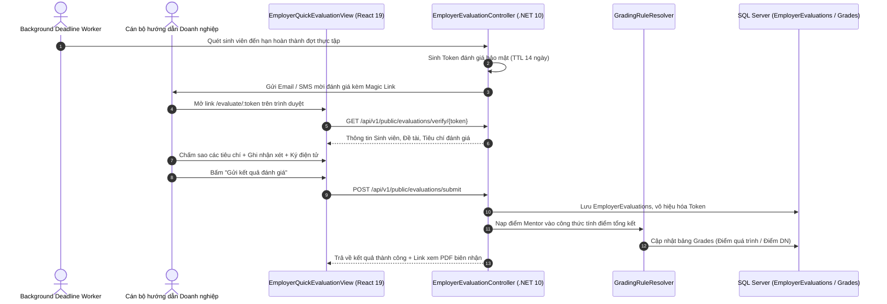

# ĐẶC TẢ KỸ THUẬT PHÂN HỆ SPEC-04
# ĐÁNH GIÁ THỰC TẬP DOANH NGHIỆP QUA MAGIC LINK & CHẤM ĐIỂM ĐIỆN TỬ (EMPLOYER EVALUATION & FEEDBACK ENGINE)

> **Mã tài liệu:** SPEC-04-EMPLOYER-EVAL  
> **Dự án:** Nền tảng Quản trị Thực tập InternLink (B2B SaaS)  
> **Cấp bảo mật:** Nội bộ / Đối tác Triển khai  
> **Phiên bản:** 2.0 Enterprise  
> **Mục tiêu cốt lõi:** Số hóa 100% Phiếu đánh giá của Doanh nghiệp, loại bỏ phiếu giấy ký khống, kết nối trực tiếp điểm Mentor vào bộ máy tính điểm chuẩn Bộ GD&ĐT  
> **Trạng thái:** Sẵn sàng cho triển khai và chuyển đổi sang Word (.docx)

---

## 1. TỔNG QUAN VÀ BỐI CẢNH NGHIỆP VỤ (EXECUTIVE OVERVIEW)

### 1.1 "Lỗ hổng" trong khâu đánh giá cuối kỳ tại Doanh nghiệp
- **Chậm trễ nộp điểm làm nghẽn tiến độ tốt nghiệp:** Cuối đợt thực tập, sinh viên phải in "Phiếu đánh giá của doanh nghiệp", đợi lãnh đạo công ty ký tên đóng dấu rồi nộp về khoa. Nhiều sinh viên bị trễ hạn nộp điểm cả tháng vì mentor đi công tác hoặc thất lạc giấy tờ.
- **Tình trạng "ký khống" và đánh giá qua loa:** Một tỷ lệ không nhỏ sinh viên nhờ vả người quen đóng mộc tròn mà không thực sự đi thực tập, hoặc mentor cho đại 10 điểm toàn bộ tiêu chí mà không có bất kỳ nhận xét thực chất nào về năng lực chuyên môn.
- **Dữ liệu phân mảnh, không thể thống kê chất lượng đào tạo:** Nhà trường không thể tổng hợp xem sinh viên của mình yếu kỹ năng nào (tiếng Anh, làm việc nhóm, kỹ năng viết code...) để điều chỉnh khung chương trình đào tạo vì toàn bộ nhận xét nằm chết trên các tờ giấy A4 lưu trong kho.

### 1.2 Giải pháp Đột phá của InternLink (Magic Evaluation Studio)
- **Tự động gửi Magic Link khi đến hạn:** Khi sinh viên hoàn thành tuần thực tập cuối cùng (hoặc Giảng viên bấm nút yêu cầu), hệ thống tự động gửi email/tin nhắn chứa liên kết đánh giá bảo mật duy nhất cho Mentor: `https://internlink.vn/evaluate/{token}`.
- **Giao diện chấm điểm trực quan 10 sao:** Mentor mở trên điện thoại hoặc máy tính, chấm điểm nhanh theo 3 nhóm tiêu chí chuẩn với thang điểm 10 hoặc hệ 5 sao:
  1. *Kỷ luật & Tác phong làm việc* (Chuyên cần, tuân thủ giờ giấc, bảo mật thông tin).
  2. *Năng lực chuyên môn* (Khả năng hoàn thành nhiệm vụ, giải quyết vấn đề kỹ thuật).
  3. *Kỹ năng mềm* (Giao tiếp, làm việc nhóm, tinh thần học hỏi chủ động).
- **Ký xác thực điện tử & Sinh PDF tức thì:** Mentor ghi nhận xét (Điểm mạnh, Điểm cần khắc phục), ký xác nhận điện tử trực tiếp trên màn hình cảm ứng hoặc nhập mã OTP email. Hệ thống tự động xuất Phiếu đánh giá điện tử có mã băm bảo mật.

---

## 2. KIẾN TRÚC VÀ SƠ ĐỒ LUỒNG ĐÁNH GIÁ (SEQUENCE WORKFLOW)



---

## 3. THIẾT KẾ CƠ SỞ DỮ LIỆU (DATABASE SCHEMA)

```sql
-- 1. BẢNG TOKEN ĐÁNH GIÁ DOANH NGHIỆP
CREATE TABLE [dbo].[EmployerEvaluationTokens] (
    [Auto_ID]             BIGINT IDENTITY(1,1) NOT NULL,
    [Public_ID]           UNIQUEIDENTIFIER NOT NULL DEFAULT NEWID(),
    [Token]               NVARCHAR(128) NOT NULL,         -- SHA-256 Token
    [InternshipId]        BIGINT NOT NULL,                -- Liên kết đợt thực tập
    [MentorEmail]         NVARCHAR(150) NOT NULL,
    [MentorName]          NVARCHAR(150) NOT NULL,
    [ExpiredAt]           DATETIME2 NOT NULL,
    [IsCompleted]         BIT NOT NULL DEFAULT 0,
    [CompletedAt]         DATETIME2 NULL,
    [CreatedAt]           DATETIME2 NOT NULL DEFAULT SYSUTCDATETIME(),
    CONSTRAINT [PK_EmployerEvaluationTokens] PRIMARY KEY CLUSTERED ([Auto_ID]),
    CONSTRAINT [AK_EmployerEvaluationTokens_Public_ID] UNIQUE NONCLUSTERED ([Public_ID]),
    CONSTRAINT [UQ_Eval_Token] UNIQUE NONCLUSTERED ([Token]),
    CONSTRAINT [FK_EvalToken_Internship] FOREIGN KEY ([InternshipId]) REFERENCES [dbo].[Internships] ([Id])
);

-- 2. BẢNG LƯU KẾT QUẢ ĐÁNH GIÁ CHI TIẾT
CREATE TABLE [dbo].[EmployerEvaluations] (
    [Auto_ID]             BIGINT IDENTITY(1,1) NOT NULL,
    [Public_ID]           UNIQUEIDENTIFIER NOT NULL DEFAULT NEWID(),
    [InternshipId]        BIGINT NOT NULL,
    [EvaluatorName]       NVARCHAR(150) NOT NULL,         -- Họ tên người chấm
    [EvaluatorTitle]      NVARCHAR(150) NOT NULL,         -- Chức vụ (Tech Lead, PM, Trưởng phòng...)
    [EvaluatorEmail]      NVARCHAR(150) NOT NULL,
    [EvaluatorPhone]      NVARCHAR(50) NULL,
    [Score_Attitude]      DECIMAL(4,2) NOT NULL,          -- Điểm thái độ & kỷ luật (Thang 10)
    [Score_Competence]    DECIMAL(4,2) NOT NULL,          -- Điểm năng lực chuyên môn (Thang 10)
    [Score_SoftSkills]    DECIMAL(4,2) NOT NULL,          -- Điểm kỹ năng mềm & thích ứng (Thang 10)
    [Final_Score]         DECIMAL(4,2) NOT NULL,          -- Điểm trung bình trọng số doanh nghiệp
    [Strengths]           NVARCHAR(2000) NULL,            -- Nhận xét điểm mạnh
    [Weaknesses]          NVARCHAR(2000) NULL,            -- Nhận xét điểm cần hoàn thiện
    [HireRecommendation]  INT NOT NULL DEFAULT 1,         -- Khuyến nghị tuyển dụng (1=Ưu tiên, 2=Cân nhắc, 3=Không)
    [DigitalSignatureHash]NVARCHAR(256) NOT NULL,         -- Băm SHA-256 xác thực con dấu số
    [IpAddress]           NVARCHAR(50) NULL,
    [SubmittedAt]         DATETIME2 NOT NULL DEFAULT SYSUTCDATETIME(),
    CONSTRAINT [PK_EmployerEvaluations] PRIMARY KEY CLUSTERED ([Auto_ID]),
    CONSTRAINT [AK_EmployerEvaluations_Public_ID] UNIQUE NONCLUSTERED ([Public_ID]),
    CONSTRAINT [FK_EmployerEval_Internship] FOREIGN KEY ([InternshipId]) REFERENCES [dbo].[Internships] ([Id])
);
```

---

## 4. ĐẶC TẢ GIAO DIỆN LẬP TRÌNH ỨNG DỤNG (BACKEND API CONTRACTS)

### 4.1 Danh sách Endpoints

| STT | Phương thức | Đường dẫn API | Mục đích |
|---|---|---|---|
| 1 | `POST` | `/api/v1/internships/{id}/evaluation-invite` | Sinh token và gửi email mời mentor đánh giá |
| 2 | `GET` | `/api/v1/public/evaluations/verify/{token}` | Xác thực token, lấy danh mục tiêu chí & thông tin SV |
| 3 | `POST` | `/api/v1/public/evaluations/submit` | Gửi toàn bộ điểm số, nhận xét và xác thực điện tử |
| 4 | `GET` | `/api/v1/public/evaluations/{id}/pdf` | Tải phiếu đánh giá định dạng PDF có mã số tra cứu |

### 4.2 C# Data Transfer Objects (DTOs)

```csharp
namespace InternLink.Application.DTOs.Evaluation;

public record SubmitEmployerEvaluationRequest(
    string Token,
    string EvaluatorName,
    string EvaluatorTitle,
    string EvaluatorPhone,
    decimal ScoreAttitude,
    decimal ScoreCompetence,
    decimal ScoreSoftSkills,
    string Strengths,
    string Weaknesses,
    int HireRecommendation,
    string? SignatureBase64
);

public record EmployerEvaluationDetailDto(
    Guid PublicId,
    string StudentName,
    string StudentCode,
    string CompanyName,
    string EvaluatorName,
    string EvaluatorTitle,
    decimal FinalScore,
    string Strengths,
    string Weaknesses,
    DateTime SubmittedAt,
    string DigitalSignatureHash
);
```

---

## 5. ĐẶC TẢ GIAO DIỆN NGƯỜI DÙNG (FRONTEND UI SPECIFICATION)

### 5.1 Giao diện Đánh giá Nhanh `EmployerQuickEvaluationView.tsx`
- **Route:** `/evaluate/:token`
- **Quy chuẩn hiển thị:**
  - Tiêu chuẩn bo góc & viền: `rounded-xl border border-slate-200/90 bg-white shadow-2xs`
  - Màu chủ đạo các thanh trượt điểm & nút CTA: `#026aa7`
  - Màu hiển thị trạng thái hoàn thành / điểm xuất sắc ($\ge 8.5$): `#7bc043`
  - Container chính: `mx-auto max-w-[1300px]`
- **Khối Tiêu chí Đánh giá (Scoring Cards):**
  - Sử dụng giao diện thanh trượt điểm (Slider) hoặc hệ 5 sao có tooltip diễn giải rõ ràng (VD: *Mức 8-9: Chủ động hoàn thành công việc trước thời hạn, xử lý tốt các task phức tạp*).
  - Tự động tính toán Điểm tổng kết theo thời gian thực (Real-time Live Calculation) dựa trên trọng số được cấu hình trong `GradingRulesConfigView`.

---

## 6. MA TRẬN KIỂM THỬ VÀ NGHIỆM THU QA (TEST MATRIX)

| Test ID | Tình huống kiểm thử | Dữ liệu đầu vào | Kết quả mong đợi |
|---|---|---|---|
| `TC-EVAL-01` | Gửi điểm số hợp lệ trong khoảng 0 - 10 | Điểm: 8.5, 9.0, 7.5 | Lưu điểm thành công, tính đúng điểm trung bình trọng số, sinh mã băm chữ ký điện tử |
| `TC-EVAL-02` | Gửi điểm số vượt khung quy định | Điểm năng lực: 11.0 | Backend chặn ngay ở tầng FluentValidation: `Score must be between 0 and 10` |
| `TC-EVAL-03` | Nộp đánh giá từ token đã được sử dụng | Token đã hoàn tất trước đó | Hiển thị thông báo: *"Phiếu đánh giá này đã được gửi thành công vào lúc DD/MM/YYYY. Bạn có thể tải lại bản sao PDF"* |
| `TC-EVAL-04` | Tích hợp vào bảng điểm tổng kết | Điểm DN gửi về thành công | Bảng điểm môn Thực tập tốt nghiệp tự động cập nhật, giảng viên không cần nhập tay |

