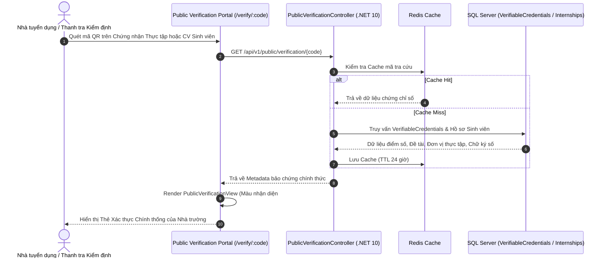

# ĐẶC TẢ KỸ THUẬT PHÂN HỆ SPEC-05
# BÁO CÁO HỒ SƠ KIỂM ĐỊNH CHUẨN QUỐC GIA & CỔNG XÁC THỰC CÔNG KHAI (ACCREDITATION REPORTS & PUBLIC VERIFICATION PORTAL)

> **Mã tài liệu:** SPEC-05-ACCREDITATION-VERIFY  
> **Dự án:** Nền tảng Quản trị Thực tập InternLink (B2B SaaS)  
> **Cấp bảo mật:** Nội bộ / Đối tác Triển khai  
> **Phiên bản:** 2.0 Enterprise  
> **Mục tiêu cốt lõi:** Thay thế hoàn toàn các file Excel phân tán, các nhóm Zalo lộn xộn, Google Classroom thiếu kiểm soát và các nền tảng tuyển dụng thu phí đắt đỏ bằng Bộ hồ sơ kiểm định chuẩn hóa Bộ GD&ĐT cùng Cổng tra cứu văn bằng số chống làm giả  
> **Trạng thái:** Sẵn sàng cho triển khai và chuyển đổi sang Word (.docx)

---

## 1. TỔNG QUAN VÀ BỐI CẢNH NGHIỆP VỤ (EXECUTIVE OVERVIEW)

### 1.1 Sự bất cập của quy trình lưu trữ và kiểm định cũ
- **Cơn ác mộng mỗi mùa kiểm định chất lượng (AUN-QA / MOET):**
  - Giảng viên và thư ký khoa phải mất hàng tuần lục tìm file Word, bảng Excel điểm số, và giấy tờ thực tập sinh viên nộp rải rác trên Zalo, Google Drive cá nhân, hoặc Google Classroom.
  - Hồ sơ thường xuyên bị thiếu chữ ký xác nhận của doanh nghiệp, thiếu nhật ký tuần, hoặc số liệu báo cáo không khớp với bảng điểm trên hệ thống đào tạo.
- **Vấn nạn văn bằng, chứng chỉ thực tập giả mạo:**
  - Nhà tuyển dụng (Doanh nghiệp) khi phỏng vấn ứng viên không có cách nào kiểm tra tính xác thực của Giấy xác nhận thực tập hay bảng điểm ngoại trừ việc gửi công văn về trường — một quy trình tốn thời gian từ 2 đến 4 tuần.
  - Nhiều trường đại học phải phụ thuộc vào các sàn tuyển dụng thứ ba trả phí rất cao chỉ để kết nối và xác minh hồ sơ sinh viên.
- **Tàn dư của các mã khóa học nội bộ cũ (C22, C23):**
  - Trong các phiên bản sơ khởi, các nút bấm trên giao diện bị gán nhãn cứng theo mã lớp cục bộ (`Hồ sơ C22`, `Bảng tổng hợp C23`). Đây là hạt sạn lớn làm mất đi tính tổng quát và sự chuyên nghiệp của một sản phẩm thương mại B2B SaaS.

### 1.2 Giải pháp Đột phá của InternLink
- **Bộ 3 Hồ sơ Kiểm định Tiêu chuẩn Thương mại:**
  1. **Hồ sơ đánh giá sinh viên (ZIP):** Đóng gói toàn bộ minh chứng của từng sinh viên (Nhật ký tuần có xác nhận của mentor, Phiếu chấm điểm doanh nghiệp, Báo cáo tổng kết, Chứng nhận điện tử).
  2. **Bảng tổng hợp kết quả (Excel):** Trích xuất theo chuẩn mẫu Bộ GD&ĐT với đầy đủ cột điểm quá trình, điểm doanh nghiệp, điểm giảng viên và xếp loại tốt nghiệp.
  3. **Báo cáo tổng kết đợt thực tập (Word):** Mẫu văn bản hành chính hoàn chỉnh sẵn sàng trình Ban Giám hiệu ký duyệt.
- **Chứng nhận Thực tập Số hóa với Mã QR Độc bản (`IL-VERIFY-YYYY-XXXXX`):** Mỗi chứng nhận sinh viên nhận được đều có một mã băm mã hóa bất biến (Cryptographic Verification Code).
- **Cổng Tra cứu Công khai (`/verify/:code`):** Nhà tuyển dụng tương lai chỉ cần quét mã QR bằng camera điện thoại hoặc nhập mã vào cổng tra cứu để xem hồ sơ năng lực chính thức do Nhà trường bảo chứng.

---

## 2. KIẾN TRÚC VÀ SƠ ĐỒ LUỒNG XÁC THỰC (VERIFICATION WORKFLOW)



---

## 3. THIẾT KẾ CƠ SỞ DỮ LIỆU (DATABASE SCHEMA)

```sql
-- 1. BẢNG LƯU TRỮ CHỨNG NHẬN ĐIỆN TỬ VÀ MÃ TRA CỨU
CREATE TABLE [dbo].[VerifiableCredentials] (
    [Auto_ID]                BIGINT IDENTITY(1,1) NOT NULL,
    [Public_ID]              UNIQUEIDENTIFIER NOT NULL DEFAULT NEWID(),
    [VerificationCode]       NVARCHAR(50) NOT NULL,          -- Mã công khai: IL-VERIFY-2026-99881
    [InternshipId]           BIGINT NOT NULL,                -- Liên kết hồ sơ thực tập
    [StudentId]              BIGINT NOT NULL,                -- Sinh viên thụ hưởng
    [StudentCode]            NVARCHAR(50) NOT NULL,
    [StudentFullName]        NVARCHAR(150) NOT NULL,
    [UniversityName]         NVARCHAR(200) NOT NULL,
    [FacultyName]            NVARCHAR(150) NOT NULL,
    [CompanyName]            NVARCHAR(200) NOT NULL,
    [InternshipTerm]         NVARCHAR(100) NOT NULL,         -- Học kỳ / Đợt thực tập
    [FinalScore]             DECIMAL(4,2) NOT NULL,          -- Điểm tổng kết thực tập
    [GradeClassification]   NVARCHAR(50) NOT NULL,          -- Xuất sắc / Giỏi / Khá
    [IssuedDate]             DATETIME2 NOT NULL DEFAULT SYSUTCDATETIME(),
    [CryptographicHash]      NVARCHAR(256) NOT NULL,         -- Băm SHA-256 toàn bộ thông tin bảo chứng
    [IsRevoked]              BIT NOT NULL DEFAULT 0,         -- Cờ thu hồi chứng chỉ (nếu có gian lận)
    [RevokedReason]          NVARCHAR(500) NULL,
    [RevokedAt]              DATETIME2 NULL,
    [ScanCount]              INT NOT NULL DEFAULT 0,         -- Số lần nhà tuyển dụng tra cứu
    [LastScannedAt]          DATETIME2 NULL,
    CONSTRAINT [PK_VerifiableCredentials] PRIMARY KEY CLUSTERED ([Auto_ID]),
    CONSTRAINT [AK_VerifiableCredentials_Public_ID] UNIQUE NONCLUSTERED ([Public_ID]),
    CONSTRAINT [UQ_Verification_Code] UNIQUE NONCLUSTERED ([VerificationCode]),
    CONSTRAINT [FK_Credentials_Internship] FOREIGN KEY ([InternshipId]) REFERENCES [dbo].[Internships] ([Id])
);
```

---

## 4. ĐẶC TẢ GIAO DIỆN LẬP TRÌNH ỨNG DỤNG (BACKEND API CONTRACTS)

### 4.1 Danh sách Endpoints

| STT | Phương thức | Đường dẫn API | Mục đích | Quyền truy cập |
|---|---|---|---|---|
| 1 | `GET` | `/api/v1/reports/batch-portfolio-zip` | Xuất file nén ZIP toàn bộ hồ sơ đánh giá sinh viên | Giảng viên / Quản trị |
| 2 | `GET` | `/api/v1/reports/grade-summary-excel` | Xuất Bảng tổng hợp kết quả thực tập (Excel chuẩn) | Giảng viên / Quản trị |
| 3 | `GET` | `/api/v1/reports/summary-word` | Xuất Báo cáo tổng kết đợt thực tập (Word chuẩn BGD) | Giảng viên / Quản trị |
| 4 | `GET` | `/api/v1/public/verification/{code}` | Tra cứu hồ sơ bảo chứng công khai qua mã bảo mật | Public (Không cần Login) |

### 4.2 C# Data Transfer Objects (DTOs)

```csharp
namespace InternLink.Application.DTOs.Accreditation;

public record PublicVerificationResponse(
    bool IsValid,
    string VerificationCode,
    string StudentName,
    string StudentCode,
    string UniversityName,
    string FacultyName,
    string CompanyName,
    string ProjectTitle,
    string AcademicYear,
    decimal FinalScore,
    string Classification,
    DateTime IssuedDate,
    bool IsRevoked,
    string? RevocationNotice,
    string SecurityChecksum
);
```

---

## 5. ĐẶC TẢ GIAO DIỆN NGƯỜI DÙNG (FRONTEND UI SPECIFICATION)

### 5.1 Xóa bỏ Triệt để Tên gọi Cũ (Legacy Cleanup)
Tại các trang quản trị (`DashboardView.tsx`, `SummaryView.tsx`):
- ❌ **Cấm hoàn toàn các nhãn:** *"Hồ sơ C22 (ZIP)"*, *"Bảng tổng hợp C23"*
- ✅ **Bắt buộc sử dụng tên thương mại:**
  - Nút xuất ZIP: **"Hồ sơ đánh giá sinh viên (ZIP)"** kèm chú thích: *"Gói tài liệu báo cáo tuần, phiếu đánh giá DN và chữ ký điện tử"*.
  - Nút xuất Excel: **"Bảng tổng hợp kết quả (Excel)"** kèm chú thích: *"Bảng điểm quá trình, điểm doanh nghiệp và điểm tổng kết theo mẫu Bộ GD&ĐT"*.

### 5.2 Giao diện Cổng Tra cứu Công khai `PublicVerificationView.tsx`
- **Route:** `/verify/:code`
- **Nguyên tắc thiết kế:** Đạt chứng nhận tin cậy tối đa (Trust & Authority Portal).
- **Thành phần màn hình:**
  1. **Huy hiệu Xác thực Xanh:** Khối tròn xanh `#7bc043` với biểu tượng khiên bảo vệ và dòng chữ *"CHỨNG NHẬN ĐIỆN TỬ CHÍNH THỨC ĐÃ ĐƯỢC XÁC THỰC"*.
  2. **Bảng Hồ sơ Năng lực (Verifiable Record Card):**
     - Sinh viên: Nguyễn Văn A — MSSV: 20261109
     - Cơ sở đào tạo: Trường Đại học Công nghiệp TP.HCM (Khoa CNTT)
     - Đơn vị thực tập: FPT Software — Dự án: AI Platform Engineer
     - Kết quả đánh giá: 9.2 / 10 (Xếp loại: Xuất sắc)
     - Người ký xác nhận: Cán bộ hướng dẫn & Trưởng khoa
  3. **Cơ chế chống giả mạo:** Hiển thị mã băm số (Hash) và thời điểm phát hành trên hệ thống máy chủ InternLink.

---

## 6. MA TRẬN KIỂM THỬ VÀ NGHIỆM THU QA (TEST MATRIX)

| Test ID | Tình huống kiểm thử | Dữ liệu đầu vào | Kết quả mong đợi |
|---|---|---|---|
| `TC-REP-01` | Xuất gói ZIP Hồ sơ đánh giá sinh viên | Khóa thực tập 50 sinh viên | Tải về file ZIP chứa 50 thư mục tương ứng 50 MSSV, mỗi thư mục gồm đầy đủ file PDF báo cáo |
| `TC-REP-02` | Tra cứu mã bảo chứng hợp lệ | Mã: `IL-VERIFY-2026-001` | Trả về thông tin sinh viên đầy đủ, trạng thái hợp lệ màu `#7bc043`, tăng số lượt quét lên 1 |
| `TC-REP-03` | Tra cứu mã giả mạo hoặc không tồn tại | Mã ngẫu nhiên không có trong CSDL | Trả về cảnh báo đỏ: *"Mã xác thực không tồn tại trên hệ thống dữ liệu quốc gia"* |
| `TC-REP-04` | Kiểm tra giao diện không còn chứa từ khóa C22, C23 | Kiểm tra toàn bộ màn hình Dashboard và Summary | Không tìm thấy bất kỳ chuỗi `C22` hay `C23` nào trong giao diện người dùng |

