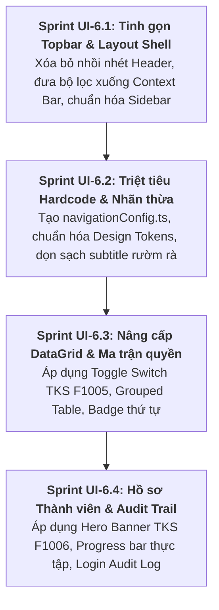

# KẾ HOẠCH ĐẠI TU & CHUẨN HÓA GIAO DIỆN TOÀN HỆ THỐNG
## SYSTEM-WIDE UI/UX AUDIT & HARMONIZATION MASTER PLAN
### (GIẢI QUYẾT TRIỆT ĐỂ RỐI MẮT, QUÁ TẢI TOPBAR, NHÃN THỪA VÀ HARDCODE)

> **Mã tài liệu:** `PLAN-UI-HARMONIZATION-ENTERPRISE`  
> **Cấp độ:** Kiến trúc Trải nghiệm Người dùng & Đặc tả Tái cấu trúc Giao diện  
> **Thời điểm ban hành:** 17/11/2026 (Chuẩn bị triển khai sau Giai đoạn 5)  
> **Tài liệu tham khảo thực tế:** TKSolution V11 (F1005 Phân quyền & F1006 Profile)

---

## 1. "BỆNH ÁN" GIAO DIỆN HIỆN TẠI CỦA INTERNLINK

Nhận xét của anh **"hardcode cũng còn khá nhiều, nhãn thừa, bố cục bất hợp lý, rối mắt, topbar của super admin là điển hình"** là hoàn toàn chính xác và chạm trúng điểm yếu chí mạng nhất của giao diện InternLink hiện nay.

### 🔴 1.1 Điển hình số 1: Sự quá tải & lộn xộn của Topbar Super Admin (`Header.tsx`)
Khi mở tài khoản Super Admin trên màn hình laptop tiêu chuẩn (1366x768 hoặc 1440x900), thanh Topbar bị nhồi nhét đến mức nghẹt thở:
* **8 thành phần cùng chen chúc trên 1 dòng cao 56px:**
  1. Nút Hamburger mobile
  2. Breadcrumbs ("Cổng Quản trị › ...")
  3. Pill chọn Đợt thực tập (Học kỳ)
  4. Pill chọn Khoa (Department)
  5. Ô tìm kiếm sinh viên ("Tìm MSSV hoặc tên...")
  6. Chuông thông báo (`NotificationDropdown`)
  7. Nút "Mô phỏng góc nhìn" (Impersonation button - màu vàng chanh nổi bần bật)
  8. Nút `AdminMegaMenu`
  9. Avatar tài khoản + Profile dropdown
* **Hậu quả:** 
  - Các nút bị ép co cụm, tràn ngang hoặc vỡ layout khi màn hình thu nhỏ.
  - Người dùng không biết đâu là điểm nhấn thị giác chính (Visual Focal Point).
  - Vừa có MegaMenu vừa có Sidebar bên trái làm người dùng bị phân vân: *"Vào chức năng này bằng Sidebar hay bằng Topbar?"*.

### 🔴 1.2 Điển hình số 2: Hardcode rải rác khắp nơi
* Trong `Header.tsx`, hàm `getTabTitle(tab)` hardcode hơn **20 nhánh `case "admin-..."`** để đổi tên tiếng Việt. Mỗi lần thêm 1 chức năng mới là dev lại phải vào sửa tay `switch-case`.
* Trong `gradingRules.ts`, xếp loại "Xuất sắc" bị hardcode trả về chuỗi màu `bg-purple-100 text-purple-700`.
* Màu sắc hex (`#026aa7`, `#025a8e`, `#7bc043`) bị gõ lặp lại hàng trăm lần trong class Tailwind thay vì dùng CSS Variables hoặc Design Tokens chuẩn.

### 🔴 1.3 Điển hình số 3: Nhãn thừa và thông tin rườm rà
* Rất nhiều trang bị tình trạng: Trên đầu đã có **PageHeader** to (Title + Subtitle + Badge), bên dưới lại có thêm 1 **Panel Header** lặp lại đúng nội dung đó.
* Các câu giải thích quá dài dòng chiếm diện tích hiển thị của bảng dữ liệu (người dùng làm việc hàng ngày cần bảng số liệu rộng rãi, không cần đọc lại hướng dẫn sử dụng mỗi ngày).

---

## 2. HỌC HỎI TỪ BỐ CỤC TINH GỌN CỦA TKSOLUTION

Nhìn vào cách TKSolution thiết kế Topbar ở trang F1005 và F1006:
* **Topbar của họ chỉ làm đúng 1 nhiệm vụ:** Định danh người dùng + Thông báo + Nút thu phóng / Đăng xuất. Chiều cao chỉ 45-50px, cực kỳ thoáng đãng.
* **Các bộ lọc phạm vi dữ liệu (Khoa, Học kỳ, Bộ lọc chức năng):** Được đưa xuống **Toolbar của nội dung trang** (nằm ngay trên đầu DataGrid).
  - Người dùng chọn Khoa/Kỳ ngay tại trang dữ liệu đang làm việc, không biến Topbar thành "cái kho chứa dropdown".

---

## 3. THIẾT KẾ TOPBAR & HEADER MỚI (CHUẨN TỐI GIẢN ENTERPRISE)

```
┌────────────────────────────────────────────────────────────────────────────────────────┐
│  [Logo InternLink]  Khoa CNTT › Quản lý Thực tập               [🔔] [Avatar Admin] ▼  │  <- Topbar cực gọn (48px)
└────────────────────────────────────────────────────────────────────────────────────────┘
┌────────────────────────────────────────────────────────────────────────────────────────┐
│  🎓 KỲ THỰC TẬP 2026 - HK1  |  Khoa: Công nghệ Thông tin                 [+ Thêm mới] │  <- Context Toolbar trang
│  [ Tìm kiếm... ]  [ Tất cả trạng thái ▼ ]  [ Lọc nâng cao ▼ ]           [ Xuất Excel ] │
└────────────────────────────────────────────────────────────────────────────────────────┘
```

### 3.1. Phân bổ lại vị trí các thành phần trên Topbar:
1. **Pill chọn Học kỳ & Khoa:** Đưa ra khỏi Topbar chính, chuyển xuống **Context Bar** hoặc thanh Toolbar của màn hình đang xem. Topbar chỉ giữ lại tên Khoa / Học kỳ hiện tại dưới dạng text nhẹ nhàng.
2. **Ô tìm kiếm sinh viên:** Chuyển vào đúng trang Quản lý Sinh viên (`StudentManagementView`), không để trên thanh điều hướng chung của toàn hệ sinh thái.
3. **Chế độ mô phỏng (Impersonation):** Tích hợp vào bên trong menu Avatar cá nhân (hoặc thành 1 nút icon nhỏ cạnh Avatar), xóa bỏ nút vàng to tướng gây rối mắt.
4. **Hợp nhất điều hướng:** Bỏ `AdminMegaMenu` trên Topbar, quy về **Sidebar bên trái** làm Single Source of Truth cho toàn bộ điều hướng.

---

## 4. CHIẾN DỊCH 4 SPRINT ĐẠI TU GIAO DIỆN (SAU GIAI ĐOẠN 5)



### Chi tiết các Sprint:
* **Sprint UI-6.1 (Topbar & Shell):**
  - Viết lại `Header.tsx`: Giảm chiều cao xuống 48px, chỉ giữ lại Breadcrumb tối giản, Chuông thông báo và Profile Avatar.
  - Tách bộ chọn `SemesterSelect` và `DepartmentSelect` thành component dùng chung trong Toolbar trang.
* **Sprint UI-6.2 (Clean Hardcode & Tokens):**
  - Xóa 100% các class `indigo-*`, `purple-*` còn sót (trong `LandingPage`, `AccountView`, `gradingRules.ts`).
  - Thay toàn bộ switch-case trong `getTabTitle` bằng `appRoutesConfig.ts`.
* **Sprint UI-6.3 (DataGrid theo chuẩn F1005):**
  - Thay checkbox bằng Toggle Switch tròn (`#7bc043`).
  - Gom các bảng lẻ tẻ ở màn hình cũ về chuẩn `DynamicDataGrid`.
* **Sprint UI-6.4 (Profile Studio theo chuẩn F1006):**
  - Xây dựng lại trang Profile cho cả 3 đối tượng (Sinh viên, Giảng viên, Admin) theo bố cục 3 tab của TKS: Tổng quan (Progress bar), Nhật ký đăng nhập, Lịch sử thao tác.

---

*(Bản kế hoạch này chính thức được bổ sung vào bộ tài liệu dự án để chuẩn bị kích hoạt ngay khi kết thúc Giai đoạn 5).*
